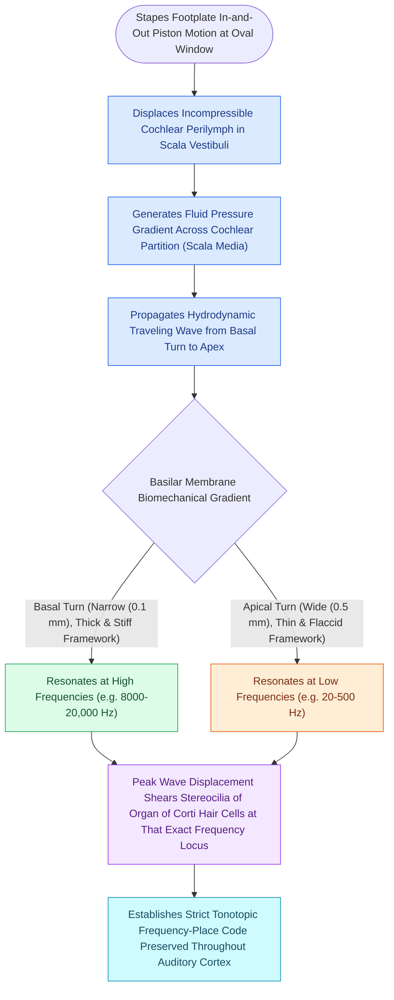

# The traveling wave along the basilar membrane establishes tonotopic frequency organization

## Active Recall

> [!question]- How do the physical dimensions and stiffness of the basilar membrane change from the base to the apex of the cochlea?
> *Answer / Clinical Rationale*: The basilar membrane changes from **narrow and stiff at the base** (high frequencies) to **wide and compliant at the apex** (low frequencies).

> [!question]- Why is presbycusis and ototoxicity characteristically high-frequency initially?
> *Answer / Clinical Rationale*: Because the **basal turn of the cochlea** experiences the highest mechanical wave energy and shear stress and is most susceptible to metabolic injury.

## Core Clinical & Mechanistic Principles
Acoustic energy transmitted to the stapes footplate initiates a fluid displacement wave in the perilymph of the scala vestibuli that propagates along the **basilar membrane (BM)**:
- **Biomechanical Gradient of the Basilar Membrane (von Békésy Principle)**:
  - **Base of Cochlea**: Narrow ($100\ \mu\text{m}$), stiff, and light; responds maximally to **high frequencies (up to $20\text{ kHz}$)**.
  - **Apex of Cochlea (Helicotrema)**: Wide ($500\ \mu\text{m}$), compliant/flaccid, and heavy; responds maximally to **low frequencies ($20\text{–}200\text{ Hz}$)**.
- **Wave Dynamics & Peak Resonance**:
  - The traveling wave starts at the base with high velocity and low amplitude, slows down as it propagates apically, and reaches a **sharp peak of maximum displacement** at its characteristic resonance frequency before abruptly dying out due to fluid damping.

### Surgical Technique & Critical Safety Checks
- **Clinical Relevance**: High-frequency hearing loss ([[Presbycusis produces symmetric high-frequency sensorineural loss with disproportionate speech-in-noise decline|presbycusis]], aminoglycoside/cisplatin ototoxicity, noise-induced acoustic trauma) selectively damages the vulnerable basal turn outer hair cells before apical turns are affected.

## Connected Concepts & Graph Traversal
- **Prestin Motor Amplification**: [[Outer hair cell electromotility driven by prestin amplifies cochlear micromechanics|Prestin Outer Hair Cell Motors]]
- **Endocochlear Driving Battery**: [[The stria vascularis generates the endocochlear potential of positive eighty millivolts|Stria Vascularis +80 mV Potential]]
- **High-Frequency Presbycusis**: [[Presbycusis produces symmetric high-frequency sensorineural loss with disproportionate speech-in-noise decline|Presbycusis High-Frequency SNHL]]
- **Cochlear Array Stimulation**: [[Scala tympani electrode array placement preserves residual hearing and avoids basilar membrane translocation|Scala Tympani Array Tonotopy]]
- **OAE Acoustic Distortion**: [[Otoacoustic emissions evaluate outer hair cell integrity and differentiate cochlear from auditory neuropathy spectrum disorder|Otoacoustic Emissions]]
