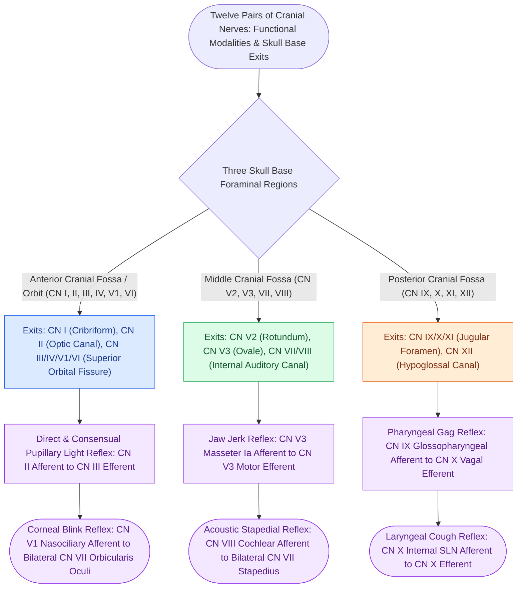

# The twelve cranial nerves are evaluated by functional components, skull base exits, and clinical reflexes

## Active Recall

> [!question]- What specific skull base foramina transmit cranial nerves I through XII from anterior to posterior cranial fossa?
> *Answer / Clinical Rationale*: - **Anterior Fossa**: **CN I** (Cribriform plate). - **Middle Fossa / Sphenoid**: **CN II** + Ophthalmic artery (Optic canal); **CN III, IV, $V_1$, VI** + Superior ophthalmic vein (Superior Orbital Fissure); **CN $V_2$** (Foramen Rotundum); **CN $V_3$** + Lesser petrosal nerve (Foramen Ovale); Middle meningeal artery (Foramen Spinosum). - **Posterior Fossa / Temporal Bone & Occipital**: **CN VII, VIII** + Labyrinthine artery (Internal Auditory Canal); **CN IX, X, XI** + Internal jugular vein (Jugular Foramen); **CN XII** (Hypoglossal Canal).

> [!question]- What are the afferent and efferent limbs for the corneal, gag, pupillary light, and jaw jerk reflexes?
> *Answer / Clinical Rationale*: - **Corneal Reflex**: Afferent **CN $V_1$ (Nasociliary / Long ciliary nerves)** $\rightarrow$ Efferent **CN VII (Orbicularis oculi)** bilaterally via the facial motor nucleus. - **Gag (Pharyngeal) Reflex**: Afferent **CN IX (Glossopharyngeal nerve)** $\rightarrow$ Efferent **CN X (Vagus nerve / Pharyngeal constrictors)** via nucleus ambiguus. - **Pupillary Light Reflex**: Afferent **CN II (Optic nerve)** $\rightarrow$ Pretectal nuclei $\rightarrow$ Bilateral Edinger-Westphal nuclei $\rightarrow$ Efferent **CN III (Parasympathetic ciliary ganglion / Sphincter pupillae)**. - **Jaw Jerk Reflex**: Afferent **CN $V_3$ (Mesencephalic nucleus)** $\rightarrow$ Efferent **CN $V_3$ (Trigeminal motor nucleus / Masseter)**.

> [!question]- Which cranial nerve is uniquely vulnerable to isolated intracranial hypertension and petrous apex lesions, and why?
> *Answer / Clinical Rationale*: **CN VI (Abducens nerve)** has the **longest intracranial subarachnoid course** and makes a sharp angulation over the petrous apex through **Dorello's canal** under Gruber's petrosphenoidal ligament. Raised ICP causes downward brainstem displacement, stretching CN VI against the sharp petrous ridge ("false localizing" sixth nerve palsy; Gradenigo syndrome).

## Core Clinical & Mechanistic Principles
The 12 pairs of [[Cranial nerve polyneuropathies of the skull base are localized by specific anatomical foramen involvement|cranial]] nerves mediate specialized sensory, somatic motor, branchiomotor, and parasympathetic visceral functions:

### Neurotologic Skull Base Localization Patterns
- **Cavernous Sinus / Superior Orbital Fissure**: CN III, IV, $V_1$, $V_2$, VI involvement $\rightarrow$ Total ophthalmoplegia with upper facial sensory loss.
- **Jugular Foramen (Vernet Syndrome)**: CN IX, X, XI palsy $\rightarrow$ Loss of taste/gag, vocal fold immobility, shoulder drop.
- **Collet-Sicard Syndrome**: CN IX, X, XI, XII palsy $\rightarrow$ Jugular foramen + hypoglossal canal involvement without sympathetic Horner syndrome.

## Connected Concepts & Graph Traversal
- **Skull Base Polyneuropathies**: [[Cranial nerve polyneuropathies of the skull base are localized by specific anatomical foramen involvement|Cranial Nerve Polyneuropathies]]
- **🔗 Cavernous Sinus Pathology (Sinus)**: [[Cavernous sinus thrombosis presents with chemosis, proptosis, and progressive ophthalmoplegia from CN III, IV, V1, V2, and VI involvement|Cavernous Sinus Pathology]]
- **Lateral Medullary Stroke**: [[Lateral medullary syndrome Wallenberg syndrome results from PICA occlusion causing distinct cranial neuropathies and sensory dissociation|Wallenberg Syndrome]]
- **Facial Nerve Topography**: [[The facial nerve traverses six distinct anatomical segments from the pons to the parotid gland|CN VII Anatomical Segments]]
- **Jugular Paragangliomas**: [[Jugular paragangliomas arise from the glomus body in the adventitia of the jugular bulb|Jugular Foramen Tumors]]
