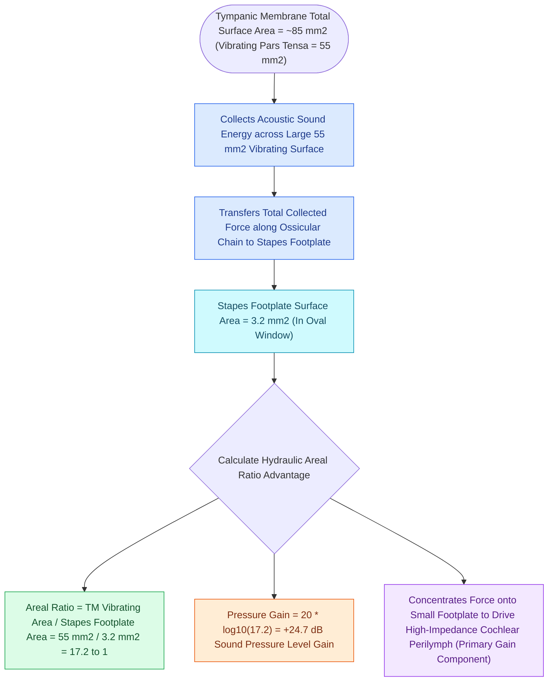

# The tympanic membrane areal ratio of seventeen to one provides the primary impedance gain

## Active Recall

> [!question]- What is the effective vibrating area of the human tympanic membrane compared to the stapes footplate area?
> *Answer / Clinical Rationale*: The effective vibrating area of the TM is **$\approx 55\ \text{mm}^2$**, compared to the stapes footplate area of **$\approx 3.2\ \text{mm}^2$** (yielding a ratio of $17:1$).

> [!question]- Why is the total anatomical area of the TM ($85\ \text{mm}^2$) not used in the areal ratio calculation?
> *Answer / Clinical Rationale*: Because the **peripheral annulus and superior quadrant are anchored and rigid**, leaving only the central $55\ \text{mm}^2$ capable of free acoustic displacement.

## Core Clinical & Mechanistic Principles
The **areal ratio (hydraulic ratio)** of the middle ear operates on the hydraulic principle: Force applied over a large surface area concentrated onto a small surface area increases pressure proportionally ($P = F / A$):
- **Anatomical & Histological Micro-Architecture**:
  - The tympanic membrane measures $8\text{–}10\text{ mm}$ across and $\approx 0.1\text{ mm}$ thick, constructed from **three layers derived from all three embryonic germ layers**:
    1. *Outer Cutaneous Layer*: Stratified squamous epithelium continuous with the external auditory canal, derived from **ectoderm of the 1st branchial cleft (groove)**.
    2. *Middle Fibrous Layer (Lamina Propria)*: Outer radial and inner circular collagenous fibers organized by neural-crest mesenchyme, derived from **mesoderm of the 1st branchial arch**. The fibrous annulus seats in the bony tympanic sulcus everywhere except superiorly at the **notch of Rivinus** (tympanic notch), where this fibrous layer is completely absent—forming the compliant **pars flaccida (Shrapnell's membrane)** vulnerable to retraction pockets and [[Primary acquired cholesteatoma arises from retraction pocket invagination of the pars flaccida into Prussak space|cholesteatoma]] formation in Prussak's space.
    3. *Inner Mucosal Layer*: Non-ciliated simple cuboidal / squamous epithelium continuous with the middle ear cleft, derived from **endoderm of the 1st branchial pouch (tubotympanic recess)**.
- **Anatomical Surface Areas**:
  - Total anatomical area of the human tympanic membrane is $\approx 85\ \text{mm}^2$.
  - **Effective Vibrating Surface Area**: Only the lower two-thirds of the pars tensa vibrates freely with acoustic sound waves, corresponding to an **effective area of $\approx 55\ \text{mm}^2$** (the peripheral $1\text{–}2\text{ mm}$ near the annulus and superior quadrant are relatively fixed).
  - **Stapes Footplate Area**: Measures $\approx 3.2\ \text{mm}^2$ ($3.0\text{–}3.5\ \text{mm}^2$).
- **The Mathematical Gain Ratio**:
  $$\text{Areal Ratio} = \frac{55\ \text{mm}^2}{3.2\ \text{mm}^2} \approx 17.2 : 1$$
- **Pressure & Decibel Gain**:
  $$\text{Gain (dB)} = 20 \log_{10}(17.2) \approx 24.7\text{ dB}$$

### Surgical Technique & Critical Safety Checks
- **Surgical Implication in Tympanoplasty**: Creating a graft that adheres widely to the malleus and covers the full vibrating surface area restores this hydraulic advantage; graft stiffening or blunting reduces effective vibrating area and causes residual air-bone gaps.

## Connected Concepts & Graph Traversal
- **Malleus-to-Incus Lever Advantage**: [[The lever ratio of the malleus to incus provides a one point three to one mechanical advantage|Malleus-to-Incus Lever Ratio]]
- **Total Middle Ear Transformer**: [[The middle ear transformer ratio provides twenty-seven decibels of acoustic impedance matching|Middle Ear Transformer Ratio]]
- **Underlay vs Overlay Grafting**: [[Underlay and overlay tympanoplasty techniques have distinct advantages and complication profiles|Underlay vs Overlay Tympanoplasty]]
- **Cartilage Island Stiffening**: [[Cartilage island tympanoplasty resists negative middle ear pressure and recurrent retraction|Cartilage Island Tympanoplasty]]
- **PORP Reconstruction**: [[Partial ossicular replacement prosthesis PORP requires an intact and mobile stapes superstructure|PORP Reconstruction]]
