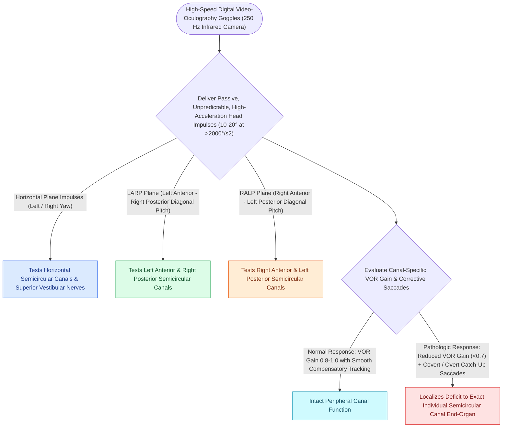

# The video head impulse test vHIT identifies high-frequency angular vestibulo-ocular reflex deficits

## Active Recall

> [!question]- What is the normal VOR gain range on vHIT for the horizontal semicircular canals?
> *Answer / Clinical Rationale*: A VOR gain of **$0.80\text{ to }1.00$**.

> [!question]- What two coplanar canal pairs are evaluated in vertical vHIT testing?
> *Answer / Clinical Rationale*: The **LARP** (Left Anterior / Right Posterior) and **RALP** (Right Anterior / Left Posterior) pairs.

## Core Clinical & Mechanistic Principles
The **video Head Impulse Test (vHIT)** is the modern clinical gold standard for [[Bithermal caloric testing calculates Jongkees formula to quantify unilateral vestibular paresis|quantifying]] the high-frequency angular Vestibulo-Ocular Reflex (VOR) across all six individual semicircular canals:
- **Physiological Basis of the VOR**:
  - Head rotation stimulates endolymph flow in the coplanar semicircular canal, generating compensatory eye rotation of equal velocity and opposite direction to maintain foveal fixation.
  - Head impulses test high-frequency, high-acceleration angular motion (**$2\text{–}6\text{ Hz}$, $>150\text{–}250^\circ/\text{s}$**), reflecting real-world head movement.
- **vHIT Goggle Technology**:
  - High-speed digital camera ($250\text{ Hz}$) tracking pupil position paired with gyroscopes/accelerometers measuring head velocity.
- **Normal VOR Gain**:
  - $\text{Gain} = \frac{\text{Eye Velocity}}{\text{Head Velocity}}$.
  - **Normal Horizontal Canal Gain**: **$0.80\text{–}1.00$**.
  - **Normal Vertical Canal (LARP / RALP) Gain**: **$0.70\text{–}1.00$**.

### Surgical Technique & Critical Safety Checks
- **Canal Planes Tested**:
  1. Horizontal (Yaw plane).
  2. **LARP** (Left Anterior - Right Posterior).
  3. **RALP** (Right Anterior - Left Posterior).

## Connected Concepts & Graph Traversal
- **Covert & Overt Saccades**: [[Overt and covert saccades on vHIT indicate peripheral vestibular hypofunction|Overt & Covert Saccade Analysis]]
- **Caloric Low-Frequency Testing**: [[Bithermal caloric testing calculates Jongkees formula to quantify unilateral vestibular paresis|Bithermal Caloric Testing]]
- **Rotary Chair Comparison**: [[Rotary chair testing assesses low-frequency bilateral vestibular hypofunction and central compensation|Rotary Chair Diagnostics]]
- **Acute Neuritis Diagnosis**: [[Vestibular neuritis causes acute spontaneous prolonged vertigo without auditory symptoms|Vestibular Neuritis]]
- **HINTS Bedside Stroke Protocol**: [[The HINTS examination separates vestibular neuritis from posterior circulation stroke in acute vestibular syndrome|HINTS Stroke Protocol]]
