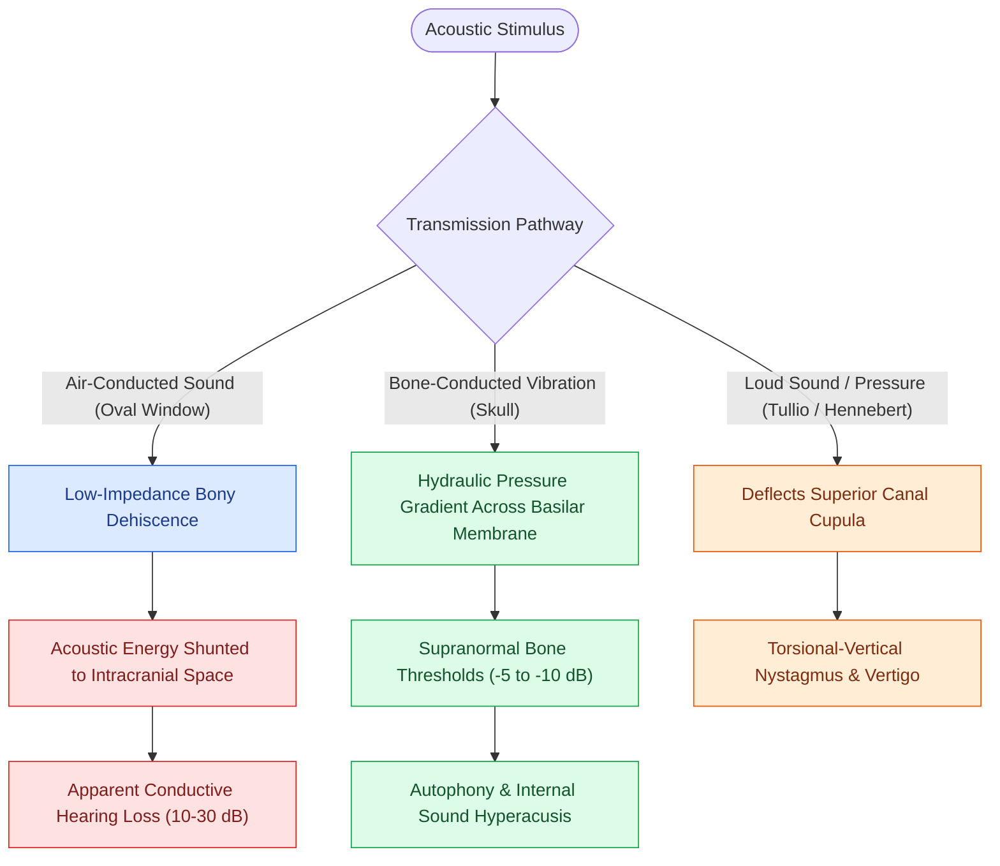

# Third mobile window pathophysiology causes hyperacusis to bone-conducted sounds and acoustic energy dissipation

## Active Recall

> [!question]- Why does a third mobile window cause an apparent conductive hearing loss for air-conducted sounds?
> *Answer / Clinical Rationale*: Because acoustic energy entering the oval window **shunts out through the low-impedance bony defect**, bypassing the basilar membrane.

> [!question]- Why are bone-conducted sounds and internal body noises heard abnormally loudly in SCDS?
> *Answer / Clinical Rationale*: The dehiscence lowers acoustic impedance to skull vibrations, **increasing fluid displacement across the cochlea** for bone-conducted signals.

## Core Clinical & Mechanistic Principles
In a normal ear, two mobile windows exist: the **oval window** (sound input) and the **round window** (acoustic volume compliance). A bony defect in the otic capsule—most commonly seen in [[Superior semicircular canal dehiscence SCDS presents with Tullio phenomenon and sound-induced vertigo|superior semicircular canal dehiscence (SCDS)]]—creates an abnormal **"Third Mobile Window"**:

- **Acoustic Shunting of Air-Conducted Sound**:
  - Acoustic pressure entering the oval window via the ossicular chain shunts out through the low-[[The middle ear transformer ratio provides twenty-seven decibels of acoustic impedance matching|acoustic impedance]] dehiscence into the middle cranial fossa, rather than traveling down the scala vestibuli and deflecting the basilar membrane.
  - This acoustic energy dissipation elevates air-conduction thresholds, causing an **apparent conductive hearing loss of $10\text{–}30\text{ dB}$** with an intact stapedial reflex.
- **Augmentation of Bone-Conducted Sound (Internal Sound Hyperacusis)**:
  - Skull vibrations from vocalization, mastication, heartbeat, and ocular globe movements compress the otic capsule. The third window creates a path of abnormally low hydraulic impedance for fluid displacement across the organ of Corti.
  - This generates **supranormal bone conduction ($-5\text{ to }-10\text{ dB}$)**, autophony, and hypersensitivity to internal bodily sounds.
- **Vestibular Hydrodynamic Stimulation**:
  - Sound and pressure waves drive fluid motion across the cupula of the superior semicircular canal, generating vestibular excitation (Tullio phenomenon and Hennebert sign) with lowered thresholds on [[Cervical and ocular vestibular evoked myogenic potentials test saccular and utricular otolith function|cervical and ocular VEMP testing]].

### Surgical Technique & Critical Safety Checks
- **Differential & Other Third Window Entities**:
  - **Enlarged Vestibular Aqueduct (EVA)**: Low-frequency air-bone gap without ossicular pathology.
  - **Perilymph Fistula**: Round or oval window breach from barotrauma or stapes surgery.
  - **Posterior Canal Dehiscence**: Typically adjacent to a high jugular bulb.
  - **Radiographic Confirmation**: Requires sub-millimeter [[High-resolution temporal bone CT with Poschl and Stenvers reformatting confirms superior canal dehiscence|temporal bone CT with Pöschl and Stenvers reformatting]] to avoid false-positive volume averaging artifacts.

## Connected Concepts & Graph Traversal
- **Clinical Presentation**: [[Superior semicircular canal dehiscence SCDS presents with Tullio phenomenon and sound-induced vertigo|SCDS Clinical Hallmarks]]
- **Diagnostic Imaging**: [[High-resolution temporal bone CT with Poschl and Stenvers reformatting confirms superior canal dehiscence|Pöschl and Stenvers Temporal Bone CT]]
- **Electrophysiological Testing**: [[Cervical and ocular vestibular evoked myogenic potentials test saccular and utricular otolith function|VEMP Hypersensitivity Testing]]
- **Impedance Foundation**: [[The middle ear transformer ratio provides twenty-seven decibels of acoustic impedance matching|Middle Ear Acoustic Impedance]]
- **Surgical Repair Technique**: [[Middle cranial fossa and transmastoid canal plugging or resurfacing repair superior canal dehiscence|SCDS Middle Fossa & Transmastoid Repair]]
