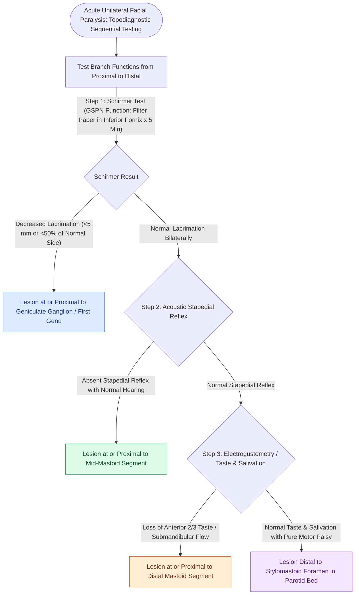

# Topodiagnostic testing localizes facial nerve injury through Schirmer testing, stapedius reflexometry, and electrogustometry

## Active Recall

> [!question]- What are the four primary step-off branches of the intratemporal facial nerve utilized for classical topodiagnostic lesion localization?
> *Answer / Clinical Rationale*: - (1) **Greater Superficial Petrosal Nerve (GSPN)** (originates at the **Geniculate Ganglion**): Provides parasympathetic secretomotor fibers to the lacrimal and nasal seromucinous glands; evaluated via the **Schirmer tear test**. - (2) **Nerve to the Stapedius Muscle** (originates in the **upper mastoid segment**): Innervates the stapedius muscle; evaluated via **acoustic reflexometry**. - (3) **Chorda Tympani Nerve** (originates in the **lower mastoid segment**): Carries special sensory taste from anterior 2/3 of tongue and parasympathetics to submandibular/sublingual glands; evaluated via **electrogustometry / chemical taste testing** and **submandibular salivary flow testing**. - (4) **Main Motor Trunk** (exits at the **Stylomastoid Foramen**): Innervates muscles of facial expression; evaluated via physical exam and electroneurography (ENoG).

> [!question]- What quantitative findings define an abnormal Schirmer test and an abnormal submandibular salivary flow test?
> *Answer / Clinical Rationale*: - **Schirmer Test**: Filter paper strip ($5\times 35\text{ mm}$) placed in inferior fornix for 5 minutes. Abnormal if **$<5\text{ mm}$ of total wetting in 5 minutes** OR **$<50\%$ wetting compared to the normal contralateral eye**, indicating a lesion at or proximal to the **geniculate ganglion**. - **Submandibular Salivary Flow (Blatt Test)**: Bilateral Wharton's duct cannulation with lemon juice stimulation. Abnormal if **$>25\%$ reduction in salivary flow** on the paralyzed side compared to the normal side, indicating a lesion proximal to the chorda tympani takeoff.

> [!question]- Why has classical topodiagnostic testing largely been replaced by high-resolution CT/MRI in modern neurotologic practice?
> *Answer / Clinical Rationale*: Topodiagnostic tests suffer from **poor anatomical reliability and variable predictive value** because inflammatory or ischemic edema (as in Bell's palsy or herpes zoster oticus) produces patchy, non-uniform conduction blocks across different nerve fibers within the Fallopian canal. **High-resolution temporal bone CT and contrast-enhanced MRI** provide precise, direct anatomical visualization of fractures, schwannomas, cholesteatoma erosions, or labyrinthine/geniculate segment enhancement.

## Core Clinical & Mechanistic Principles

The facial nerve gives off sequential branches as it traverses its intratemporal course through the **Fallopian canal**, providing an [[The facial nerve traverses six distinct anatomical segments from the pons to the parotid gland|anatomical]] framework for step-off lesion localization:

### Diagnostic Patterns by Anatomical Level
1. **Intracranial / CPA / Labyrinthine Segment**: Total facial paralysis + decreased tearing + absent stapedius reflex + loss of taste + sensorineural hearing loss / vestibular deficits ($CN\ VIII$ involvement).
2. **Geniculate Ganglion**: Facial paralysis + decreased tearing (positive Schirmer) + absent stapedius reflex + loss of taste.
3. **Tympanic / Upper Mastoid Segment**: Facial paralysis + NORMAL tearing (negative Schirmer) + absent stapedius reflex + loss of taste.
4. **Lower Mastoid Segment (Distal to Stapedius, Proximal to Chorda)**: Facial paralysis + normal tearing + NORMAL stapedius reflex + loss of taste.
5. **Extracranial / Stylomastoid Foramen**: Isolated motor facial paralysis with complete preservation of tearing, stapedial reflexes, and taste.

## Connected Concepts & Graph Traversal
- **Facial Nerve Segments**: [[The facial nerve traverses six distinct anatomical segments from the pons to the parotid gland|CN VII Anatomical Segments]]
- **Acoustic Reflex Arc**: [[Acoustic reflex thresholds and reflex decay testing identify retrocochlear lesions and facial nerve pathology|Acoustic Reflex Arc & Reflex Decay]]
- **Labyrinthine Vulnerability**: [[The labyrinthine segment is the narrowest portion of the Fallopian canal and most vulnerable to edema|Labyrinthine Segment Edema]]
- **Geniculate Ganglion Landmark**: [[The first genu marks the location of the geniculate ganglion and origin of the greater superficial petrosal nerve|First Genu & GSPN Origin]]
- **ENoG Prognostication**: [[Electroneuronography showing greater than ninety percent degeneration within fourteen days indicates severe facial nerve axonal injury|ENoG & Facial Nerve Prognosis]]
- **Bell's Palsy Management**: [[Acute Bell's palsy presents with unilateral lower motor neuron facial paralysis treated with early oral steroids|Bell's Palsy Steroid Protocols]]
