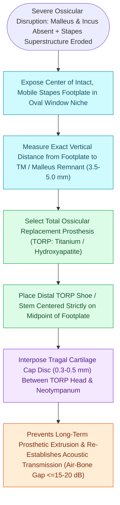

# Total ossicular replacement prosthesis TORP bridges the malleus or tympanic membrane to the stapes footplate

## Active Recall

> [!question]- When is a TORP indicated instead of a PORP?
> *Answer / Clinical Rationale*: When the **stapes superstructure (head and crura) is eroded or absent**, leaving only the stapes footplate.

> [!question]- What is the purpose of placing a tissue washer or stabilizing shoe on the stapes footplate during TORP placement?
> *Answer / Clinical Rationale*: To **center the shaft tip**, prevent subluxation out of the oval window, and prevent fracture/perforation of the footplate.

## Core Clinical & Mechanistic Principles
A **Total Ossicular Replacement Prosthesis (TORP)** is indicated for [[Partial ossicular replacement prosthesis PORP requires an intact and mobile stapes superstructure|ossicular reconstruction]] when the **stapes superstructure is absent / eroded**, leaving only a mobile stapes footplate:
- **Anatomical Challenges**:
  - The prosthesis must span the entire depth of the middle ear from the tympanic membrane / malleus down to the thin, mobile footplate in the oval window niche.
  - Typical [[The distance from the incus long process to the stapes footplate averages four to four point five millimeters|prosthesis length]]: **$3.0\text{–}5.0\text{ mm}$**.
- **Surgical Execution**:
  1. Inspect and palpate the stapes footplate to confirm normal mobility.
  2. Clear mucosal bands or granulomas from the oval window niche.
  3. Measure distance from the center of the footplate to the malleus handle or TM.
  4. Place a small tissue washer (perichondrium or fascia) or footplate shoe (Dornhoffer / Spiggle shoe) on the footplate to stabilize the shaft tip and prevent footplate perforation.
  5. Position the TORP shaft centrally on the footplate.
  6. Inset head plate beneath the malleus handle.
  7. **Interpose a full-size [[Cartilage interposition over ossicular prostheses prevents extrusion through the tympanic membrane|cartilage shield]] ($0.3\text{–}0.5\text{ mm}$)** covering the entire prosthesis head plate.

### Surgical Technique & Critical Safety Checks
- **Prosthesis Displacement Hazards**: Subluxation out of the oval window niche is the most common cause of late failure; footplate shoes and malleus-coupling heads enhance stability.

## Connected Concepts & Graph Traversal
- **Partial Prosthetic Alternative**: [[Partial ossicular replacement prosthesis PORP requires an intact and mobile stapes superstructure|PORP Reconstruction]]
- **Cartilage Interposition Cap**: [[Cartilage interposition over ossicular prostheses prevents extrusion through the tympanic membrane|Cartilage Interposition Cap]]
- **Austin-Kartush Classification**: [[The Austin-Kartush classification categorizes ossicular chain defects based on the presence of the malleus handle and stapes arch|Austin-Kartush Group B & D]]
- **Impedance Transformer Ratio**: [[The middle ear transformer ratio provides twenty-seven decibels of acoustic impedance matching|Middle Ear Transformer Gain]]
- **Tympanoplasty Grafting**: [[Underlay and overlay tympanoplasty techniques have distinct advantages and complication profiles|Underlay vs Overlay Tympanoplasty]]
- **Active Implant Alternative**: [[Active middle ear implants drive ossicular vibration via floating mass transducers to rehabilitate sensorineural and mixed hearing loss without external canal occlusion|Active Middle Ear Implants]]
