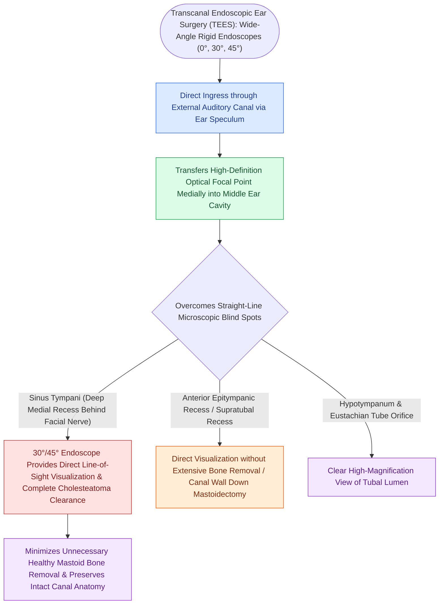

# Transcanal endoscopic ear surgery TEES provides line-of-sight visualization into the sinus tympani and epitympanum

## Active Recall

> [!question]- Which anatomical middle ear recess, situated medial to the facial nerve, is famously difficult to visualize with a microscope but accessible via TEES?
> *Answer / Clinical Rationale*: The **sinus tympani**.

> [!question]- What are the two primary technical limitations of Transcanal Endoscopic Ear Surgery (TEES)?
> *Answer / Clinical Rationale*: It is **strictly one-handed surgery** and lacks **binocular stereoscopic depth perception**.

## Core Clinical & Mechanistic Principles
**Transcanal Endoscopic Ear Surgery (TEES)** utilizes rigid wide-angle endoscopes ($0^\circ, 30^\circ, 45^\circ$; $2.7\text{–}3.0\text{ mm}$ diameter) to overcome the line-of-sight limitations of traditional operative microscopes:
- **The "Hidden Recesses" of the Middle Ear**:
  - Under microscopic view, straight-line vision is blocked by the canal wall, scutum, and facial nerve, creating blind spots in:
    1. **Sinus Tympani (Deep Medial to CN VII)**: The most difficult recess to clear; traditional microscopic view requires drilling [[Posterior tympanotomy facial recess approach opens the corridor between CN VII and chorda tympani|posterior tympanotomy]].
    2. **Anterior Epitympanic Recess (Supratubal Recess)**.
    3. **Protympanum (Eustachian Tube Orifice)**.
    4. **Hypotympanic Cellular Tracts**.
- **TEES Advantages**:
  - Brings the light source and high-definition wide-angle lens directly inside the tympanic cavity ("fish-eye" perspective).
  - Permits complete transcanal eradication of attic and sinus tympani cholesteatoma, **avoiding postauricular incisions, mastoidectomy, and healthy bone removal**.

### Surgical Technique & Critical Safety Checks
- **Technical Limitations of TEES**:
  - **One-handed surgery**: Surgeon holds endoscope in non-dominant hand; requires meticulous bloodless field (epinephrine-soaked cottonoids).
  - **Loss of binocular stereoscopic depth perception**.
  - **Thermal dissipation**: LED light source can heat middle ear fluids (keep light intensity $<50\%$).

## Connected Concepts & Graph Traversal
- **Primary Cholesteatoma Retraction**: [[Primary acquired cholesteatoma arises from retraction pocket invagination of the pars flaccida into Prussak space|Prussak Space Invagination]]
- **Congenital Middle Ear Cholesteatoma**: [[Congenital cholesteatoma presents as an anterosuperior white mass behind an intact tympanic membrane|Congenital Cholesteatoma]]
- **Non-EPI DWI Surveillance**: [[Non-echo-planar diffusion-weighted MRI detects recurrent and residual cholesteatoma as small as two millimeters|Non-EPI DWI MRI]]
- **Posterior Tympanotomy Comparison**: [[Posterior tympanotomy facial recess approach opens the corridor between CN VII and chorda tympani|Facial Recess Posterior Tympanotomy]]
- **Otic Capsule Anatomy**: [[The otic capsule is an immutable endochondral bone that provides fixed surgical reference landmarks|Otic Capsule Constants]]
