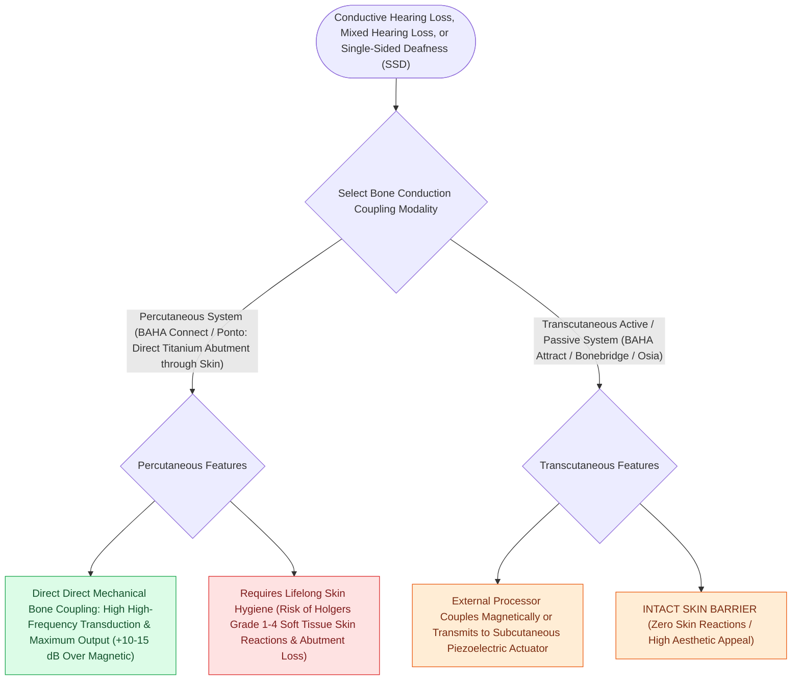

# Transcutaneous and percutaneous bone conduction implants bypass conductive and mixed hearing losses

## Active Recall

> [!question]- What is the major clinical advantage of an active transcutaneous bone implant (e.g., Osia) over a percutaneous abutment?
> *Answer / Clinical Rationale*: It provides high vibrational power while maintaining an **intact skin barrier**, completely eliminating skin overgrowth, abutment infections, and Holgers reactions.

> [!question]- What is the Holgers classification used for in percutaneous BAHA management?
> *Answer / Clinical Rationale*: To grade the severity of **postoperative skin inflammation and soft tissue reactions** around the percutaneous abutment.

## Core Clinical & Mechanistic Principles
Bone-conduction [[Bone-anchored hearing implants BAHA stimulate the cochlea directly via bone conduction pathways|hearing]] devices are engineered as either percutaneous or transcutaneous systems:
- **Percutaneous Systems (e.g., Cochlear Baha Connect, Oticon Ponto)**:
  - Utilize a titanium abutment that protrudes through the skin, directly coupling the processor to the bone fixture.
  - *Advantages*: **Zero skin attenuation** of high-frequency acoustic energy; maximal vibrational output (ideal for higher bone conduction thresholds up to $65\text{ dB HL}$).
  - *Disadvantages*: Lifelong risk of **Holgers skin complications** (erythema, skin overgrowth, abutment loss, infection in $10\text{–}20\%$).
- **Transcutaneous Systems**:
  1. **Passive Magnetic Systems (e.g., Baha Attract, Sophono)**: External magnet holds processor over internal magnetic implant; skin attenuates high frequencies by $10\text{–}15\text{ dB}$; risk of skin necrosis from magnetic pressure.
  2. **Active Transcutaneous Systems (e.g., Cochlear Osia, Bonebridge)**: The vibrating transducer is implanted directly under the skin into bone and driven by RF signals; **zero skin dampening**, intact skin barrier, and zero Holgers complications.

### Surgical Technique & Critical Safety Checks
- **Surgical Implantation Safety**: Implant placed **$5.0\text{–}6.0\text{ cm}$ posterior and superior to the external auditory meatus** at a $45^\circ$ angle, ensuring adequate clearance from pinna and glasses.

## Connected Concepts & Graph Traversal
- **BAHA Bone Conduction Mechanics**: [[Bone-anchored hearing implants BAHA stimulate the cochlea directly via bone conduction pathways|BAHA Implants]]
- **Congenital Aural Atresia**: [[Congenital aural atresia candidacy is graded by the ten-point Jahrsdoerfer scale|Jahrsdoerfer Atresia Grading]]
- **Single-Sided Deafness Protocol**: [[Single-sided deafness is rehabilitated via CROS hearing aids, osseointegrated bone conduction implants, and cochlear implantation|Single-Sided Deafness Rehabilitation]]
- **Masking & Interaural Attenuation**: [[Audiometric masking with the plateau method prevents shadow responses from the non-test ear|Bone Conduction Interaural Attenuation]]
- **Middle Ear Transformer Bypass**: [[The middle ear transformer ratio provides twenty-seven decibels of acoustic impedance matching|Middle Ear Transformer Ratio]]
