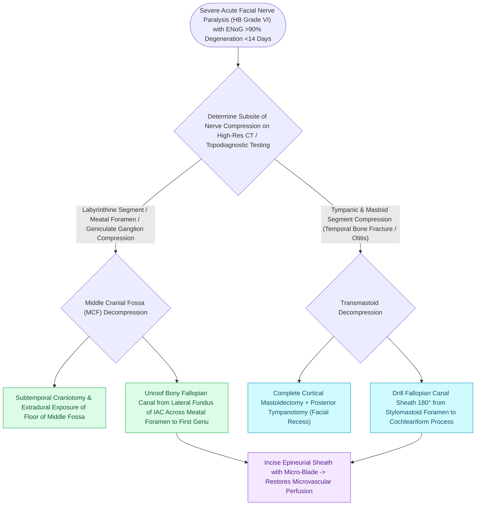

# Transmastoid and middle cranial fossa facial nerve decompression relieves canalicular compression

## Active Recall

> [!question]- What specific segments of the facial nerve are decompressed via the middle cranial fossa (MCF) approach?
> *Answer / Clinical Rationale*: The **fundus of the IAC**, the **meatal foramen**, the **labyrinthine segment**, and the **geniculate ganglion**.

> [!question]- What surgical approach is used to decompress the entire facial nerve in a patient with a pre-existing non-functional 'dead ear'?
> *Answer / Clinical Rationale*: The **[[The translabyrinthine approach provides direct exposure of the internal auditory canal with complete hearing sacrifice|translabyrinthine approach]]**.

## Core Clinical & Mechanistic Principles
**Facial nerve decompression** is indicated for refractory [[Acute Bell's palsy presents with unilateral lower motor neuron facial paralysis treated with early oral steroids|Bell]]'s palsy ($>90\%$ ENoG degeneration at 14 days) or traumatic [[Temporal bone longitudinal and transverse fractures cause delayed or immediate facial paralysis|temporal bone fractures]] with immediate paralysis and bony impingement:
- **Comprehensive Middle Cranial Fossa (MCF) + Transmastoid Approach (Total Decompression)**:
  1. **Middle Cranial Fossa (MCF) Stage**:
     - Unroofs the **fundus of the IAC, meatal foramen, labyrinthine segment, and [[The first genu marks the location of the geniculate ganglion and origin of the greater superficial petrosal nerve|geniculate ganglion]]**.
     - Identifies the superior semicircular canal (arcuate eminence) and GSPN; dissects medial to GSPN to unroof the geniculate ganglion and labyrinthine segment.
     - Incises the **meatal foramen ring** and nerve sheath (epineurium) to relieve compartment pressure.
  2. **Transmastoid Stage**:
     - Unroofs the **tympanic (horizontal) segment, second genu, and mastoid (vertical) segment** down to the stylomastoid foramen.
- **Transmastoid-Extralabyrinthine Approach (Preserving Hearing)**:
  - Can decompress from the stylomastoid foramen up through the tympanic segment and anterior to the ampulla of the superior canal to reach the geniculate ganglion without craniotomy.

### Surgical Technique & Critical Safety Checks
- **Translabyrinthine Decompression**: Utilized when the patient has a pre-existing "dead ear", providing rapid, wide access to the entire intratemporal course through the destroyed labyrinth.

## Connected Concepts & Graph Traversal
- **Labyrinthine Fallopian Segment**: [[The labyrinthine segment is the narrowest portion of the Fallopian canal and most vulnerable to edema|Labyrinthine Segment Vulnerability]]
- **First Genu & Geniculate Ganglion**: [[The first genu marks the location of the geniculate ganglion and origin of the greater superficial petrosal nerve|First Genu Landmarks]]
- **Middle Cranial Fossa Route**: [[The middle cranial fossa approach provides hearing preservation for intracanalicular schwannomas with lateral fundus extension|Middle Cranial Fossa Approach]]
- **Electrodiagnostic ENoG Degeneration**: [[Electroneuronography showing greater than ninety percent degeneration within fourteen days indicates severe facial nerve axonal injury|ENoG Degeneration Criteria]]
- **Traumatic Temporal Bone Fractures**: [[Temporal bone longitudinal and transverse fractures cause delayed or immediate facial paralysis|Temporal Bone Fractures]]
