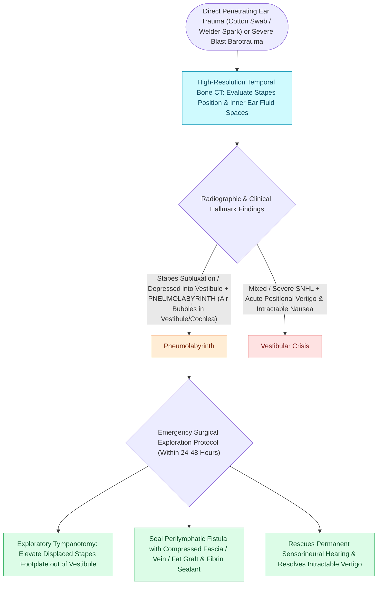

# Traumatic perilymphatic fistula and stapes subluxation present with pneumolabyrinth, vertigo, and mixed hearing loss

## Active Recall

> [!question]- What is Hennebert's sign, and what physical mechanism generates it in a perilymphatic fistula?
> *Answer / Clinical Rationale*: Hennebert's sign is the induction of acute conjugate eye deviation (or nystagmus) and vertigo upon applying positive or negative pneumatic pressure to the external auditory canal. In PLF, pressure changes transmit directly across the mobile fistulous window into the vestibule, mechanically deflecting the cupula of the lateral semicircular canal.

> [!question]- Why is the presence of pneumolabyrinth on temporal bone CT considered an absolute indication for prompt surgical exploration?
> *Answer / Clinical Rationale*: Pneumolabyrinth indicates a large, unsealed communication between the contaminated middle ear and sterile inner ear perilymph. Persistent air in the labyrinth causes direct cochlear hair cell necrosis, severe vestibulopathy, and creates an open conduit for ascending bacterial labyrinthitis and life-threatening meningitis.

## Core Clinical & Mechanistic Principles
A traumatic [[Perilymphatic fistula causes fluctuating hearing loss and pressure-induced vertigo after barotrauma or stapes surgery|perilymphatic fistula]] (PLF) is an abnormal communication between the perilymphatic space of the inner ear (scala vestibuli or scala tympani) and the air-filled middle ear cavity, occurring via disruption of the **annular ligament at the oval window** or tearing of the **round window membrane**. Common etiologies include penetrating ear canal trauma (e.g., cotton tipped applicator impalement), barotrauma (scuba diving, blast overpressure, explosive decompression), severe blunt [[Temporal bone longitudinal and transverse fractures cause delayed or immediate facial paralysis|temporal bone trauma]], or forceful Valsalva maneuvers (implosive/explosive mechanisms). 

Direct mechanical displacement or subluxation of the stapes footplate into the vestibule allows escape of perilymph and entry of middle ear air into the inner ear, visualized on high-resolution temporal bone CT as **pneumolabyrinth** (micro-bubbles of air within the vestibule, cochlea, or semicircular canals). Patients present with fluctuating sensorineural or mixed hearing loss, roaring tinnitus, sudden positional vertigo, and a positive **Hennebert's sign** (vertigo or nystagmus provoked by positive/negative pneumatoscopy pressure in the external canal).

### Management Algorithm: Conservative vs. Exploratory Tympanotomy
1. **Acute Diagnostic Workup**:
   - **High-Resolution Temporal Bone CT ($0.5\text{ mm}$ cuts)**: Mandated to assess stapes position within the oval window niche, identify ossicular disruption, and evaluate for pneumolabyrinth or otic capsule fractures.
   - **Formal Audiogram**: Quantifies conductive vs. sensorineural components and baseline bone conduction thresholds.
2. **Initial Conservative Management (48 to 72 Hours)**:
   - For mild cases without pneumolabyrinth, fluctuating symptoms, or progressive sensorineural drop:
   - Strict bed rest with head-of-bed elevation at $30^\circ\text{ to }45^\circ$.
   - Avoidance of all straining, heavy lifting, coughing, and nose-blowing; initiate scheduled stool softeners.
   - High-dose oral corticosteroids (prednisone $1\text{ mg/kg/day}$) to salvage cochlear hair cell function.
3. **Indications for Emergent Surgical Exploration (Exploratory Tympanotomy)**:
   - Definite pneumolabyrinth on CT imaging.
   - Subluxated stapes depressed into the vestibule.
   - Severe, intractable vertigo with incapacitating vegetative symptoms.
   - Progressive or profound [[Idiopathic sudden sensorineural hearing loss requires prompt systemic corticosteroids and intratympanic salvage injection|sudden sensorineural hearing loss]].
4. **Surgical Technique (Window Patching)**:
   - Transcanal tympanomeatal flap elevation under local anesthesia.
   - Direct inspection of the oval and round window niches.
   - Denudation of mucosal margins around the fistula site.
   - Application of autologous connective tissue grafts (temporalis fascia, tragal perichondrium, or adipose tissue) secured with fibrin glue or Gelfoam packing over the oval and round windows.

## References
1. Wilkerson, B.J., et al. (2020). Management of Temporal Bone Trauma. In Flint, P.W., et al. (Eds.), *Cummings Otolaryngology Head and Neck Surgery* 7e (pp. 2207-2219). Philadelphia, PA: Elsevier.
2. Diaz, R.C., et al. (2013). Middle Ear and Temporal Bone Trauma. In Johnson, J.J., Rosen, C.A. (Eds.), *Bailey’s Head and Neck Surgery-Otolaryngology* 5e (pp. 2410-2432). Baltimore, MD: Lippincott Williams & Wilkins.
3. Sarna, B., et al. (2020). Traumatic perilymphatic fistula: a systematic review. *Otol Neurotol*, 41(8):1018-1025.

## Connected Concepts & Graph Traversal
- **Physiological Basis**: [[Temporal bone longitudinal and transverse fractures cause delayed or immediate facial paralysis|Temporal Bone Fractures]]
- **Differential Pathology**: [[Benign paroxysmal positional vertigo BPPV results from canalithiasis or cupulolithiasis in semicircular canals|BPPV Canalithiasis]]
- **Tympanic Membrane Safety**: [[Traumatic tympanic membrane perforations heal spontaneously in the majority of cases without early surgery|Traumatic TM Perforations]]
- **Sensorineural Rescue**: [[Idiopathic sudden sensorineural hearing loss requires prompt systemic corticosteroids and intratympanic salvage injection|Sudden Sensorineural Hearing Loss]]
- **Vestibular Loss**: [[Labyrinthitis presents with acute prolonged vertigo combined with sudden sensorineural hearing loss|Acute Suppurative Labyrinthitis]]
