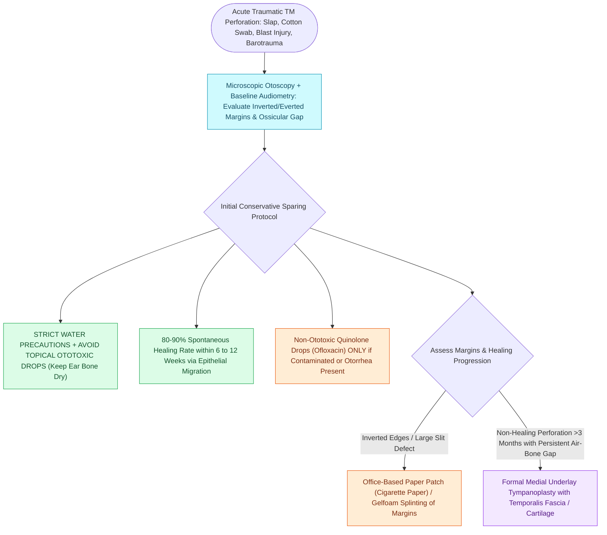

# Traumatic tympanic membrane perforations heal spontaneously in the majority of cases without early surgery

## Active Recall

> [!question]- Why are neomycin- or polymyxin-containing ear drops strictly contraindicated in the setting of an acute traumatic tympanic membrane perforation?
> *Answer / Clinical Rationale*: Aminoglycosides (neomycin, gentamycin) cross the perforated tympanic membrane into the middle ear and diffuse across the **round window membrane** into the scala tympani, selectively destroying outer hair cells in the cochlea and vestibular sensory epithelium, causing irreversible sensorineural hearing loss and vestibulopathy.

> [!question]- What is the natural spontaneous healing rate of uncomplicated traumatic tympanic membrane perforations within 3 months?
> *Answer / Clinical Rationale*: Between **80% and 90%**. The normal tympanic membrane epithelium has an active centrifugal migration pattern radiating from the umbo outward, which drives rapid spontaneous re-epithelialization across small to moderate traumatic defects without surgical intervention.

## Core Clinical & Mechanistic Principles

**Traumatic tympanic membrane (TM) perforations** occur secondary to penetrating mechanical injuries (cotton swabs, bobby pins, twigs), sudden barometric overpressure (slap to the ear, blast injury, scuba diving barotrauma), or thermal/chemical burns (welding slag, caustic drops). Perforations most commonly involve the **pars tensa**, where the middle fibrous layer (composed of outer radial and inner circular collagen fibers) shears under excessive acoustic or atmospheric force.

Patients present with acute lancinating otalgia, bloody otorrhea, tinnitus, conductive hearing loss (proportional to perforation size and middle ear volume alteration), and occasionally transient vertigo. More than **80% to 90% of traumatic TM perforations heal spontaneously within 6 to 12 weeks** through native epithelial migration and fibroblastic bridging from the annulus toward the umbo.

Key diagnostic steps include binocular microscopic examination to assess perforation size, margin eversion, and ossicular chain integrity, and comprehensive audiometry. If a concurrent ossicular disruption or stapes subluxation occurs, conductive or mixed hearing loss exceeding >30–35 dB is present. If the perforation fails to close spontaneously after 3 months, it becomes a chronic perforation requiring [[Underlay and overlay tympanoplasty techniques have distinct advantages and complication profiles|Type I underlay tympanoplasty]].

### Key Consultation Supplies
- Coaxial surgical headlight, loupes, or binocular operating microscope
- Metallic ear speculums (sizes 3, 4, 5 mm)
- Frazier suction tips (sizes 3 Fr, 5 Fr)
- 512 Hz aluminum tuning fork
- 0.5 mm right-angle micro-hook and fine Rosen needle (for edge eversion)
- Sterile cigarette paper / Steri-Strip / Gelfilm patch
- Non-ototoxic topical fluoroquinolone drops (ciprofloxacin-dexamethasone or ofloxacin 0.3%)
- Formal comprehensive audiogram referral order

> [!example]- **Operative Note Template: Bedside microscopic paper-patch myringoplasty**
> **PROCEDURE**: Bedside microscopic paper-patch myringoplasty
> **PRE-PROCEDURAL DIAGNOSIS**: Acute traumatic tympanic membrane perforation of the [right/left] ear
> **POST-PROCEDURAL DIAGNOSIS**: Acute traumatic tympanic membrane perforation of the [right/left] ear status-post microscopic paper patching
> **SURGEON**: [Surgeon Name, MD]
> **ASSISTANT**: [Resident/Fellow Name, MD]
>
> **PROCEDURE IN DETAIL**:
> Informed consent was obtained. The patient was positioned supine with the head rotated to expose the affected ear. Under direct visualization using the binocular operating microscope, an appropriately sized ear speculum was inserted.
>
> The tympanic membrane demonstrated a central [describe % size, e.g., 25%] traumatic perforation in the posteroinferior pars tensa with mild inverted mucosal edges and minimal dried blood clot at the margin. Obstructing debris was gently suctioned using a 3 Fr Frazier suction. Using a 0.5 mm blunt right-angle micro-hook, the inverted edges of the perforation were meticulously everted and flattened into anatomical alignment.
>
> A small sterile patch of cigarette paper, sized slightly larger than the perforation defect, was moistened with sterile saline and carefully positioned across the external surface of the tympanic membrane to bridge the defect entirely. Good contact and complete occlusion of the perforation were verified under microscopy. Strict dry ear precautions were reinforced, and the patient was scheduled for follow-up microscopic exam and audiogram in 4–6 weeks. The patient tolerated the procedure well.

## References
1. Diaz, R.C., Kamal, S.M., Brodie, H.A. (2013). Middle Ear and Temporal Bone Trauma. In Johnson, J.J., Rosen, C.A. (Eds.), *Bailey’s Head and Neck Surgery-Otolaryngology* 5e (pp. 2410-2432). Baltimore, MD: Lippincott Williams & Wilkins.
2. Prueter, J.C., Teasley, R.A., Backous, D.B. (2020). Clinical Assessment and Surgical Treatment of Conductive Hearing Loss. In Flint, P.W., et al. (Eds.), *Cummings Otolaryngology Head and Neck Surgery* 7e (pp. 2186-2196). Philadelphia, PA: Elsevier.
3. Lou, Z.C., et al. (2012). Spontaneous healing of traumatic tympanic membrane perforation: a retrospective study. *Clin Otolaryngol*, 37(5):372-377.

## Connected Concepts & Graph Traversal
- **Definitive Surgical Repair**: [[Underlay and overlay tympanoplasty techniques have distinct advantages and complication profiles|Type I Tympanoplasty Technique]]
- **Acoustic Biophysics**: [[The middle ear transformer ratio provides twenty-seven decibels of acoustic impedance matching|Middle Ear Impedance Matching]]
- **Differential Trauma**: [[Temporal bone longitudinal and transverse fractures cause delayed or immediate facial paralysis|Temporal Bone Fractures]]
- **Iatrogenic Injury Precursor**: [[External auditory canal foreign bodies require atraumatic extraction under microscopic guidance to protect the tympanic membrane|EAC Foreign Body Extraction]]
- **Infectious Differential**: [[Uncomplicated acute otitis media in pediatric and adult patients is treated with first-line high-dose amoxicillin|Acute Otitis Media]]
