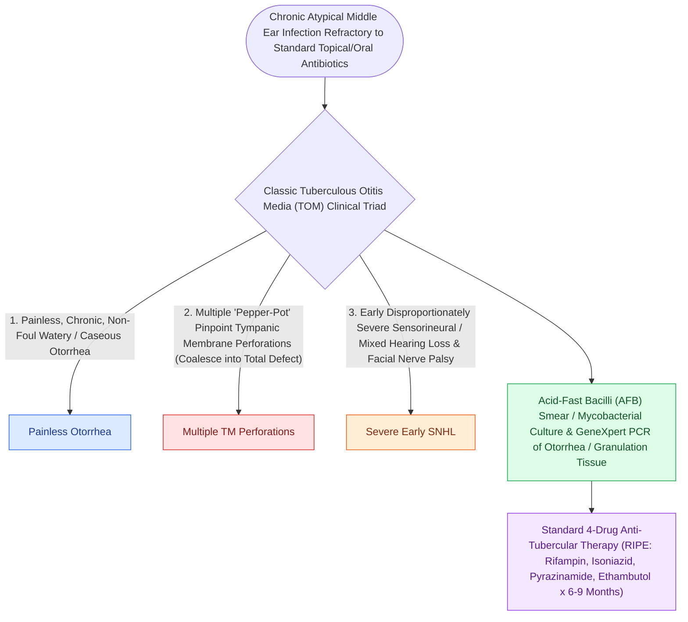

# Tuberculous otitis media presents with painless otorrhea, multiple tympanic membrane perforations, and early profound hearing loss

## Active Recall

> [!question]- What is the classical clinical diagnostic triad of tuberculous otitis media (TOM)?
> *Answer / Clinical Rationale*: (1) **Painless, watery-to-foul chronic otorrhea** that is refractory to standard topical and oral broad-spectrum antibiotic therapy; (2) **Multiple "punched-out" tympanic membrane perforations** (which later coalesce into a single large subtotal perforation); (3) **Disproportionately early and severe sensorineural or mixed hearing loss** accompanied by early **facial nerve paralysis** (occurring in $15-40\%$ of cases).

> [!question]- What characteristic otoscopic and surgical findings alert the otologist to underlying tuberculous infection?
> *Answer / Clinical Rationale*: Otoscopy reveals **pale, exuberant, avascular mucosal granulation tissue** filling the middle ear and mastoid bowl (in contrast to the beefy red hypervascular granulations of standard pyogenic otitis media). Bone destruction is out of proportion to symptoms, with extensive **bony sequestration of the incus, malleus, or labyrinth** (cold necrosis) in the absence of active cholesteatoma.

> [!question]- What is the primary treatment modality for tuberculous otitis media, and when is surgical mastoidectomy indicated?
> *Answer / Clinical Rationale*: The primary treatment is **multidrug systemic anti-tuberculous chemotherapy (RIPE regimen: Rifampin, Isoniazid, Pyrazinamide, Ethambutol)** for a minimum of **6 to 9 months**. **Surgery is contraindicated in the acute inflammatory phase** (as it leads to non-healing wound dehiscence, chronic persistent fistulas, and facial nerve injury) and is reserved strictly for: (1) **Biopsy of granulation tissue** for definitive AFB staining, culture, and PCR; (2) **Debridement of dead bony sequestra** after starting chemotherapy; and (3) **Decompression of acute facial nerve paralysis** unresponsive to medical therapy.

## Core Clinical & Mechanistic Principles

**Tuberculous otitis media (TOM)** is caused by *Mycobacterium tuberculosis* reaching the middle ear cleft via the **Eustachian tube** (retrograde ascent of infected sputum / milk), **hematogenous dissemination** from pulmonary/miliary disease, or direct trans-tympanic membrane inoculation:

### Chemotherapy Regimen & Management Rules
- **Standard RIPE Protocol**:
  - **Initial Phase (2 Months)**: Daily Rifampin ($10\text{ mg/kg}$), Isoniazid ($5\text{ mg/kg}$ + Pyridoxine/Vitamin B6), Pyrazinamide ($25\text{ mg/kg}$), and Ethambutol ($15\text{ mg/kg}$).
  - **Continuation Phase (4–7 Months)**: Daily Rifampin and Isoniazid.
- **Surgical Rule**: Never perform routine tympanoplasty or [[Mastoid obliteration with local muscle flaps or bioactive glass reduces cavity volume and discharge|mastoid obliteration]] in active tuberculous otitis media; medical cure must be established for at least 1 year post-chemotherapy before considering elective hearing reconstruction.

## Connected Concepts & Graph Traversal
- **AOM Management**: [[Uncomplicated acute otitis media in pediatric and adult patients is treated with first-line high-dose amoxicillin|AOM Differential]]
- **Facial Paralysis Workup**: [[House-Brackmann grading system stratifies facial nerve function from Grade I normal to Grade VI total paralysis|Facial Nerve Grading]]
- **Petrous Apicitis**: [[Gradenigo triad of otorrhea, retroorbital pain, and abducens nerve palsy indicates suppurative petrous apicitis|Gradenigo Syndrome Triad]]
- **Tympanic Membrane Perforations**: [[Traumatic tympanic membrane perforations heal spontaneously in the majority of cases without early surgery|TM Perforation Healing]]
- **Malignant Otitis Externa**: [[Malignant necrotizing otitis externa is an invasive pseudomonal skull base osteomyelitis in elderly diabetic patients|Necrotizing Otitis Externa]]
