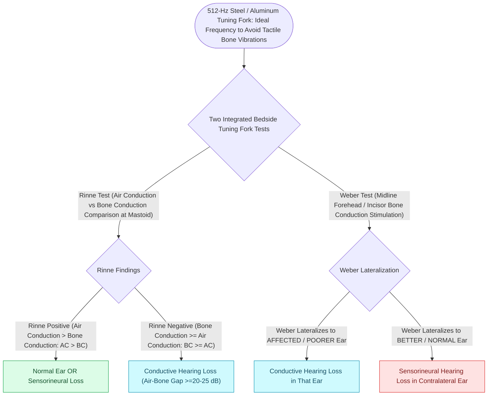

# Tuning fork tests utilize the 512-Hertz fork to differentiate conductive from sensorineural hearing loss via Weber and Rinne tests

## Active Recall

> [!question]- Why is the 512-Hz tuning fork preferred over 256-Hz and 1024-Hz forks for routine otologic examination?
> *Answer / Clinical Rationale*: The **512-Hz fork** provides the ideal balance between acoustic tone perception and tactile vibration. The **256-Hz fork** produces strong somatosensory / tactile vibratory cues that patients mistake for auditory perception, leading to false-positive bone conduction. The **1024-Hz fork** has a very rapid tone decay time and poor bone conduction transmission through the skull, making clinical testing difficult and unreliable.

> [!question]- What is the threshold of air-bone gap required to flip the Rinne test from positive (AC > BC) to negative (BC > AC)?
> *Answer / Clinical Rationale*: A standard **Rinne test flips to negative ($BC > AC$) only when a conductive air-bone gap reaches at least $20-25\text{ dB}$ at 512 Hz** (and $\ge 15\text{ dB}$ for 256 Hz). Air-bone gaps smaller than $20\text{ dB}$ frequently yield a false-normal positive Rinne ($AC > BC$).

> [!question]- What is a "false negative Rinne" and how is it definitively unmasked at the bedside?
> *Answer / Clinical Rationale*: A **false negative Rinne** occurs in a patient with a **severe-to-profound unilateral sensorineural hearing loss (dead ear)**. When bone conduction is tested on the affected mastoid, transcranial bone conduction transmits across the skull with minimal interaural attenuation ($0-10\text{ dB}$) to stimulate the *normal contralateral cochlea*. The patient reports $BC > AC$ in the dead ear, falsely mimicking a conductive hearing loss. It is unmasked by: (1) **The Weber test**, which vigorously lateralizes to the contralateral (normal) ear, and (2) **Barany noise box or tragal rub masking** of the contralateral good ear during bone conduction testing.

## Core Clinical & Mechanistic Principles

Tuning fork evaluations represent the primary bedside qualitative confirmation of pure-tone audiometry, essential for avoiding wrong-ear surgery in [[Otosclerosis is characterized by abnormal bone remodeling of the otic capsule causing stapes fixation|otosclerosis]] and chronic otitis media:

- **Weber Test Mechanics**:
  - Fork placed on midline forehead, vertex, or upper incisors.
  - **Conductive Hearing Loss**: Sound lateralizes to the **affected (poorer) ear** because the conductive barrier reduces background ambient masking noise (the *occlusion effect*) and alters phase resonance.
  - **Sensorineural Hearing Loss**: Sound lateralizes to the **unaffected (better) ear** because the intact cochlear hair cells generate higher-amplitude neural firing.
- **Rinne Test Mechanics**:
  - Fork base placed firmly on the mastoid process until sound fades (BC), then vibrating tines are brought $2\text{ cm}$ adjacent to the external auditory canal (AC).
  - **Positive Rinne ($AC > BC$)**: Normal hearing or sensorineural hearing loss (air conduction acoustic amplifier mechanism remains superior to skull vibration).
  - **Negative Rinne ($BC > AC$)**: Conductive hearing loss of $\ge 20-25\text{ dB}$.
- **Gelle Test**:
  - Pneumatic otoscope increases pressure in EAC while fork is on mastoid.
  - **Normal / Ossicular Discontinuity**: Increased air pressure stiffens TM and ossicles, decreasing bone conduction volume.
  - **Otosclerosis / Stapes Fixation**: Bone conduction volume remains unchanged (fixed footplate cannot be further stiffened).
- **Bing Test (Occlusion Effect Evaluation)**:
  - The vibrating tuning fork is placed on the mastoid process while the examiner alternately occludes and unoccludes the external auditory canal with a finger.
  - *Bing Positive (Normal or Sensorineural Loss)*: Sound becomes distinctly louder when the canal is occluded (normal physiological **occlusion effect**, where osseotympanic bone vibration is trapped within the closed external canal).
  - *Bing Negative (Conductive Hearing Loss)*: Sound loudness does not change with occlusion (a pre-existing conductive lesion already creates a maximal internal occlusion effect, so external closure adds no further perceived loudness).

## Connected Concepts & Graph Traversal
- **Audiometric Masking**: [[Audiometric masking with the plateau method prevents shadow responses from the non-test ear|Audiometric Masking Mechanics]]
- **Acoustic Impedance Matching**: [[The middle ear transformer ratio provides twenty-seven decibels of acoustic impedance matching|Middle Ear Transformer Ratio]]
- **Otosclerosis & Stapes Fixation**: [[Otosclerosis is characterized by abnormal bone remodeling of the otic capsule causing stapes fixation|Otosclerosis Pathophysiology]]
- **Sudden SNHL Triage**: [[Idiopathic sudden sensorineural hearing loss requires prompt systemic corticosteroids and intratympanic salvage injection|Sudden SNHL Emergency Protocol]]
- **Tympanometric Correlation**: [[Tympanometry classifies middle ear compliance and pressure into Jerger Types A, As, Ad, B, and C|Jerger Tympanometric Curves]]
- **Retrocochlear Testing**: [[Auditory brainstem response waves I through V identify retrocochlear and brainstem pathology|ABR Diagnostic Latencies]]
