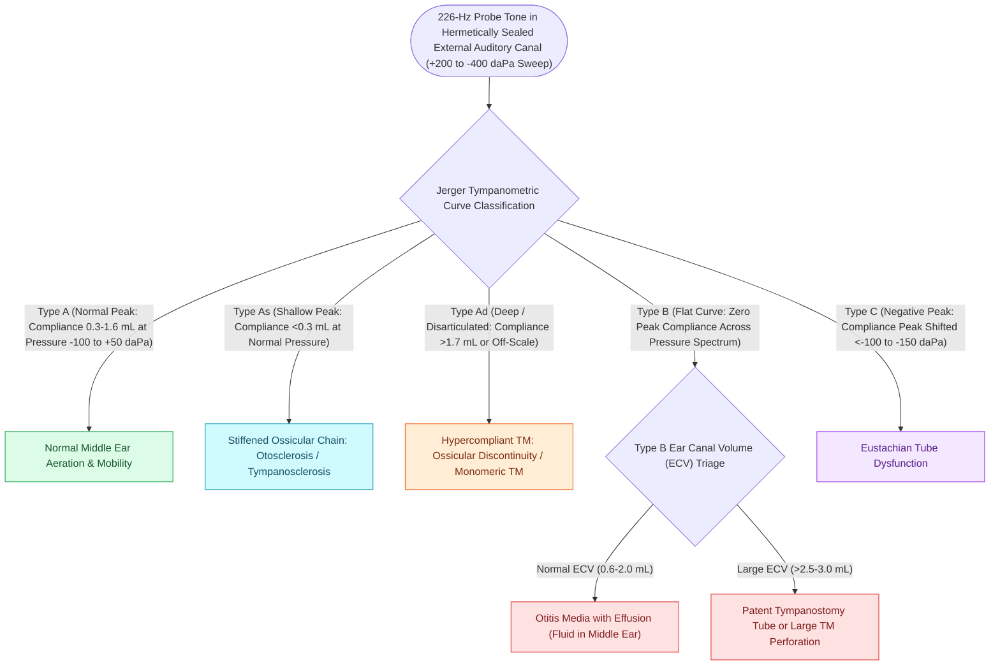

# Tympanometry classifies middle ear compliance and pressure into Jerger Types A, As, Ad, B, and C

## Active Recall

> [!question]- What are the normal adult normative values for static acoustic admittance (compliance), tympanometric peak pressure (TPP), and equivalent ear canal volume (ECV)?
> *Answer / Clinical Rationale*: (1) **Static Compliance / Admittance ($Y_{tm}$)**: $0.3\text{ to }1.6\text{ mL}$ (or $\text{mmho}$). (2) **Tympanometric Peak Pressure (TPP)**: $-100\text{ to }+50\text{ daPa}$ (decapascals). (3) **Equivalent Ear Canal Volume (ECV)**: $0.6\text{ to }2.0\text{ mL}$ in adults ($0.3\text{ to }1.0\text{ mL}$ in children).

> [!question]- How does Equivalent Ear Canal Volume (ECV) differentiate the three distinct pathological causes of a flat (Type B) tympanogram?
> *Answer / Clinical Rationale*: A flat Type B curve has no identifiable peak compliance. ECV categorizes the pathology: (1) **Normal ECV ($0.6-2.0\text{ mL}$)**: Intact tympanic membrane with **middle ear effusion (OME)**, hemotympanum, or massive middle ear tumor. (2) **Low ECV ($<0.6\text{ mL}$)**: **Canal occlusion** (impacted cerumen, probe tip against canal wall, or canal atresia). (3) **High ECV ($>2.0\text{ mL}$ in adults, $>1.0\text{ mL}$ in children)**: **Tympanic membrane perforation** or widely patent functioning tympanostomy tube measuring the combined volume of the canal and mastoid-middle ear cavity.

> [!question]- What anatomical pathologies produce Type $A_S$ (stiff) versus Type $A_D$ (deep / hypermobile) tympanometric curves?
> *Answer / Clinical Rationale*: Both exhibit normal peak pressure ($-100\text{ to }+50\text{ daPa}$). **Type $A_S$ (shallow/stiff, compliance $<0.3\text{ mL}$)** indicates increased stiffness of the acoustic transformer: **otosclerosis (stapes fixation)**, malleus head fixation, or dense tympanosclerosis. **Type $A_D$ (deep/disarticulated, compliance $>1.6\text{ mL}$ or off-scale)** indicates increased flaccidity: **ossicular chain discontinuity** (incudostapedial joint separation) or a hypercompliant flaccid monomeric/dimeric healed tympanic membrane.

## Core Clinical & Mechanistic Principles

**Acoustic immittance tympanometry** measures the acoustic admittance (ease of sound energy flow) of the [[The middle ear transformer ratio provides twenty-seven decibels of acoustic impedance matching|middle]] ear as air pressure in the external canal is varied from $+200\text{ daPa}$ to $-400\text{ daPa}$ using a $226\text{ Hz}$ probe tone (or $1000\text{ Hz}$ probe tone in infants $<6\text{ months}$ due to canal wall compliance):

### High-Frequency ($1000\text{ Hz}$) Tympanometry in Neonates
- In neonates and infants younger than 6 months, the cartilage and bony walls of the external auditory canal are highly compliant.
- A standard $226\text{ Hz}$ probe tone causes the **canal walls themselves to vibrate**, yielding a falsely normal Type A curve despite a middle ear full of fluid.
- A **$1000\text{ Hz}$ probe tone** eliminates canal wall artifact, accurately reflecting true middle ear status for newborn hearing screening confirmations.

## Connected Concepts & Graph Traversal
- **Bedside Tuning Forks**: [[Tuning fork tests utilize the 512-Hertz fork to differentiate conductive from sensorineural hearing loss via Weber and Rinne tests|Tuning Fork Bedside Correlation]]
- **Acoustic Reflex Testing**: [[Acoustic reflex thresholds and reflex decay testing identify retrocochlear lesions and facial nerve pathology|Stapedius Acoustic Reflex Arc]]
- **Otosclerosis & Stapes Fixation**: [[Otosclerosis is characterized by abnormal bone remodeling of the otic capsule causing stapes fixation|Otosclerosis Immittance Findings]]
- **Eustachian Tube Mechanics**: [[Eustachian tube dysfunction divides into dilatory and patulous forms with opposite treatment goals|ET Dysfunction Pathophysiology]]
- **Tympanostomy Tube Guidelines**: [[Tympanostomy tube placement follows guideline criteria for chronic effusion and recurrent acute otitis media|T&A and PE Tube Indications]]
- **Middle Ear Transformer**: [[The middle ear transformer ratio provides twenty-seven decibels of acoustic impedance matching|Middle Ear Acoustic Transformer]]
