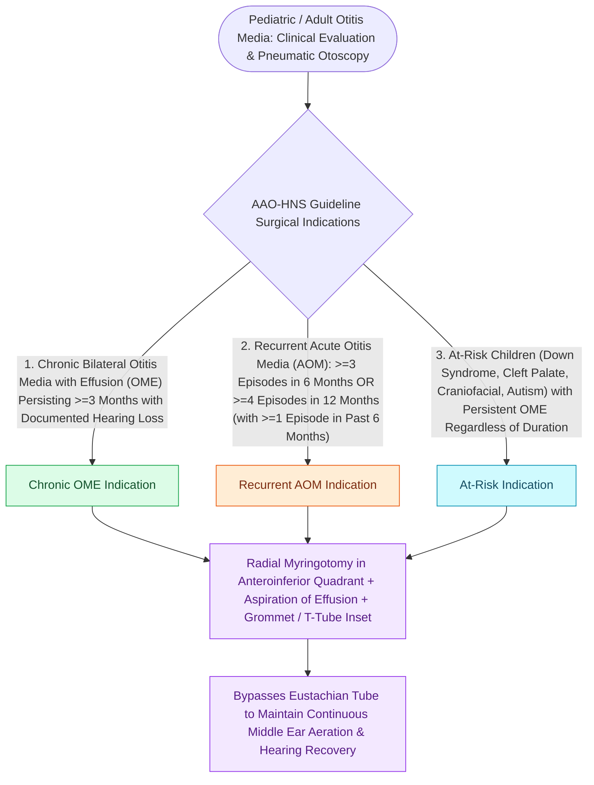

# Tympanostomy tube placement follows guideline criteria for chronic effusion and recurrent acute otitis media

## Active Recall

> [!question]- Under what clinical condition should tympanostomy tubes be withheld in a child who meets the numerical frequency criteria for Recurrent AOM (e.g., 4 episodes in 12 months)?
> *Answer / Clinical Rationale*: When the child has **completely clear, aerated middle ears with NO middle ear effusion (MEE) on physical examination** at the time of surgical evaluation; surgery is deferred until a subsequent active episode or persistent effusion develops.

> [!question]- Why does the AAO-HNS guideline recommend topical fluoroquinolone drops over oral antibiotics as first-line therapy for acute uncomplicated tympanostomy tube otorrhea?
> *Answer / Clinical Rationale*: Topical drops deliver **up to 1,000-fold higher local antibiotic concentrations** directly into the middle ear without systemic adverse effects or gut microbiome disruption, eradicating *Pseudomonas* and *S. aureus* far more effectively than oral agents.

> [!question]- Which children qualify for tympanostomy tube placement immediately upon diagnosing OME without waiting for 3 months of chronic effusion?
> *Answer / Clinical Rationale*: **"At-Risk" children** (including those with Down syndrome, cleft palate, baseline permanent hearing loss, Autism, or developmental delay), because they cannot tolerate the cognitive and communicative setbacks of a prolonged conductive hearing overlay.

## Core Clinical & Mechanistic Principles
**Tympanostomy tube placement (pressure equalization / PE tubes)** is the most common pediatric surgical procedure, indicated to restore middle ear ventilation, equalize atmospheric pressure, and resolve conductive hearing loss according to the **AAO-HNS Clinical Practice Guidelines**:

- **Core Guideline Indications (AAO-HNS Criteria)**:
  1. **Chronic Bilateral Otitis Media with Effusion (OME)**:
     - Bilateral effusion persisting for **$\ge 3\text{ consecutive months}$** WITH documented **hearing difficulty** (conductive hearing loss, pure-tone average $>20\text{–}25\text{ dB HL}$, or speech-language delay).
  2. **Recurrent Acute Otitis Media (RAOM) WITH Effusion**:
     - **$\ge 3$ distinct episodes in $6\text{ months}$**, OR **$\ge 4$ distinct episodes in $12\text{ months}$** (with at least $\ge 1$ episode occurring within the preceding 6 months) **AND unilateral or bilateral middle ear effusion (MEE) present at the time of evaluation**.
     - *Critical Rule*: If a child meets frequency criteria for RAOM but has **completely clear, aerated middle ears with NO effusion on exam**, surgery is **deferred** (watchful waiting until the next active episode).
  3. **Chronic Unilateral OME**:
     - Unilateral effusion persisting for **$\ge 3\text{ months}$ WITH symptoms** (vestibular/balance disturbance, poor school performance, behavioral issues, otalgia, or structural tympanic membrane retraction).

- **"At-Risk" Children Accelerated Pathway**:
  - Children categorized as **"At-Risk" are eligible for immediate tympanostomy tubes upon diagnosis of OME**, bypassing the mandatory 3-month watchful waiting period.
  - *At-Risk Categories*: Down syndrome (Trisomy 21), cleft palate / craniofacial anomalies, baseline permanent sensorineural or conductive hearing loss, visual impairment, Autism spectrum disorder, developmental delay, or blind/deafness.

- **Tympanostomy Tube Selection**:
  - **Short-Term Tubes (e.g., Armstrong, Shepard, Donaldson, Bobbin)**:
    - *Extrusion Kinetics*: Spontaneously extrude in **$6\text{–}18\text{ months}$** as the tympanic membrane epithelial migration carries the flange laterally.
    - *Perforation Risk*: Low persistent TM perforation rate (**$<2\text{–}3\%$**).
  - **Long-Term Tubes (e.g., T-Tubes, Goode T-Tubes, Modified Paparella)**:
    - *Extrusion Kinetics*: Flanged flexible arms anchor within the middle ear, remaining in place for **$\ge 2\text{–}4\text{ years}$**.
    - *Perforation Risk*: High persistent TM perforation rate (**$10\text{–}20\%$**), requiring subsequent formal tympanoplasty. Reserved for severe refractory [[Eustachian tube dysfunction divides into dilatory and patulous forms with opposite treatment goals|Eustachian tube dysfunction]], cleft palate, or radiation-induced serous otitis.

- **Adjunctive Adenoidectomy**:
  - Adenoidectomy is recommended concurrently with tympanostomy tube placement in children **$\ge 4\text{ years of age}$** receiving repeat tubes, or in children of any age with chronic nasal obstruction, chronic adenoiditis, or recurrent purulent rhinitis.

- **Postoperative Care & Water Precaution Rules**:
  - **Topical Fluoroquinolones First-Line for Otorrhea**: Uncomplicated acute tube otorrhea is managed exclusively with **topical fluoroquinolone otic drops (ciprofloxacin-dexamethasone or ofloxacin)**. Oral systemic antibiotics are **strictly contraindicated** for uncomplicated otorrhea (less effective and promote microbial resistance).
  - **Water Precautions NOT Routinely Recommended**: AAO-HNS guidelines strongly advise **against routine water precautions** (custom earplugs or bathing headbands) for casual surface swimming or hair washing, as surface tension prevents significant water entry through small-lumen tubes. Water protection is reserved only for deep diving ($>6\text{ feet}$), swimming in non-chlorinated lakes/rivers, or patients with active water-induced otalgia/drainage.

### Surgical Technique & Critical Safety Checks
- **Myringotomy Quadrant Geometry**: Place the radial incision strictly in the **anteroinferior or anterosuperior quadrant** of the pars tensa.
- *Anatomical Safety Hazard*: **Never incise the posterosuperior quadrant** (risks incudostapedial joint disruption, round window membrane penetration, or horizontal facial nerve injury). Inspect for a dehiscent jugular bulb or aberrant internal carotid artery if the lower tympanic membrane appears vascular or violaceous.

## Connected Concepts & Graph Traversal
- **Acute Middle Ear Infection**: [[Uncomplicated acute otitis media in pediatric and adult patients is treated with first-line high-dose amoxicillin|Pediatric Acute Otitis Media]]
- **Eustachian Tube Biomechanics**: [[Eustachian tube dysfunction divides into dilatory and patulous forms with opposite treatment goals|Eustachian Tube Dysfunction]]
- **Adult Unilateral Effusion Hazard**: [[Adult unilateral otitis media with effusion mandates nasopharyngoscopy to exclude nasopharyngeal carcinoma|Adult Unilateral OME & NPC Screen]]
- **🔗 Cleft Palate Middle Ear Pathology (Pediatrics)**: [[Unilateral and bilateral cleft lip and palate result from failure of fusion of the maxillary and medial nasal prominences|Cleft Palate & Tensor Veli Palatini Dysfunction]]
- **Permanent Perforation Repair**: [[Cartilage island tympanoplasty resists negative middle ear pressure and recurrent retraction|Cartilage Island Tympanoplasty for Post-Extrusion Perforation]]
- **🔗 Universal Newborn Hearing (Pediatrics)**: [[Connexin 26 mutations in GJB2 and congenital CMV infection are leading causes of non-syndromic pediatric sensorineural hearing loss|Newborn Hearing Screening]]
