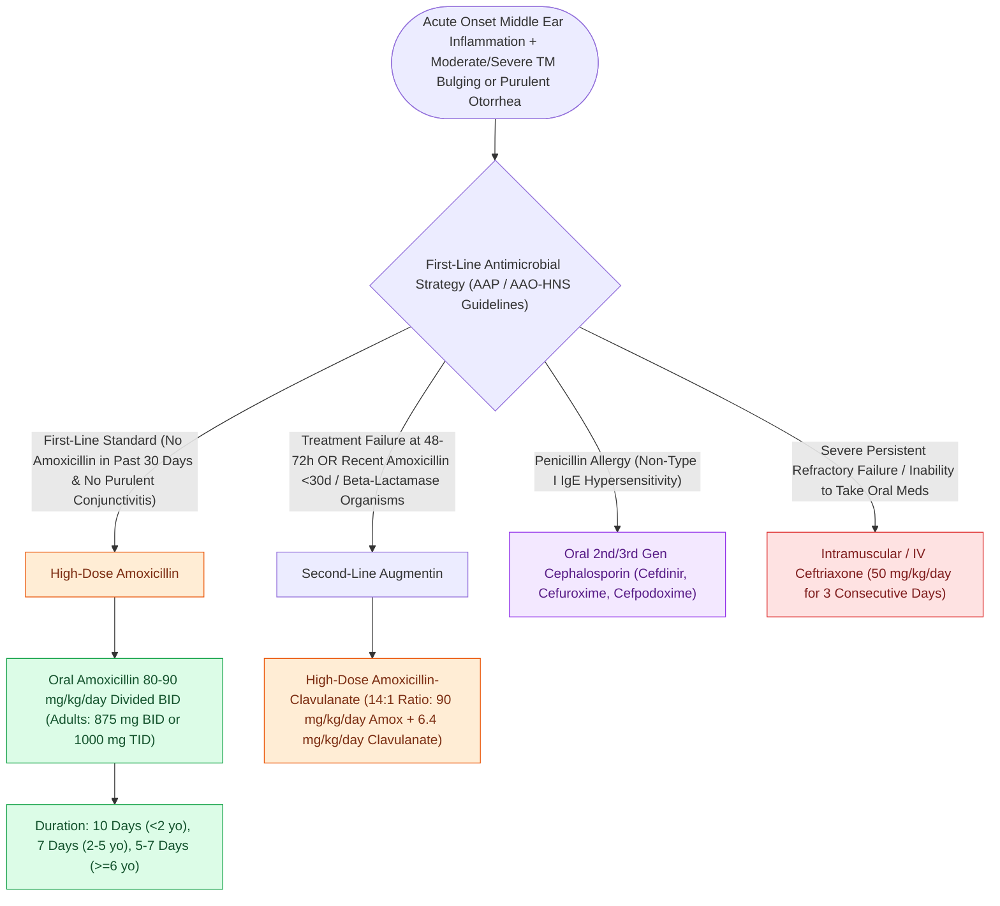

# Uncomplicated acute otitis media in pediatric and adult patients is treated with first-line high-dose amoxicillin

## Active Recall

> [!question]- Why is high-dose amoxicillin (80–90 mg/kg/day) prescribed for acute otitis media rather than standard dosing (40–45 mg/kg/day)?
> *Answer / Clinical Rationale*: Penicillin resistance in *Streptococcus pneumoniae* is mediated by altered penicillin-binding proteins (PBPs), not beta-lactamase production. Doubling the systemic amoxicillin dose elevates middle ear fluid concentrations above the minimum inhibitory concentration (MIC) required to saturate altered PBPs and effectively eradicate penicillin-intermediate and most penicillin-resistant *S. pneumoniae* strains.

> [!question]- In which quadrant of the tympanic membrane should diagnostic tympanocentesis or myringotomy be performed, and why?
> *Answer / Clinical Rationale*: In the **anteroinferior** or **posteroinferior quadrant**. The superior quadrants must be avoided to protect the underlying ossicular chain (incus long process and stapes in the posterosuperior quadrant) and the chorda tympani nerve.

## Core Clinical & Mechanistic Principles

**Acute otitis media (AOM)** is an acute bacterial infection of the middle ear cleft, universally precipitated by **[[Eustachian tube dysfunction divides into dilatory and patulous forms with opposite treatment goals|Eustachian tube dysfunction]]** following a viral upper respiratory infection (URI). Negative middle ear pressure draws nasopharyngeal secretions and pathogens into the tympanic cavity, triggering intense mucosal inflammation, purulent exudate accumulation, and tympanic membrane (TM) erythema and bulging.

The classic triad of diagnostic criteria includes:
1. **Acute onset** of symptoms (otalgia, fever, irritability in infants).
2. **Middle ear effusion (MEE)** demonstrated by pneumatic otoscopy (immobile TM, bulging, air-fluid level, or acute otorrhea).
3. **Distinct signs of middle ear inflammation** (marked erythema of the TM, distinct bulging of the pars tensa).

The predominant bacterial pathogens are **Streptococcus pneumoniae** (~35–40%), non-typeable **Haemophilus influenzae** (~30–35%), and **Moraxella catarrhalis** (~10–15%). First-line medical therapy for uncomplicated AOM is **high-dose amoxicillin (80–90 mg/kg/day divided BID in children; 875 mg PO BID in adults)** to achieve middle ear fluid concentrations that overcome intermediate penicillin resistance in *S. pneumoniae*. In patients with amoxicillin exposure in the prior 30 days or concurrent purulent conjunctivitis (otitis-conjunctivitis syndrome due to beta-lactamase-producing *H. influenzae*), **high-dose amoxicillin-clavulanate (90 mg/kg/day amoxicillin with 6.4 mg/kg/day clavulanate, 14:1 formulation)** is the initial agent of choice. Untreated or virulent infections can evolve into [[Acute coalescent mastoiditis causes trabecular osteoclasis and subperiosteal abscess formation|coalescent acute mastoiditis]] or trigger spontaneous [[Traumatic tympanic membrane perforations heal spontaneously in the majority of cases without early surgery|tympanic membrane perforation]].

### Key Consultation Supplies
- Pneumatic otoscope with fresh bulb/battery and appropriately sized specula
- 512 Hz aluminum tuning fork (for Weber and Rinne testing)
- Binocular operating microscope with metallic ear specula (sizes 3, 4, 5 mm)
- Frazier suction tips (sizes 3 Fr, 5 Fr)
- Sterile culture swab (if spontaneous perforation with active otorrhea is present)
- Ototopical drops (ciprofloxacin-dexamethasone or ofloxacin 0.3% if tympanic membrane is perforated or tympanostomy tube in place)

## References
1. Schilder, A.G., Rosenfeld, R.M., Venekamp, R.P. (2020). Acute Otitis Media and Otitis Media with Effusion. In Flint, P.W., et al. (Eds.), *Cummings Otolaryngology Head and Neck Surgery* 7e (pp. 2956-2969). Philadelphia, PA: Elsevier.
2. Rosenfeld, R.M., Shin, J.J., Schwartz, S.R., et al. (2016). Clinical Practice Guideline: Otitis Media with Effusion (Update). *Otolaryngol Head Neck Surg*, 154(1_suppl):S1-S41.
3. Rosenfeld, R.M., Schwartz, S.R., Pynnonen, M.A., et al. (2013). Clinical Practice Guideline: [[Tympanostomy tube placement follows guideline criteria for chronic effusion and recurrent acute otitis media|Tympanostomy Tubes]] in Children. *Otolaryngol Head Neck Surg*, 149(1_suppl):S1-S35.
4. Arts, H.A., Adams, M.E. (2013). Intratemporal and Intracranial [[Otogenic intracranial complications escalate from meningitis to sigmoid sinus thrombosis and brain abscess|Complications of Otitis Media]]. In Johnson, J.J., Rosen, C.A. (Eds.), *Bailey’s Head and Neck Surgery-Otolaryngology* 5e (pp. 2399-2409). Baltimore, MD: Lippincott Williams & Wilkins.

## Connected Concepts & Graph Traversal
- **Critical Complication Rescue**: [[Acute coalescent mastoiditis causes trabecular osteoclasis and subperiosteal abscess formation|Acute Mastoiditis]]
- **Surgical Craft & Intervention**: [[Tympanostomy tube placement follows guideline criteria for chronic effusion and recurrent acute otitis media|Tympanostomy Tube Placement]]
- **Differential Diagnosis**: [[Acute otitis externa is managed with topical antimicrobial-steroid drops and aural debridement|Acute Otitis Externa]]
- **Anatomical Foundation**: [[The middle ear transformer ratio provides twenty-seven decibels of acoustic impedance matching|Middle Ear Impedance Mechanics]]
- **Audiologic Consequence**: [[Traumatic tympanic membrane perforations heal spontaneously in the majority of cases without early surgery|Tympanic Membrane Perforation]]
