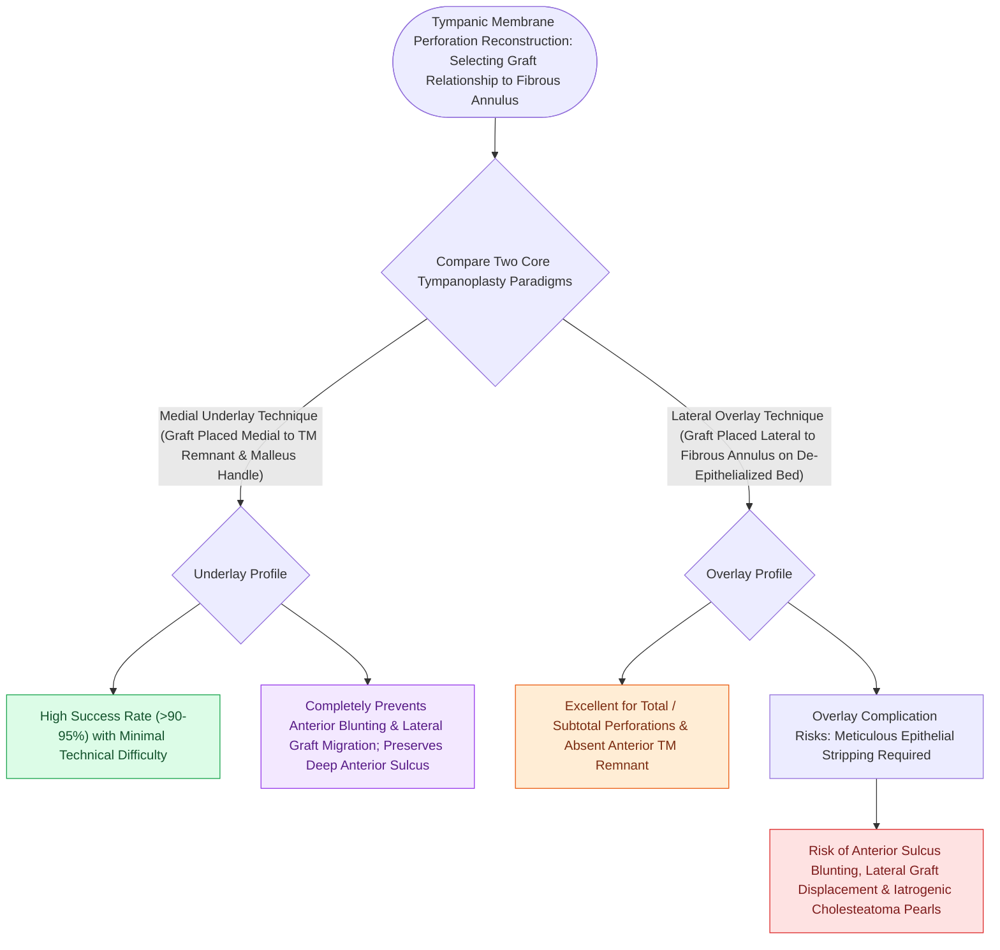

# Underlay and overlay tympanoplasty techniques have distinct advantages and complication profiles

## Active Recall

> [!question]- What are the three classic complications unique to lateral (overlay) tympanoplasty?
> *Answer / Clinical Rationale*: **Anterior sulcus blunting**, **lateralization of the graft** away from the ossicles, and **iatrogenic epithelial inclusion cysts (cholesteatoma)**.

> [!question]- Where is the graft positioned relative to the malleus and fibrous annulus in an underlay tympanoplasty?
> *Answer / Clinical Rationale*: **Medial to both the malleus handle and the fibrous remnant/annulus**.

## Core Clinical & Mechanistic Principles
Surgical closure of tympanic membrane perforations utilizes two primary anatomical grafting planes:
- **Medial (Underlay) Tympanoplasty**:
  - The graft (temporalis fascia, perichondrium, or cartilage) is placed **medial to the fibrous remnant of the tympanic membrane and the malleus handle**.
  - *Advantages*: Technically easier, avoids anterior sulcus blunting, avoids lateral graft displacement, shorter healing time, lower risk of iatrogenic [[Primary acquired cholesteatoma arises from retraction pocket invagination of the pars flaccida into Prussak space|cholesteatoma]].
  - *Disadvantages*: Lower graft take rate for large anterior or total perforations where anterior support is lacking.
- **Lateral (Overlay) Tympanoplasty**:
  - The squamous epithelium is completely stripped off the lateral surface of the TM and anterior canal wall; the graft is placed **lateral to the fibrous layer and annulus** but medial to the repositioned canal skin.
  - *Advantages*: Highest graft take rate ($>95\%$) for total, anterior, or revision perforations with no residual rim.
  - *Disadvantages*: Technically demanding, prolonged healing, risk of **anterior blunting** (blunting of anterior sulcus causing conductive hearing loss), **lateralization of the graft** away from the malleus, and **epithelial pearl inclusion cysts**.

### Surgical Technique & Critical Safety Checks
- **Over-Under Technique**: Graft placed medial to the malleus handle but lateral to the anterior annulus, combining stability with low blunting risk.

## Connected Concepts & Graph Traversal
- **Medial Underlay Fascia Craft**: [[Medial underlay fascia grafting avoids anterior blunting and lateral graft displacement|Medial Underlay Fascia Grafting]]
- **Cartilage Island Stiffening**: [[Cartilage island tympanoplasty resists negative middle ear pressure and recurrent retraction|Cartilage Island Tympanoplasty]]
- **Areal Transformer Gain**: [[The tympanic membrane areal ratio of seventeen to one provides the primary impedance gain|Tympanic Membrane Areal Gain]]
- **Surgical Approach Tailoring**: [[Endaural and postauricular surgical approaches provide tailored exposure for middle ear pathology|Endaural vs Postauricular Approaches]]
- **Ossicular Chain Reconstruction**: [[Partial ossicular replacement prosthesis PORP requires an intact and mobile stapes superstructure|PORP Reconstruction]]
- **Cartilage Reinforcement Alternative**: [[Cartilage palisade and butterfly inlay tympanoplasty techniques reinforce the reconstructed tympanic membrane against eustachian tubal negative pressure while preserving acoustic transmission|Palisade & Butterfly Inlay Cartilage Tympanoplasty]]
