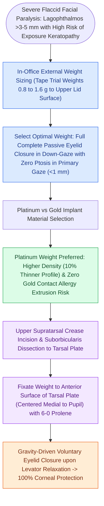

# Upper eyelid gold or platinum weight implantation prevents exposure keratopathy in lagophthalmos

## Active Recall

> [!question]- How does an upper eyelid gold weight restore eye closure in facial nerve paralysis?
> *Answer / Clinical Rationale*: It uses **gravity** to pull the upper eyelid closed whenever the levator palpebrae superioris muscle relaxes.

> [!question]- What are the clinical advantages of platinum eyelid implants over gold implants?
> *Answer / Clinical Rationale*: Platinum is denser, allowing a **thinner, lower-profile implant** that is less visible through the eyelid skin, with a lower rate of allergic capsule formation.

## Core Clinical & Mechanistic Principles
Inability to close the eye (**lagophthalmos**) resulting from orbicularis oculi [[Upper eyelid platinum weights and lateral tarsal strips protect the cornea in flaccid facial paralysis|paralysis]] places the cornea at extreme risk of drying, exposure keratitis, corneal ulceration, and permanent blindness:
- **Upper Eyelid Weight Loading Mechanism**:
  - Utilizes **gravity** to passively lower the upper eyelid when the levator palpebrae superioris muscle (CN III) relaxes during blink reflexes.
- **Preoperative Weight Sizing**:
  - In the clinic, test weights ($0.6\text{ to }1.6\text{ g}$) are taped to the upper eyelid.
  - The ideal weight allows **complete eye closure in the upright position** without producing $>1.5\text{–}2.0\text{ mm}$ of ptosis on primary gaze.
- **Gold vs. Platinum Implants**:
  - **Platinum Weights**: Denser than gold ($21.45\text{ g/cm}^3$ vs. $19.3\text{ g/cm}^3$); allows an implant that is **$10\text{–}12\%$ thinner with lower profile**, reducing visibility through thin eyelid skin; lower allergic reaction rate.
- **Surgical Inset Technique**:
  1. Supratarsal crease incision.
  2. Dissect through orbicularis oculi to expose the anterior surface of the **tarsal plate**.
  3. Fix weight to the upper half of the tarsus with 6-0 Prolene sutures; close muscle and skin.

### Surgical Technique & Critical Safety Checks
- **Complementary Procedures**: Lower eyelid **lateral tarsal strip canthoplasty** to correct paralytic ectropion and punctal eversion.

## Connected Concepts & Graph Traversal
- **🔗 Flaccid Facial Paralysis Care (FPRS)**: [[Upper eyelid platinum weights and lateral tarsal strips protect the cornea in flaccid facial paralysis|Upper Eyelid Weight Implantation]]
- **House-Brackmann Staging**: [[House-Brackmann grading system stratifies facial nerve function from Grade I normal to Grade VI total paralysis|House-Brackmann Scale]]
- **Acute Bell's Palsy Protocol**: [[Acute Bell's palsy presents with unilateral lower motor neuron facial paralysis treated with early oral steroids|Bell's Palsy Eye Care]]
- **Dynamic Reanimation Transfer**: [[Masseteric nerve transfer to facial nerve branches restores rapid, powerful dynamic smile reanimation|Masseteric Nerve Transfer]]
- **Direct Epineurial Repair**: [[Immediate direct epineurial end-to-end repair is the gold standard for transected facial nerve injury|Immediate Epineurial Repair]]
