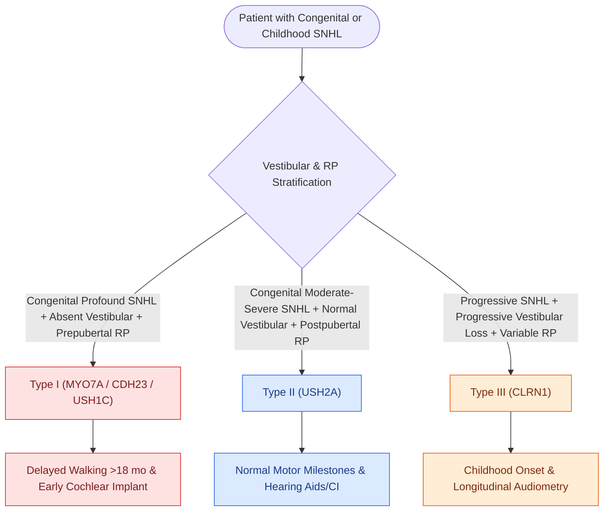

# Usher syndrome combines congenital sensorineural hearing loss with progressive retinitis pigmentosa and vestibular dysfunction

## Active Recall

> [!question]- What is the genetic and clinical classification of Usher syndrome into Types I, II, and III?
> *Answer / Clinical Rationale*: Usher syndrome is an autosomal recessive disorder representing the leading cause of deaf-blindness: - **Type I (40%)**: Congenital **profound bilateral SNHL**, **absent vestibular function** (severe balance deficits, delayed walking $>18\text{ months}$), and **prepubertal onset of retinitis pigmentosa (RP)** (night blindness before age 10); genes include *MYO7A* (1B), *USH1C* (Harmonin), *CDH23*. - **Type II (50–60%)**: Congenital **moderate-to-severe sloping SNHL**, **completely normal vestibular function** (normal motor milestones), and **postpubertal/adolescent onset of RP**; primary gene is **USH2A** (encodes usherin). - **Type III (<5%)**: **Progressive SNHL** starting in childhood, **progressive vestibular loss**, and variable adolescent onset of RP; gene is *CLRN1* (Clarin-1).

> [!question]- What are the earliest ophthalmologic symptoms of retinitis pigmentosa, and how is it definitively diagnosed before fundoscopic changes appear?
> *Answer / Clinical Rationale*: Earliest symptom is **nyctalopia (night blindness)** followed by progressive constriction of peripheral visual fields ("tunnel vision"). Fundoscopy later reveals classic **bony spicule retinal pigmentation, attenuation of retinal vessels, and waxy disc pallor**. Definitive early diagnosis before fundoscopy becomes abnormal is established via **electroretinography (ERG)**, which demonstrates marked reduction or absence of scotopic rod responses.

> [!question]- What is the clinical significance of early identification for auditory rehabilitation in Type I Usher syndrome?
> *Answer / Clinical Rationale*: Because children with Type I Usher syndrome face inevitable dual sensory deprivation (complete blindness superimposed on profound congenital deafness), **early universal newborn screening and early cochlear implantation (ideally $<12\text{ months}$ of age)** is critical to establish robust oral auditory-verbal communication before visual inputs are lost.

## Core Clinical & Mechanistic Principles
Usher syndrome is an autosomal recessive disorder accounting for $>50\%$ of inherited deaf-blindness and approximately $5\%$ of all congenital profound [[Syndromic pediatric sensorineural hearing loss encompasses Pendred, Usher, Waardenburg, and Jervell and Lange-Nielsen syndromes|syndromic sensorineural hearing loss]]:

- **Molecular Pathophysiology**:
  - The proteins encoded by Usher genes (*MYO7A*, *USH1C*, *CDH23*, *PCDH15*, *USH2A*, *CLRN1*) assemble into the macromolecular **interstereocilia link complex** in cochlear and vestibular hair cells, scaffolding [[Outer hair cell electromotility driven by prestin amplifies cochlear micromechanics|stereocilia mechanotransduction channels]].
  - In the retina, these same proteins maintain the **connecting cilium** between inner and outer photoreceptor segments; loss of structural integrity produces progressive rod-cone dystrophy (retinitis pigmentosa).
- **Critical Rehabilitation Mandate**:
  - Because Type I patients face inevitable complete dual sensory deprivation, prompt universal newborn screening and early [[Cochlear implant candidacy criteria include severe to profound bilateral sensorineural hearing loss|cochlear implantation]] ($<12\text{ months}$) is imperative to establish spoken language pathways before visual fields constrict.

### Pathophysiological Mechanism & Diagnostics
Early diagnosis before fundoscopic bone spicules appear is definitively established using scotopic electroretinography (ERG), which demonstrates absent rod responses.

## Connected Concepts & Graph Traversal
- **Cochlear Implantation Candidacy**: [[Cochlear implant candidacy criteria include severe to profound bilateral sensorineural hearing loss|Cochlear Implantation in Congenital Deafness]]
- **🔗 Syndromic SNHL Overview (Pediatrics)**: [[Syndromic pediatric sensorineural hearing loss encompasses Pendred, Usher, Waardenburg, and Jervell and Lange-Nielsen syndromes|Syndromic SNHL Overview]]
- **Vestibular Evaluation**: [[Rotary chair testing assesses low-frequency bilateral vestibular hypofunction and central compensation|Vestibular Hypofunction in Usher I]]
- **Differential Syndromic Deafness**: [[Jervell and Lange-Nielsen syndrome combines congenital profound sensorineural hearing loss with a prolonged QT interval|Jervell & Lange-Nielsen Cardiac Screening]]
- **Hair Cell Transduction Mechanics**: [[Outer hair cell electromotility driven by prestin amplifies cochlear micromechanics|Stereocilia Hair Cell Physiology]]
