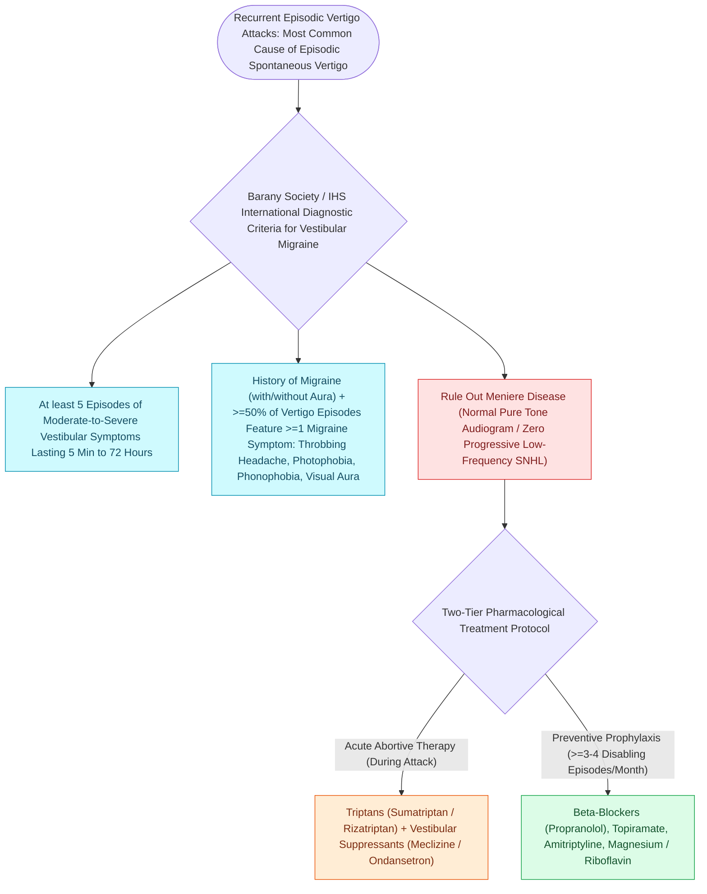

# Vestibular migraine is the most common cause of episodic spontaneous vertigo

## Active Recall

> [!question]- What single objective finding most reliably separates Meniere disease from vestibular migraine over time?
> *Answer / Clinical Rationale*: Audiometrically documented fluctuating low-frequency SNHL in Meniere; vestibular migraine spares thresholds.

> [!question]- State the attack-duration window in the diagnostic criteria.
> *Answer / Clinical Rationale*: Five minutes to seventy-two hours.

## Core Clinical & Mechanistic Principles
- Barany/IHS criteria: at least five episodes of moderate-severe vestibular symptoms lasting **five minutes to seventy-two hours**, a current or past migraine diagnosis, and migraine features (headache, photophobia/phonophobia, visual aura) in at least half the episodes.
- The Meniere discriminator: vestibular migraine lacks the **documented low-frequency fluctuating SNHL**; aural fullness and even [[Chronic subjective tinnitus is managed with cognitive behavioral and sound-based therapy rather than cure|tinnitus]] can occur in both, so the audiogram during/after attacks is the referee.
- Interictal exam and vestibular testing are typically normal or nonspecifically abnormal — the diagnosis is clinical pattern recognition, and comorbidity with true Meniere and with [[Benign paroxysmal positional vertigo BPPV results from canalithiasis or cupulolithiasis in semicircular canals|BPPV]] is real.
- Motion sensitivity, visual vertigo, and childhood benign paroxysmal vertigo history enrich the picture.

### Management & Critical Safety Checks
- Treatment is migraine treatment: trigger/lifestyle regularity, then standard prophylaxis (beta-blocker, topiramate, amitriptyline, CGRP agents by headache burden); vestibular suppressants are attack-only.
- Set the expectation that control is preventive — chasing attacks with abortives underperforms in the vestibular phenotype.

## Connected Concepts & Graph Traversal
- **Meniere Fluctuating Differential**: [[Meniere disease is characterized by episodic vertigo, fluctuating low-frequency SNHL, tinnitus, and aural fullness|Meniere Disease Differential]]
- **PPPD Functional Transition**: [[Persistent postural-perceptual dizziness is a chronic functional vestibular disorder treated with rehabilitation and SSRIs|PPPD Functional Dizziness]]
- **BPPV Positional Differential**: [[The Dix-Hallpike maneuver produces torsional upbeating nystagmus in posterior canal BPPV|BPPV Positional Vertigo]]
- **Vestibular Neuritis Sparing**: [[Vestibular neuritis causes acute spontaneous prolonged vertigo without auditory symptoms|Vestibular Neuritis Differential]]
- **vHIT Normal Gain Confirmation**: [[The video head impulse test vHIT identifies high-frequency angular vestibulo-ocular reflex deficits|vHIT Testing in Migraine]]
