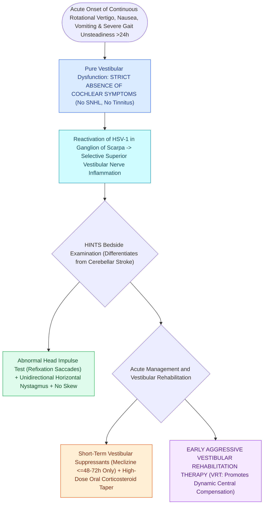

# Vestibular neuritis causes acute spontaneous prolonged vertigo without auditory symptoms

## Active Recall

> [!question]- What nerve branch is most commonly affected in vestibular neuritis, and why?
> *Answer / Clinical Rationale*: The **Superior Vestibular Nerve (SVN)** ($>90\%$), because its bony canal is longer and narrower, making it vulnerable to [[The labyrinthine segment is the narrowest portion of the Fallopian canal and most vulnerable to edema|ischemic compression]] from inflammatory edema.

> [!question]- What three findings on the HINTS exam indicate a central cerebellar/brainstem stroke rather than peripheral vestibular neuritis?
> *Answer / Clinical Rationale*: A **normal Head Impulse Test (HIT)**, **direction-changing gaze-evoked nystagmus**, and **presence of vertical skew deviation** (the 'INFARCT' mnemonic).

## Core Clinical & Mechanistic Principles
**Vestibular Neuritis** is the second most common cause of peripheral vertigo, characterized by acute unilateral loss of vestibular function (Acute Vestibular Syndrome):
- **Etiology & Nerve Branch Vulnerability**:
  - Reactivation of latent **Herpes Simplex Virus Type 1 (HSV-1)** in the vestibular (Scarpa) ganglion.
  - **Superior Vestibular Nerve (SVN)** is involved in **$>90\%$ of cases** (supplying the horizontal canal, anterior canal, and utricle) because its bony canal is $7\times$ longer and narrower with less vascularity than the inferior nerve canal.
  - **Inferior Vestibular Nerve (IVN)** (posterior canal, saccule) is rarely affected in isolation ($<5\%$).
- **Clinical Presentation**:
  - Sudden onset of severe, continuous rotational vertigo, nausea, vomiting, and gait instability lasting **days to weeks**.
  - **NO AUDITORY SYMPTOMS** (no hearing loss, no tinnitus).
  - **Spontaneous Unidirectional Horizontal-Torsional Nystagmus**: Fast phase beats **AWAY from the affected ear**; suppressed by visual fixation; does NOT change direction with gaze.

### Surgical Technique & Critical Safety Checks
- **Treatment**: Short course of vestibular suppressants ($<48\text{ hours}$ to prevent delayed compensation), oral corticosteroids (Prednisone $1\text{ mg/kg}$ taper), and immediate early **[[Vestibular rehabilitation exploits adaptation habituation and substitution to recalibrate gaze and posture|vestibular rehabilitation]] therapy (VRT)**.

## Connected Concepts & Graph Traversal
- **HINTS Bedside Stroke Protocol**: [[The HINTS examination separates vestibular neuritis from posterior circulation stroke in acute vestibular syndrome|HINTS Stroke Protocol]]
- **Suppurative Labyrinthitis Differential**: [[Labyrinthitis presents with acute prolonged vertigo combined with sudden sensorineural hearing loss|Suppurative Labyrinthitis]]
- **vHIT Angular Gain Deficits**: [[The video head impulse test vHIT identifies high-frequency angular vestibulo-ocular reflex deficits|vHIT Angular Deficits]]
- **Caloric Unilateral Paresis**: [[Bithermal caloric testing calculates Jongkees formula to quantify unilateral vestibular paresis|Bithermal Caloric Testing]]
- **Vestibular Rehabilitation Recovery**: [[Vestibular rehabilitation exploits adaptation habituation and substitution to recalibrate gaze and posture|Vestibular Rehabilitation]]
