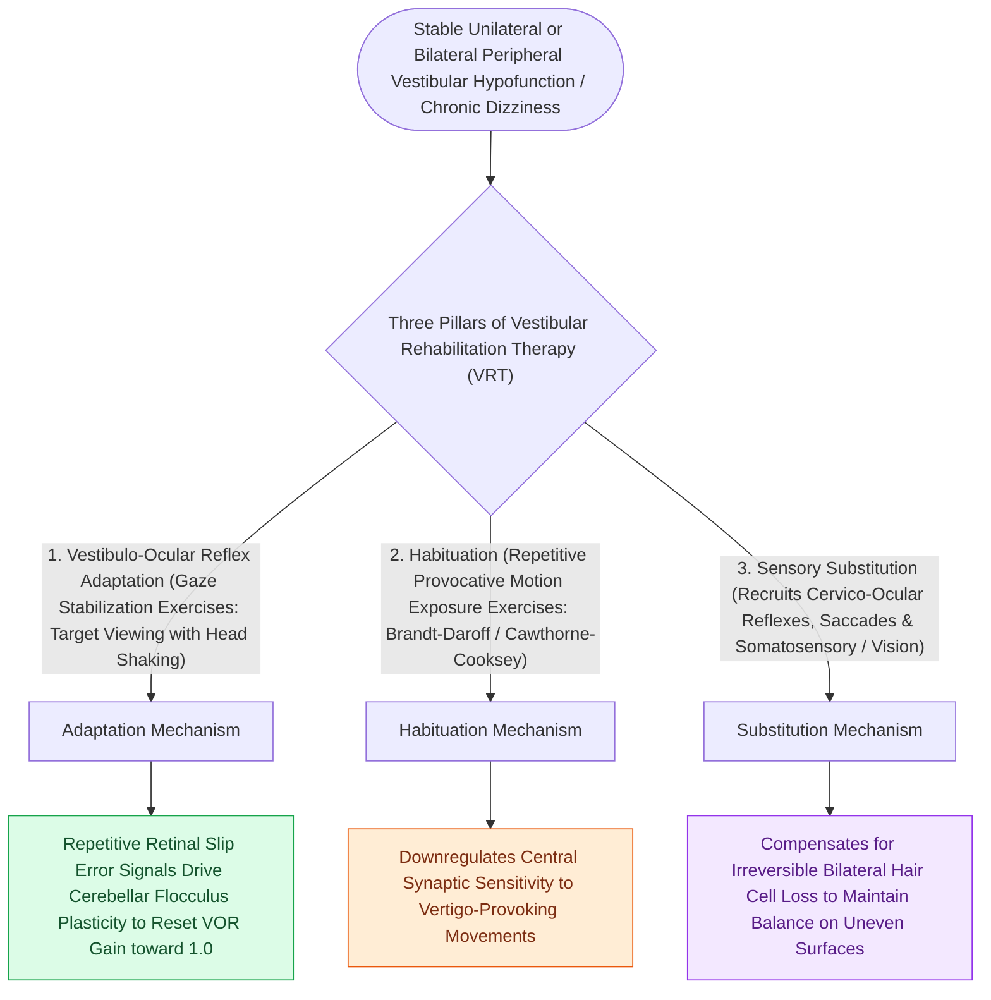

# Vestibular rehabilitation exploits adaptation habituation and substitution to recalibrate gaze and posture

## Active Recall

> [!question]- Match each mechanism to its prototype exercise.
> *Answer / Clinical Rationale*: Adaptation → X1 gaze stabilization; habituation → graded provocative motion exposure; substitution → saccadic/somatosensory strategy training.

> [!question]- Why do chronic vestibular suppressants undermine rehabilitation?
> *Answer / Clinical Rationale*: Compensation is error-signal-driven learning; suppressing the signal removes the stimulus the brain needs to recalibrate.

## Core Clinical & Mechanistic Principles
- Three mechanisms, three exercise families: **adaptation** (gaze stabilization: X1/X2 viewing driving VOR gain recalibration), **habituation** (repeated graded exposure to provocative motion/visual stimuli), **substitution** (saccadic, somatosensory, and anticipatory strategies when the labyrinth cannot recover).
- Indications with the strongest evidence: uncompensated unilateral hypofunction, [[Bilateral vestibulopathy causes oscillopsia and dark-dependent imbalance from bilateral hair cell loss|bilateral vestibulopathy]] (substitution-dominant), PPPD, and post-BPPV residual dizziness; central disorders benefit with modified expectations.
- The enemy of compensation is sensory deprivation and sedation: prolonged vestibular suppressants, inactivity, and dark quiet rooms all delay recovery.
- Repositioning maneuvers for BPPV are a separate mechanism (mechanical) and are not 'VRT' — conflating them muddles referral letters.

### Management & Critical Safety Checks
- Prescription beats suggestion: named exercises, dosed daily, progressed by symptom-guided difficulty, ideally with a vestibular-trained therapist.
- Re-test the driver of the referral (DVA, gait, provocative scores) — progress must be measured, not assumed.

## Connected Concepts & Graph Traversal
- **Acute Neuritis Recovery**: [[Vestibular neuritis causes acute spontaneous prolonged vertigo without auditory symptoms|Vestibular Neuritis Recovery]]
- **Bilateral Vestibulopathy Substitution**: [[Bilateral vestibulopathy causes oscillopsia and dark-dependent imbalance from bilateral hair cell loss|Bilateral Vestibulopathy Substitution]]
- **PPPD Habituation Therapy**: [[Persistent postural-perceptual dizziness is a chronic functional vestibular disorder treated with rehabilitation and SSRIs|PPPD Habituation Therapy]]
- **Repositioning Adjunct**: [[The Epley particle repositioning maneuver clears otoconia from the posterior canal into the utricle|Epley Repositioning Adjunct]]
- **vHIT Objective Monitoring**: [[The video head impulse test vHIT identifies high-frequency angular vestibulo-ocular reflex deficits|vHIT VOR Gain Monitoring]]
