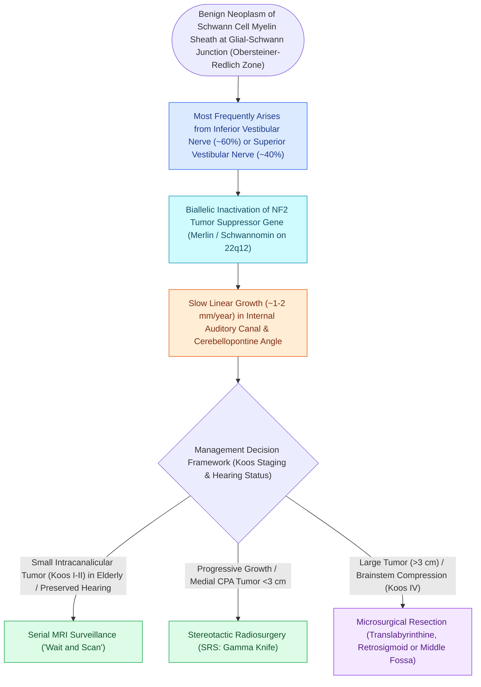

# Vestibular schwannomas arise from the Schwann cell sheath of the inferior or superior vestibular nerve

## Active Recall

> [!question]- What specific anatomical transition zone serves as the primary site of origin for vestibular schwannomas?
> *Answer / Clinical Rationale*: The **Obersteiner-Redlich zone** (the glial-Schwannian junction in the internal auditory canal).

> [!question]- What tumor suppressor gene and chromosome locus are mutated in vestibular schwannomas?
> *Answer / Clinical Rationale*: The **NF2 gene on chromosome 22q12** (encoding the merlin / schwannomin protein).

## Core Clinical & Mechanistic Principles
**Vestibular Schwannomas (Acoustic Neuromas)** are benign, slow-growing neoplasms ($8\text{–}10\%$ of all intracranial tumors, $>85\%$ of cerebellopontine angle tumors) arising from the Schwann cell myelin sheath of the vestibular nerve:
- **Site of Origin & Transition Zone**:
  - Arise at the **Obersteiner-Redlich zone (glial-Schwannian junction)**, where central oligodendroglial myelin transitions to peripheral Schwann cell myelin within the lateral internal auditory canal (IAC).
  - Arise most commonly from the **Inferior Vestibular Nerve (IVN)** or Superior Vestibular Nerve (SVN).
- **Genetic Basis**:
  - Driven by biallelic inactivation of the **NF2 tumor suppressor gene** on chromosome 22q12, which encodes the protein **merlin (schwannomin)**.
  - *Unilateral / Sporadic*: 95% of cases.
  - *Bilateral*: Diagnostic hallmark of **Neurofibromatosis Type 2 (NF2)**.
- **Clinical Presentation**:
  - **Asymmetric progressive high-frequency sensorineural hearing loss** ($>90\%$).
  - Unilateral high-pitched [[Chronic subjective tinnitus is managed with cognitive behavioral and sound-based therapy rather than cure|tinnitus]].
  - Word recognition score drop out of proportion to pure-tone threshold.
  - Mild imbalance / disequilibrium (vertigo is rare due to gradual central compensation).
  - Trigeminal nerve hypoesthesia (corneal reflex loss) in large tumors ($>2.5\text{–}3.0\text{ cm}$).

### Surgical Technique & Critical Safety Checks
- **Gold Standard Diagnostic Imaging**: **Contrast-enhanced T1-weighted MRI**, demonstrating an avidly enhancing "ice-cream cone" mass centered in the IAC and CPA with widening of the porus acusticus.

## Connected Concepts & Graph Traversal
- **Koos Staging Classification**: [[Koos grading system classifies vestibular schwannomas from Stage I intracanalicular to Stage IV brainstem compression|Koos Staging Classification]]
- **Translabyrinthine Surgery**: [[The translabyrinthine approach provides direct exposure of the internal auditory canal with complete hearing sacrifice|Translabyrinthine Approach]]
- **Retrosigmoid Hearing Preservation**: [[The retrosigmoid suboccipital approach allows hearing preservation for small to medium vestibular schwannomas|Retrosigmoid Approach]]
- **Middle Cranial Fossa Route**: [[The middle cranial fossa approach provides hearing preservation for intracanalicular schwannomas with lateral fundus extension|Middle Cranial Fossa Approach]]
- **Diagnostic ABR Latencies**: [[Auditory brainstem response waves I through V identify retrocochlear and brainstem pathology|ABR Wave I-V Interpeak Latency]]
