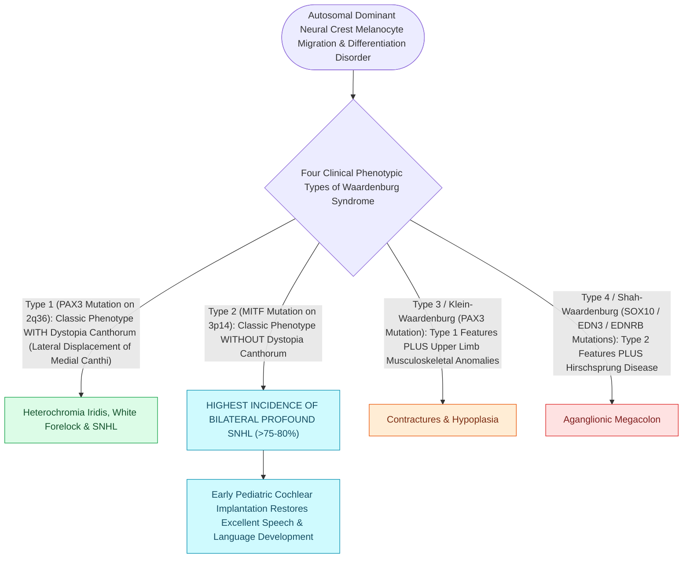

# Waardenburg syndrome causes sensorineural hearing loss with pigmentary abnormalities and dystopia canthorum

## Active Recall

> [!question]- What is the cellular mechanism and embryological origin of auditory and pigmentary defects in Waardenburg syndrome?
> *Answer / Clinical Rationale*: Waardenburg syndrome is a neurocristopathy resulting from defective proliferation, survival, and migration of **embryonic neural crest-derived melanocytes**. In the inner ear, melanocytes are essential constituents of the **stria vascularis (intermediate cells)**; their absence prevents generation of the **$+80\text{ mV}$ endocochlear potential**, causing sensorineural deafness. In cutaneous/ocular tissue, lack of melanocytes produces pigmentary anomalies.

> [!question]- What are the key clinical differences and genetic mutations across Waardenburg syndrome Types 1 through 4?
> *Answer / Clinical Rationale*: - **Type 1 (Autosomal Dominant, PAX3)**: SNHL, pigmentary anomalies, and pathognomonic **dystopia canthorum** (lateral displacement of the medial canthi with normal interpupillary distance; $W$-index $>1.95$). - **Type 2 (Autosomal Dominant, MITF / SOX10)**: SNHL and pigmentary anomalies **WITHOUT dystopia canthorum** (higher penetrance of severe SNHL, $>80\%$). - **Type 3 (Klein-Waardenburg, PAX3)**: Type 1 features + **upper limb musculoskeletal abnormalities** (hypoplasia, contractures, syndactyly). - **Type 4 (Shah-Waardenburg, EDNRB / EDN3 / SOX10)**: Type 2 features + **Hirschsprung disease** (aganglionic megacolon).

> [!question]- What are the classic pigmentary physical findings on head and neck examination?
> *Answer / Clinical Rationale*: **White forelock (poliosis, $>45\%$)**, premature graying of hair/beard, **heterochromia iridis** (complete mismatch of eye colors or sectoral/segmental iris heterochromia), brilliant sapphire "ice-blue" eyes, and **synophrys** (medial eyebrow confluence).

## Core Clinical & Mechanistic Principles
[[Syndromic pediatric sensorineural hearing loss encompasses Pendred, Usher, Waardenburg, and Jervell and Lange-Nielsen syndromes|Waardenburg syndrome]] accounts for $2\text{–}5\%$ of all congenital hearing loss, with high penetrance and variable phenotypic expressivity:

### Audiological Profiles & Management
- **Hearing Loss Manifestation**:
  - Variable from mild unifrequency loss to profound bilateral sensorineural deafness.
  - Audiometric configurations: Unilateral or bilateral; frequently flat or profound "corner" audiograms.
- **Auditory Rehabilitation**:
  - Early digital hearing aid fitting for moderate-severe loss.
  - Early bilateral cochlear implantation for profound prelingual deafness, achieving excellent speech perception scores due to intact spiral ganglion and auditory nerve pathways.

## Connected Concepts & Graph Traversal
- **Endocochlear Potential Physiology**: [[The stria vascularis generates the endocochlear potential of positive eighty millivolts|Stria Vascularis & Endocochlear Potential Generation]]
- **🔗 Syndromic SNHL Overview (Pediatrics)**: [[Syndromic pediatric sensorineural hearing loss encompasses Pendred, Usher, Waardenburg, and Jervell and Lange-Nielsen syndromes|Syndromic SNHL Overview]]
- **Cochlear Implantation**: [[Cochlear implant candidacy criteria include severe to profound bilateral sensorineural hearing loss|Cochlear Implantation Candidacy]]
- **Syndromic Differential**: [[Pendred syndrome causes sensorineural hearing loss and euthyroid goiter due to SLC26A4 mutations with enlarged vestibular aqueducts|Pendred vs Waardenburg Comparison]]
- **🔗 Genetic Non-Syndromic SNHL (Pediatrics)**: [[Connexin 26 mutations in GJB2 and congenital CMV infection are leading causes of non-syndromic pediatric sensorineural hearing loss|Connexin 26 Genetics]]
