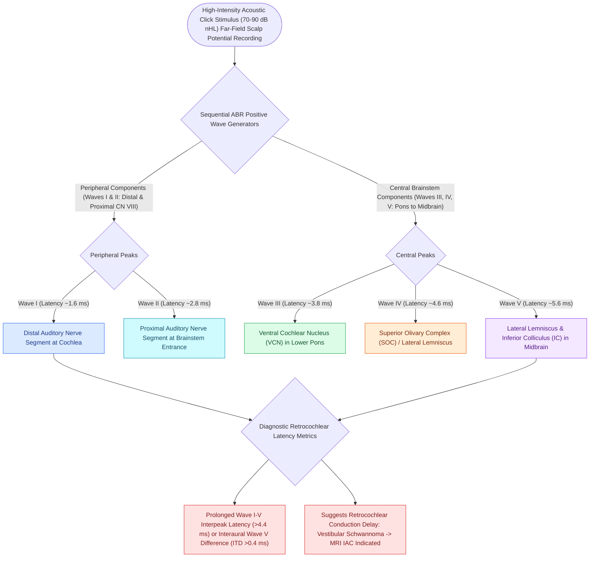

# Wave I of the ABR arises from the distal auditory nerve while wave V originates at the lateral lemniscus and inferior colliculus

## Active Recall

> [!question]- What anatomical generator is responsible for Wave V of the ABR?
> *Answer / Clinical Rationale*: The **lateral lemniscus and inferior colliculus** in the midbrain.

> [!question]- What changes in Wave V latency and amplitude during skull base surgery warn of cochlear nerve injury?
> *Answer / Clinical Rationale*: A **Wave V latency prolongation $>1.0\text{ ms}$** or an **amplitude decrease $>50\%$**.

## Core Clinical & Mechanistic Principles
Understanding the exact dipolar source generators of ABR waves is fundamental for neurotologic diagnosis and intraoperative cranial nerve monitoring:
- **Wave I Mechanics**:
  - Represents the compound action potential generated at the **unmyelinated distal dendrites and initial myelinated portion of the auditory nerve** as it exits the habenula perforata in the cochlea.
  - Can be enhanced intraoperatively using an **[[Electrocochleography SP to AP ratio exceeding zero point four indicates endolymphatic hydrops|Electrocochleography]] (ECochG) transtympanic needle** or promontory electrode.
- **Wave V Mechanics**:
  - The most robust, stable, and persistent wave down to threshold.
  - Generated primarily at the **contralateral inferior colliculus** and upper lateral lemniscus.
  - Used for objective auditory threshold estimation in infants and uncooperative patients.

### Surgical Technique & Critical Safety Checks
- **Intraoperative Monitoring Alert**: A **$>1.0\text{ ms}$ prolongation in Wave V latency** or a **$>50\%$ drop in Wave V amplitude** indicates impending stretch or ischemic injury to the cochlear nerve during [[Vestibular schwannomas arise from the Schwann cell sheath of the inferior or superior vestibular nerve|vestibular schwannoma]] resection.

## Connected Concepts & Graph Traversal
- **ABR Clinical Interpretation**: [[Auditory brainstem response waves I through V identify retrocochlear and brainstem pathology|ABR Clinical Interpretation]]
- **Retrocochlear Tumor Diagnosis**: [[Vestibular schwannomas arise from the Schwann cell sheath of the inferior or superior vestibular nerve|Vestibular Schwannoma]]
- **ANSD Diagnostic Disconnect**: [[Otoacoustic emissions evaluate outer hair cell integrity and differentiate cochlear from auditory neuropathy spectrum disorder|OAEs and ANSD]]
- **Intraoperative Skull Base Monitoring**: [[Intraoperative facial nerve and cochlear nerve monitoring minimize cranial nerve morbidity in skull base surgery|Intraoperative Cranial Monitoring]]
- **Electrocochleography Far-Field Check**: [[Electrocochleography SP to AP ratio exceeding zero point four indicates endolymphatic hydrops|ECoG Far-Field Comparison]]
