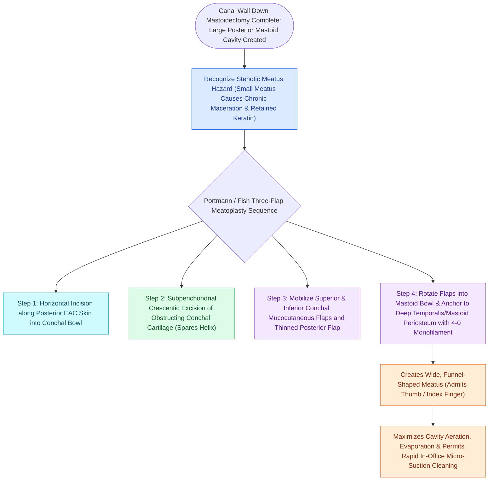

# Wide meatoplasty provides adequate aeration and easy cleaning of a canal wall down mastoid cavity

## Active Recall

> [!question]- What is the primary reason for performing a wide meatoplasty in a CWD mastoidectomy?
> *Answer / Clinical Rationale*: To provide **adequate aeration and ventilation** of the enlarged cavity and allow **easy in-office cleaning and surveillance**.

> [!question]- What tissue must be excised during a meatoplasty to prevent postoperative cicatricial narrowing?
> *Answer / Clinical Rationale*: A generous crescent of **conchal cartilage**.

## Core Clinical & Mechanistic Principles
A **wide meatoplasty** is the single most critical step determining the long-term success and dryness of a [[Canal wall down mastoidectomy lowers the facial ridge and exteriorizes the mastoid into the ear canal|Canal Wall Down]] mastoid cavity:
- **Physiological Purpose**:
  - The volume of a CWD cavity is $2\text{–}3\times$ larger than the normal ear canal.
  - A standard narrow external meatus cannot provide sufficient air exchange, leading to a warm, humid microenvironment that fosters *Pseudomonas* and *Aspergillus* overgrowth.
  - A generous meatoplasty provides **continuous ventilation**, allows **spontaneous epithelial migration**, and permits **easy in-office microscopic inspection and cleaning**.
- **Techniques (e.g., Portmann / Mirko Tos / Fish Meatoplasty)**:
  1. **Conchal Cartilage Excision**: Excise a generous crescent of conchal bowl cartilage ($1.0\text{–}1.5\text{ cm}$) through the postauricular or transcanal incision.
  2. **Skin Flap Inversion**: Create superior and inferior (or posterior) skin flaps from the posterior canal wall skin.
  3. **Fixation**: Suture the thinned conchal skin flaps to the posterior conchal cartilage / periosteum with 3-0/4-0 Vicryl to line the cavity entrance.
- **The "Thumb / Index Finger" Rule**: The completed meatoplasty should easily admit the tip of the patient's little finger or surgeon's index finger.

### Surgical Technique & Critical Safety Checks
- **Meatal Stenosis Prevention**: Generous cartilage removal and tight packing with antibiotic-impregnated ribbon gauze for 10–14 days prevents cicatricial stenosis.

## Connected Concepts & Graph Traversal
- **Canal Wall Down Mastoidectomy**: [[Canal wall down mastoidectomy lowers the facial ridge and exteriorizes the mastoid into the ear canal|CWD Mastoidectomy]]
- **Facial Ridge Lowering**: [[Lowering the facial ridge flush with the facial nerve is essential to prevent dependent cavity pooling|Facial Ridge Lowering]]
- **Mastoid Cavity Obliteration**: [[Mastoid obliteration with local muscle flaps or bioactive glass reduces cavity volume and discharge|Mastoid Obliteration]]
- **Auto-Mastoidectomy Aeration**: [[Auto-mastoidectomy occurs when chronic expansive cholesteatoma exteriorizes spontaneously into the canal|Auto-Mastoidectomy]]
- **Anatomical Foundation**: [[Canal wall up mastoidectomy preserves the posterior bony external auditory canal wall|Canal Wall Up Mastoidectomy]]
