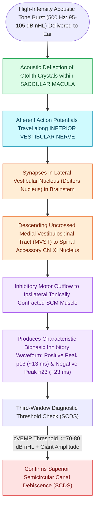

# cVEMP evaluates the saccule and inferior vestibular nerve via uncrossed sternocleidomastoid inhibition

## Active Recall

> [!question]- What is the characteristic biphasic wave complex of cVEMP and its normal peak latencies?
> *Answer / Clinical Rationale*: The **p13–n23 complex** (initial positive peak at $\approx 13\text{ ms}$, negative peak at $\approx 23\text{ ms}$).

> [!question]- Why must the patient actively contract their neck musculature during cVEMP testing?
> *Answer / Clinical Rationale*: Because cVEMP is an **inhibitory reflex**; an existing baseline motor unit contraction in the SCM is required to record the transient dip in electrical activity.

## Core Clinical & Mechanistic Principles
**Cervical Vestibular Evoked Myogenic Potential (cVEMP)** measures the vestibulocollic reflex:
- **Physiological Basis & Sensory Plane**: The **saccular macula** is oriented in the **parasagittal (vertical) plane**, making it the primary otolithic organ detecting **linear acceleration in the vertical axis** (e.g., gravitational load, elevator translation, vertical jumping).
- **Neural Reflex Arc**:
  1. Acoustic stimulus ($500\text{-Hz}$ tone burst) activates the **saccular macula**.
  2. Signal travels along the **inferior vestibular nerve (IVN)** to the lateral vestibular (Deiters) nucleus.
  3. Descends via the **medial vestibulospinal tract (MVST)** uncrossed.
  4. Inhibits motor neurons in the spinal accessory nucleus (CN XI), producing transient **ipsilateral SCM muscle inhibition**.
- **Waveform Characteristics**:
  - Biphasic waveform: Positive peak at **$\approx 13\text{ ms}$ (p13)** followed by a negative peak at **$\approx 23\text{ ms}$ (n23)**.
- **Recording Technique**:
  - Patient must actively contract the SCM (head turned against resistance or elevated supine); amplitude is proportional to tonic muscle contraction.

### Surgical Technique & Critical Safety Checks
- **Asymmetry Ratio (AR)**: $\text{AR} = \frac{|A_L - A_R|}{A_L + A_R} \times 100\%$. An $\text{AR} > 35\text{–}40\%$ indicates saccular or [[oVEMP evaluates the utricle and superior vestibular nerve via crossed inferior oblique excitation|inferior]] nerve paresis.

## Connected Concepts & Graph Traversal
- **Utricular Crossed Diagnostic Pair**: [[oVEMP evaluates the utricle and superior vestibular nerve via crossed inferior oblique excitation|oVEMP Utricular Pair]]
- **Third-Window Acoustic Thresholds**: [[Superior semicircular canal dehiscence SCDS presents with Tullio phenomenon and sound-induced vertigo|SCDS Third-Window Hypersensitivity]]
- **High-Resolution CT Poschl Views**: [[High-resolution temporal bone CT with Poschl and Stenvers reformatting confirms superior canal dehiscence|Poschl & Stenvers CT Views]]
- **Endolymphatic Hydrops Monitoring**: [[Electrocochleography SP to AP ratio exceeding zero point four indicates endolymphatic hydrops|ECoG in Hydrops]]
- **Vestibular Neuritis Localization**: [[Vestibular neuritis causes acute spontaneous prolonged vertigo without auditory symptoms|Inferior Vestibular Neuritis]]
