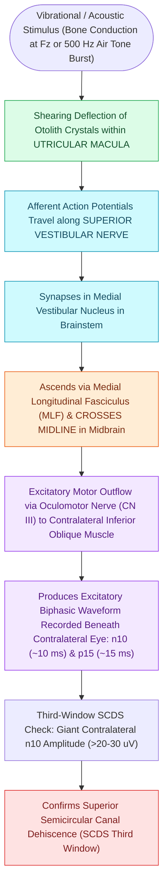

# oVEMP evaluates the utricle and superior vestibular nerve via crossed inferior oblique excitation

## Active Recall

> [!question]- What extraocular muscle is recorded during oVEMP testing, and which eye is measured relative to the stimulated ear?
> *Answer / Clinical Rationale*: The **contralateral inferior oblique muscle** (beneath the eye opposite the stimulated ear).

> [!question]- What is the initial wave complex and latency for oVEMP?
> *Answer / Clinical Rationale*: The **n10–p15 complex** (initial negative peak at $\approx 10\text{ ms}$).

## Core Clinical & Mechanistic Principles
**Ocular Vestibular Evoked Myogenic Potential (oVEMP)** evaluates the utriculo-ocular reflex:
- **Physiological Basis & Sensory Plane**: The **utricular macula** is oriented in the **horizontal plane**, making it the primary vestibular receptor detecting **linear acceleration in the horizontal axis** (e.g., car acceleration/braking, side-to-side translation) as well as static head tilt relative to gravity.
- **Neural Reflex Arc**:
  1. Sound or bone vibration activates the **utricular macula**.
  2. Signal ascends along the **superior vestibular nerve (SVN)** to the superior and medial vestibular nuclei.
  3. Decussates (crosses) via the **medial longitudinal fasciculus (MLF)** in the brainstem.
  4. Ascends to the contralateral oculomotor nucleus (CN III), causing transient **excitation of the contralateral inferior oblique extraocular muscle**.
- **Waveform Characteristics**:
  - Initial negative peak at **$\approx 10\text{ ms}$ (n10)** followed by a positive peak at **$\approx 15\text{ ms}$ (p15)**.
- **Recording Technique**:
  - Surface electrode placed on the infraorbital skin directly beneath the contralateral eye.
  - Patient maintains **maximal upward gaze ($30\text{–}35^\circ$)** to bring the inferior oblique muscle close to the recording electrode.

### Surgical Technique & Critical Safety Checks
- **Clinical Application**: Differentiates superior from inferior [[Vestibular neuritis causes acute spontaneous prolonged vertigo without auditory symptoms|vestibular neuritis]]; identifies utricular dysfunction in SCDS and otolith trauma.

## Connected Concepts & Graph Traversal
- **Saccular Uncrossed Diagnostic Pair**: [[cVEMP evaluates the saccule and inferior vestibular nerve via uncrossed sternocleidomastoid inhibition|cVEMP Saccular Pair]]
- **Third-Window Acoustic Thresholds**: [[Superior semicircular canal dehiscence SCDS presents with Tullio phenomenon and sound-induced vertigo|SCDS Third-Window Hypersensitivity]]
- **High-Resolution CT Poschl Views**: [[High-resolution temporal bone CT with Poschl and Stenvers reformatting confirms superior canal dehiscence|Poschl & Stenvers CT Views]]
- **BPPV Utricular Otoconia Source**: [[The Dix-Hallpike maneuver produces torsional upbeating nystagmus in posterior canal BPPV|Utricular Otoconia Origin]]
- **Vestibular Neuritis Localization**: [[Vestibular neuritis causes acute spontaneous prolonged vertigo without auditory symptoms|Superior Vestibular Neuritis]]
