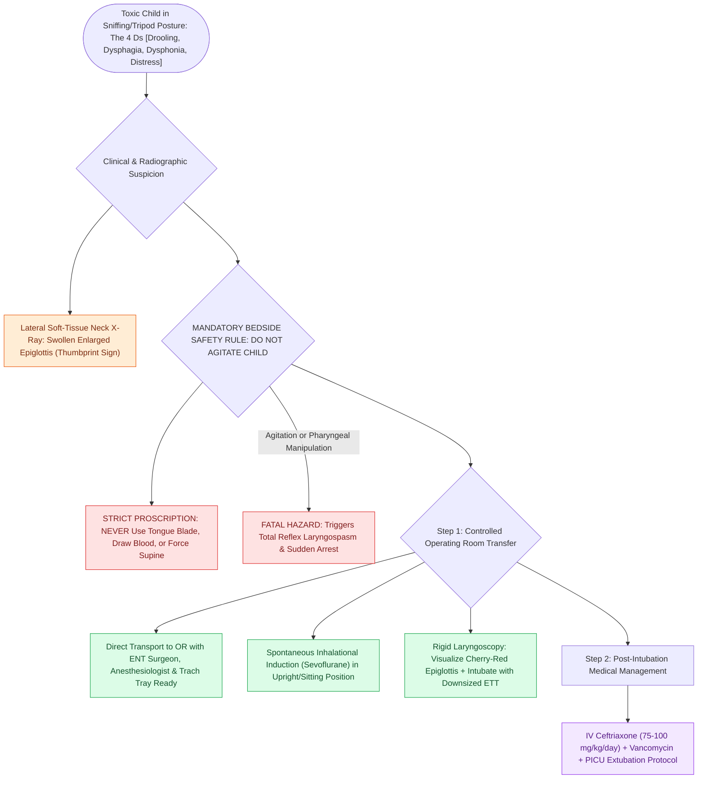

# Acute epiglottitis causes rapid supraglottic swelling with thumbprint sign and mandates controlled operating room intubation

## Active Recall

> [!question]- What are the '4 Ds' of acute epiglottitis?
> *Answer / Clinical Rationale*: **Drooling**, **Dysphagia**, **Dysphonia (muffled voice)**, and **Distress (respiratory distress)**.

> [!question]- Why should a tongue blade never be used to examine a child suspected of acute epiglottitis in the clinic or ED?
> *Answer / Clinical Rationale*: Because physical agitation or pharyngeal manipulation can trigger **sudden complete laryngospasm and fatal airway occlusion**.

## Core Clinical & Mechanistic Principles
**Acute Epiglottitis (Supraglottitis)** is a rapidly progressive, life-threatening bacterial infection of the epiglottis, aryepiglottic folds, and arytenoids:
- **Etiology & Demographics**:
  - Historically caused by *Haemophilus influenzae* type b (Hib); with widespread Hib vaccination, incidence has dropped dramatically, now seen in older children/adults caused by *Streptococcus pneumoniae*, Group A Strep (*S. pyogenes*), and *Staphylococcus aureus* (MRSA).
- **The "4 Ds" Clinical Presentation**:
  1. **Drooling** (due to severe odynophagia).
  2. **Dysphagia**.
  3. **Dysphonia** ("muffled / hot potato" voice).
  4. **Distress** (respiratory distress with high fever, toxic appearance).
  - **The "Tripod / Sniffing" Posture**: Child sits upright, leaning forward with neck hyperextended, chin thrust forward, and mouth open to maintain airway patency.
- **Radiological Sign & The "DO NOT AGITATE" Rule**:
  - **"Thumbprint Sign"** on lateral soft-tissue neck radiography: Swollen, rounded, enlarged epiglottis resembling an adult thumb.
  - **CRITICAL SAFETY RULE**: **NEVER examine the pharynx with a tongue blade or agitate the child**; acute agitation can trigger total laryngospasm and immediate cardiac arrest.

### Surgical Technique & Critical Safety Checks
- **Management**: Immediate transfer to the Operating Room with ENT and Anesthesiology; gas induction with sevoflurane; intubation with a smaller-sized ETT; IV Ceftriaxone + Vancomycin (see [[Viral laryngotracheobronchitis croup presents with a barking cough and subglottic steeple sign on radiography|Croup Presentation]]).

## Connected Concepts & Graph Traversal
- **Croup Presentation**: [[Viral laryngotracheobronchitis croup presents with a barking cough and subglottic steeple sign on radiography|Croup Presentation]]
- **Stridor Localization**: [[Inspiratory, biphasic, and expiratory stridor localize pediatric airway obstruction to supraglottic, subglottic, and tracheobronchial subsites|Stridor Localization]]
- **Pediatric Emergency**: [[High-stakes pediatric and adult sleep airway complications require rapid structured algorithmic emergency rescue|Airway Emergency Rescue]]
- **Embryological & Sleep Foundation**: [[High loop gain causes ventilatory instability and periodic breathing in sleep-disordered breathing]]
- **Sleep Endoscopy & Airway Dynamics**: [[Drug-induced sleep endoscopy DISE evaluates dynamic multi-level upper airway collapse under sedation|Drug-Induced Sleep Endoscopy (DISE)]] [[Severe secondary post-tonsillectomy hemorrhage requires urgent airway stabilization and surgical electrocautery]]
- **Congenital Airway Pathology**: [[Recurrent respiratory papillomatosis RRP is driven by HPV six and eleven causing recurrent laryngeal lesions]]
- **Open Airway Reconstruction**: [[Posterior costal cartilage grafts with a carved flange split the posterior cricoid lamina to expand the glottic lumen]]
