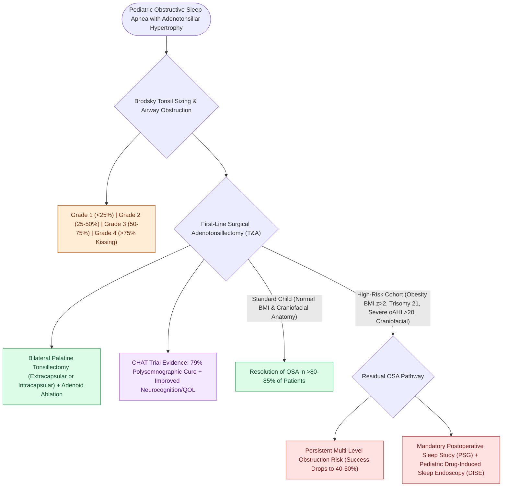

# Adenotonsillectomy is the first-line surgical treatment for pediatric obstructive sleep apnea

## Active Recall

> [!question]- What was the primary conclusion of the landmark CHAT trial regarding pediatric adenotonsillectomy for OSA?
> *Answer / Clinical Rationale*: Early adenotonsillectomy significantly **improves polysomnographic parameters ($79\%$ normalization)**, quality of life, and behavioral outcomes compared to watchful waiting.

> [!question]- What anatomical airway dimensions are scored on the Brodsky tonsil grading scale?
> *Answer / Clinical Rationale*: The **percentage of oropharyngeal airway width obstructed by the palatine tonsils** (Grade 1 to 4).

## Core Clinical & Mechanistic Principles
**Adenotonsillectomy (T&A)** is the gold standard, first-line surgical intervention for pediatric obstructive sleep apnea caused by adenotonsillar hypertrophy:
- **Efficacy & The Childhood Adenotonsillectomy Trial (CHAT)**:
  - CHAT (Marcus et al., NEJM 2013) randomized children with mild-to-moderate OSA to early T&A vs. watchful waiting.
  - **Surgical Outcomes**: Early T&A produced significant normalization of polysomnographic findings (**$79\%$ normalized PSG** vs. $46\%$ watchful waiting), dramatic improvements in quality of life, daytime behavior, executive function, and reduction in healthcare utilization.
- **Surgical Anatomical Goals**:
  - Resection of the **palatine tonsils** expands the oropharyngeal lateral airway dimensions.
  - Curettage, suction coagulator, or microdebrider ablation of the **pharyngeal adenoid pad** relieves nasopharyngeal obstruction and restores nasal breathing.
- **Brodsky Tonsil Sizing Scale**:
  - **Grade 1**: Tonsils in tonsillar pillar ($<25\%$ airway obstruction).
  - **Grade 2**: Tonsils extend beyond pillars ($25\text{–}50\%$).
  - **Grade 3**: Tonsils extend beyond pillars ($50\text{–}75\%$).
  - **Grade 4 ("Kissing Tonsils")**: Tonsils touch each other in midline ($>75\%$).

### Surgical Technique & Critical Safety Checks
- **Persistent OSA Risk Factors**: Obesity ($\text{BMI } z\text{-score} > 2$), severe baseline OSA ($\text{oAHI} > 20$), Down syndrome, craniofacial dysmorphism, and age $>7\text{ years}$ (success rate drops to $40\text{–}50\%$, requiring post-op PSG and DISE) (see [[Pediatric endoscopic sinus surgery employs a stepwise escalation algorithm following adenoidectomy and preserves midfacial growth centers through conservative mucosal sparing dissection|Pediatric ESS Escalation]]).

## Connected Concepts & Graph Traversal
- **🔗 Pediatric Sinus Surgery Escalation (Rhinology)**: [[Pediatric endoscopic sinus surgery employs a stepwise escalation algorithm following adenoidectomy and preserves midfacial growth centers through conservative mucosal sparing dissection|Pediatric ESS Escalation]] is the next surgical tier when adenoidectomy alone fails to resolve refractory pediatric rhinosinusitis.
- **Paradise Criteria**: [[Paradise criteria define evidence-based indications for pediatric tonsillectomy in recurrent throat infections|Paradise Criteria for Tonsillitis]]
- **Tonsillectomy Techniques**: [[Extracapsular total tonsillectomy and intracapsular subtotal tonsillotomy differ in postoperative hemorrhage and recovery|Extracapsular vs Intracapsular Techniques]]
- **High-Risk Admission**: [[High-risk pediatric criteria mandate overnight inpatient admission following adenotonsillectomy|Mandatory Overnight Inpatient Criteria]]
- **Pediatric PSG**: [[Pediatric polysomnography criteria define obstructive sleep apnea with an obstructive apnea-hypopnea index exceeding one|Pediatric Polysomnography (oAHI)]]
- **Pediatric DISE**: [[Pediatric DISE identifies persistent multi-level airway collapse following adenotonsillectomy|Pediatric Drug-Induced Sleep Endoscopy]]
- **Post-Tonsillectomy Hemorrhage**: [[Post-tonsillectomy hemorrhage is classified into primary within twenty-four hours and secondary beyond twenty-four hours|Post-Tonsillectomy Hemorrhage Protocol]]
