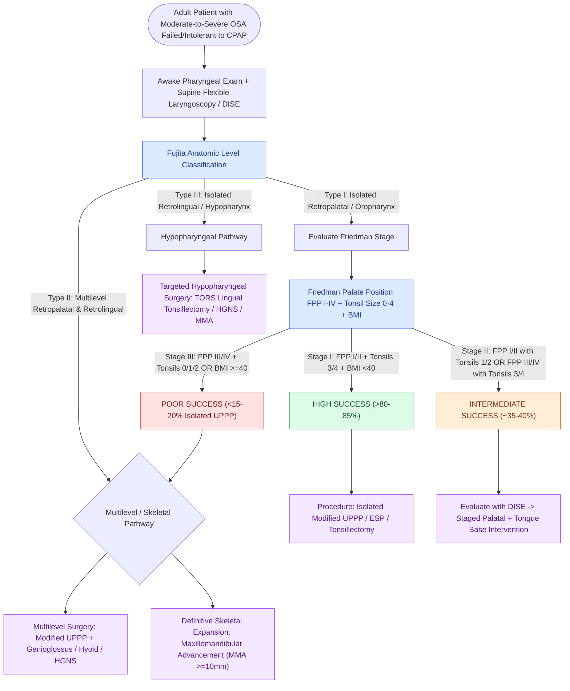

# Adult obstructive sleep apnea surgical staging synthesizes anatomical Fujita levels of collapse with the Friedman clinical staging system to predict surgical response

## Active Recall

> [!question]- How does the anatomical site classification of Fujita differ from the clinical examination staging of Friedman, and why must both be integrated?
> *Answer / Clinical Rationale*: The **Fujita classification** defines the **anatomic level(s) of upper airway collapse** based on physical examination and dynamic endoscopy: **Type I** is isolated retropalatal / oropharyngeal; **Type II** is multilevel (retropalatal and retrolingual); and **Type III** is isolated retrolingual / hypopharyngeal. In contrast, the **Friedman clinical staging system** incorporates objective awake anatomical examination metrics—**Friedman palate position (FPP I–IV)**, **Friedman tonsil size (FT 0–4+)**, and **body mass index (BMI <40 vs $\ge 40\text{ kg/m}^2$)**—to predict operative response. Integrating both prevents surgical failure by ensuring that patients with hypopharyngeal collapse (Fujita II/III or Friedman Stage III) are not subjected to isolated palatal surgery (UPPP), which succeeds only in isolated retropalatal disease.

> [!question]- How does the physical examination maneuver for Friedman palate position (FPP) differ from the modified Mallampati position, and what are the surgical response rates for Friedman Stages I, II, and III?
> *Answer / Clinical Rationale*: In the **Friedman palate position (FPP)**, the patient sits upright with the mouth opened widely and the **tongue at rest inside the oral cavity without phonation or protrusion** (reflecting natural sleeping airway caliber). In the traditional **modified Mallampati** exam, the tongue is voluntarily protruded with phonation. For isolated uvulopalatopharyngoplasty (UPPP), surgical success (defined as $\ge 50\%$ reduction in AHI and postop $\text{AHI} < 20$) is **$>80\%\text{ to }85\%$ for Friedman Stage I** (FPP I/II, FT 3/4, BMI $<40$), **$35\%\text{ to }40\%$ for Friedman Stage II** (FPP I/II with FT 1/2, OR FPP III/IV with FT 3/4), and **$<15\%\text{ to }20\%$ for Friedman Stage III** (FPP III/IV with FT 0/1/2).

> [!question]- What surgical sequence is indicated when a patient presents with Fujita Type II obstruction and Friedman Stage III clinical anatomy?
> *Answer / Clinical Rationale*: Friedman Stage III patients with Fujita Type II collapse possess severe retroglossal crowding (high palate / tongue base hypertrophy / small tonsils). Isolated UPPP has an unacceptably high failure rate ($>80\%$). These patients require comprehensive **multilevel sleep surgery** or skeletal expansion: either staged/concurrent oropharyngeal and hypopharyngeal intervention (e.g., modified UPPP or expansion sphincter pharyngoplasty combined with genioglossus advancement, hyoid suspension, or hypoglossal nerve stimulation), or definitive maxillomandibular advancement (MMA) achieving $>10\text{ mm}$ skeletal expansion.

## Core Clinical & Mechanistic Principles

Surgical management of adult obstructive sleep apnea (OSA) requires meticulous anatomical mapping to match the site(s) of dynamic airway collapse with targeted surgical procedures. Historical unselected uvulopalatopharyngoplasty (UPPP) yielded overall success rates of only $\sim 40\%\text{ to }50\%$. The synthesis of **Fujita anatomic levels** and **Friedman clinical stages** establishes an evidence-based framework that stratifies patients from high-success isolated palatal candidates to complex multilevel or skeletal candidates.

### Fujita Airway Level Classification

The Fujita classification divides the upper airway into three discrete functional subsites:
1. **Fujita Type I (Retropalatal / Oropharynx Only)**:
   - Obstruction is restricted to the region from the posterior border of the hard palate to the free edge of the soft palate and uvula, including palatine tonsillar hypertrophy and lateral pharyngeal wall collapse.
   - Ideal anatomic subsite for isolated palatopharyngeal procedures (modified UPPP, expansion sphincter pharyngoplasty, or palatal stiffening).
2. **Fujita Type II (Multilevel: Retropalatal and Retrolingual)**:
   - Simultaneous collapse at both the retropalatal and retroglossal levels.
   - Most common clinical presentation in unselected adult OSA ($>60\%\text{ to }70\%$ of surgical candidates).
   - Requires staged or concurrent multilevel airway procedures (e.g., palatopharyngoplasty combined with tongue base reduction, genioglossus advancement, or hypoglossal neurostimulation).
3. **Fujita Type III (Retrolingual / Hypopharynx Only)**:
   - Obstruction localized solely below the free margin of the soft palate, extending to the base of the tongue, epiglottis, and hypopharyngeal lateral walls.
   - Isolated palatal resection is completely ineffective; requires hypopharyngeal surgery or skeletal repositioning.

### Friedman Clinical Staging System

The Friedman staging system correlates resting oral cavity anatomy with surgical success following isolated UPPP:

| Friedman Clinical Stage | Palate Position (FPP) | Tonsil Size (FT) | Body Mass Index (BMI) | Predicted Isolated UPPP Success Rate | Recommended Surgical Strategy |
| :--- | :--- | :--- | :--- | :--- | :--- |
| **Stage I** | Position I or II | Grade 3 or 4 | $<40\text{ kg/m}^2$ | **$>80\%\text{ to }85\%$** | Isolated Modified UPPP or Expansion Sphincter Pharyngoplasty (ESP) |
| **Stage II** | Position I or II Position III or IV | Grade 1 or 2 Grade 3 or 4 | $<40\text{ kg/m}^2$ | **$35\%\text{ to }40\%$** | Preoperative DISE; targeted multilevel surgery or modified UPPP with close monitoring |
| **Stage III** | Position III or IV | Grade 0, 1, or 2 | Any BMI (or BMI $\ge 40$) | **$<15\%\text{ to }20\%$** | **Isolated UPPP contraindicated**; comprehensive multilevel surgery, HGNS, or MMA |

### Modified Mallampati vs. Friedman Palate Examination Technique

- **Modified Mallampati Palate Position** *(Fig 9.3)*:
  - Assessed with the patient sitting upright, mouth open widely, **tongue maximally protruded WITHOUT phonation**.
  - **Class I**: Soft palate, fauces, uvula, and bilateral pillars clearly visible.
  - **Class II**: Soft palate, fauces, and uvula visible; pillars hidden.
  - **Class III**: Soft palate and base of uvula visible; posterior pharyngeal wall obscured.
  - **Class IV**: Only hard palate visible; soft palate completely obscured.
- **Friedman Palate Position (FPP)**:
  - Assessed with the patient sitting upright, mouth open widely, **tongue at rest in neutral position in floor of mouth WITHOUT protrusion and WITHOUT phonation** (repeated 5 times to ensure reproducibility).
  - **Position I**: Entire uvula and tonsils/pillars visible.
  - **Position II**: Uvula visible; tonsils/pillars partially obscured.
  - **Position III**: Soft palate visible; uvula obscured.
  - **Position IV**: Only hard palate visible.

Comprehensive anatomical and therapeutic integration links these principles directly to [[Maxillomandibular advancement MMA advances the skeletal framework by ten to twelve millimeters to expand the upper airway|Maxillomandibular Advancement Technique]].

## Connected Concepts & Graph Traversal
- **Palatal Resection Craft**: [[Modified uvulopalatopharyngoplasty UPPP resects redundant palatal tissue while preserving muscular function|Modified UPPP Surgical Technique]]
- **Tonsil & Palate Scoring**: [[The Friedman staging system correlates tonsil size and palate position with uvulopalatopharyngoplasty success|Friedman Staging System]]
- **Lateral Wall Splinting**: [[Relocating the palatopharyngeus anterolaterally splints the lateral pharyngeal walls in expansion pharyngoplasty|Expansion Sphincter Pharyngoplasty]]
- **Endoscopic Sleep Assessment**: [[VOTE classification standardizes drug-induced sleep endoscopy findings across velum, oropharynx, tongue base, and epiglottis|VOTE Classification]]
- **Hypoglossal Neuromodulation**: [[Inclusion criteria for hypoglossal nerve stimulation include BMI less than thirty-five and absence of complete concentric collapse|HGNS Candidacy Criteria]]
