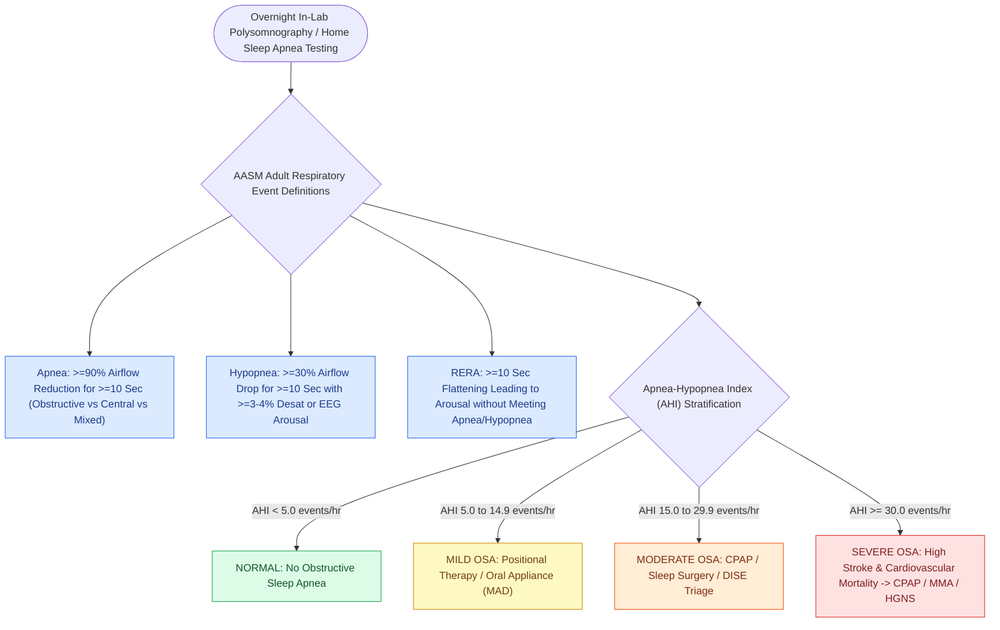

# Adult polysomnography criteria define obstructive sleep apnea severity by apnea-hypopnea index thresholds of five, fifteen, and thirty

## Active Recall

> [!question]- What are the Apnea-Hypopnea Index (AHI) cutoff thresholds for mild, moderate, and severe OSA in adults?
> *Answer / Clinical Rationale*: **Mild: 5–14.9 events/hr**; **Moderate: 15–29.9 events/hr**; **Severe: $\ge 30$ events/hr**.

> [!question]- What is the minimum duration required to score an apnea or hypopnea event in adult polysomnography?
> *Answer / Clinical Rationale*: At least **$10\text{ seconds}$**.

## Core Clinical & Mechanistic Principles
In adults, the diagnosis and severity classification of **Obstructive Sleep Apnea (OSA)** is established via overnight **Polysomnography (PSG)** or Home Sleep Apnea Testing (HSAT):
- **Adult Event Definitions (AASM Manual v2.6)**:
  - **Apnea**: Drop in nasal airflow by $\ge 90\%$ from baseline lasting for **$\ge 10\text{ seconds}$**:
    - *Obstructive*: Continued or increased inspiratory effort throughout event.
    - *Central*: Absent respiratory effort throughout event.
    - *Mixed*: Absent effort initially, followed by resumption of effort.
  - **Hypopnea**: Drop in airflow by $\ge 30\%$ for $\ge 10\text{ seconds}$ associated with either $\ge 3\%$ (or $4\%$) oxygen desaturation or an EEG arousal.
- **Adult AHI Severity Categories**:
  - **Normal**: $\text{AHI} < 5\text{ events/hour}$.
  - **Mild OSA**: $\mathbf{\text{AHI} = 5.0\text{ to }14.9\text{ events/hour}}$.
  - **Moderate OSA**: $\mathbf{\text{AHI} = 15.0\text{ to }29.9\text{ events/hour}}$.
  - **Severe OSA**: $\mathbf{\text{AHI} \ge 30.0\text{ events/hour}}$.
- **Respiratory Disturbance Index (RDI)**:
  - Includes apneas + hypopneas + **Respiratory Effort-Related Arousals (RERAs)** per hour of sleep.

### Surgical Technique & Critical Safety Checks
- **Clinical Significance**: Moderate-to-severe OSA ($\text{AHI} \ge 15$) carries substantial independent risk for systemic hypertension, coronary artery disease, stroke, and motor vehicle accidents (see [[Pediatric polysomnography criteria define obstructive sleep apnea with an obstructive apnea-hypopnea index exceeding one|Pediatric PSG]]).

## Connected Concepts & Graph Traversal
- **Pediatric PSG**: [[Pediatric polysomnography criteria define obstructive sleep apnea with an obstructive apnea-hypopnea index exceeding one|Pediatric PSG]]
- **Non-Anatomical Endotypes**: [[Loop gain, arousal threshold, and muscle responsiveness represent the non-anatomical endotypes of obstructive sleep apnea|Non-Anatomical Endotypes]]
- **Modified UPPP**: [[Modified uvulopalatopharyngoplasty UPPP resects redundant palatal tissue while preserving muscular function|Modified UPPP]]
- **Diagnostic Evaluation**: [[Polysomnographic event criteria differentiate obstructive, central, and mixed apneas through airflow sensors and thoracoabdominal effort monitoring|Sensor-Level Event Scoring Underlying AHI]]
