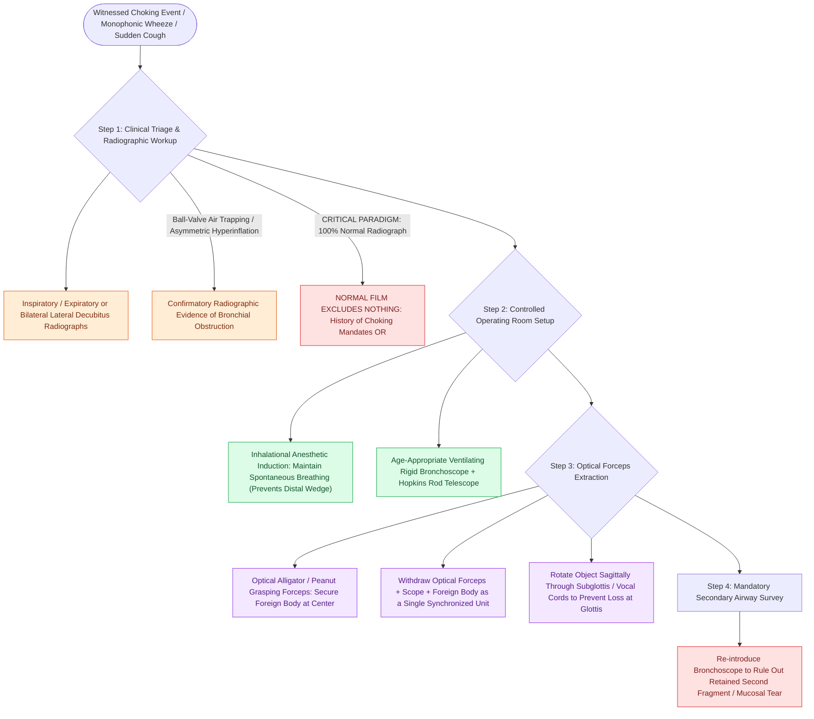

# Airway foreign body aspiration mandates rigid bronchoscopy despite normal radiographs

## Active Recall

> [!question]- Why do organic foreign bodies outrank plastic ones in urgency despite identical geometry?
> *Answer / Clinical Rationale*: Organic material is radiolucent, absorbs water and swells, and incites granulation — obstruction worsens with time and removal difficulty compounds.

> [!question]- What film technique reveals ball-valve air trapping in an uncooperative toddler?
> *Answer / Clinical Rationale*: Lateral decubitus views: the dependent obstructed lung fails to deflate — asymmetric persistent inflation replaces the expiratory film a toddler cannot perform.

## Core Clinical & Mechanistic Principles
- Epidemiology and physics: toddlers, organic material (nuts, seeds — radiolucent, inflammatory, swelling), **right mainstem preference**; the triad of cough/wheeze/decreased breath sounds is present in a minority — **the witnessed choking event is the most sensitive 'test.'**
- Radiographs are supporting actors: **air trapping with asymmetric hyperinflation** on expiratory or lateral decubitus films (ball-valve physiology), atelectasis, or nothing at all — **a normal film excludes nothing** when the history says choking.
- Complete obstruction at the larynx is BLS territory (age-appropriate back blows/chest thrusts vs abdominal thrusts); the stable partial obstruction goes to the OR, not to observation.
- Delayed presentations masquerade as unilateral 'asthma' or recurrent same-lobe pneumonia — the chronic missed peanut is a classic morbidity story.

### Management & Critical Safety Checks
- **Rigid bronchoscopy under general anesthesia** with spontaneous ventilation preference is diagnostic and therapeutic: optical forceps, ventilation through the scope, and a plan (with cardiothoracic backup for distal/impacted disease).
- Team choreography beats speed: anesthesia alignment on induction/ventilation strategy, sized equipment laid out, and the parent's history retold in the room (see [[Pediatric esophageal button battery impaction causes liquefaction necrosis within two hours and mandates emergent endoscopic extraction|Esophageal FB Emergency]]).

## Connected Concepts & Graph Traversal
- **Esophageal Counterpart**: [[Pediatric esophageal button battery impaction causes liquefaction necrosis within two hours and mandates emergent endoscopic extraction|Esophageal FB Emergency]]
- **Stridor Physiology**: [[Pediatric stertor and stridor differentiate upper supraglottic airway obstruction from intrathoracic tracheobronchial disease|Localizing Airway Noise]]
- **Infectious Mimics**: [[Viral laryngotracheobronchitis croup presents with a barking cough and subglottic steeple sign on radiography|Croup Mimic]]
- **Tracheobronchial Endoscopy**: [[Tracheobronchial foreign body aspiration presents with choking and air trapping requiring rigid bronchoscopy|Tracheobronchial Aspiration]]
- **Subglottic Sizing**: [[Myer-Cotton grading system stratifies subglottic stenosis from Grade I less than fifty percent to Grade IV no lumen|Subglottic Stenosis Sizing]]
