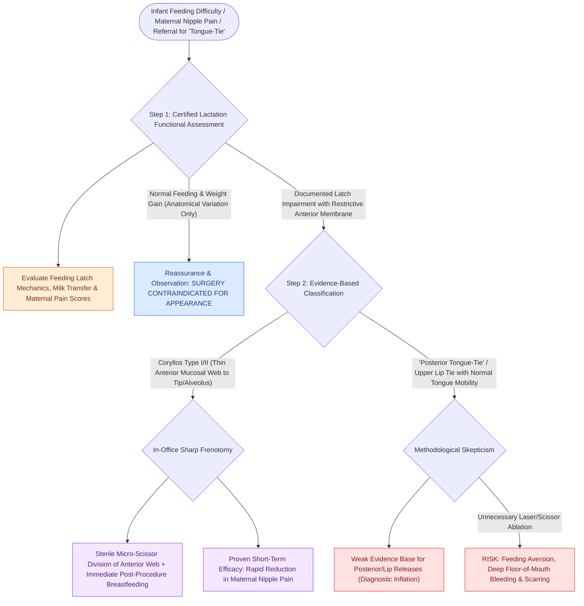

# Ankyloglossia release is indicated for functional breastfeeding impairment rather than appearance

## Active Recall

> [!question]- What is the actual evidence-supported benefit of infant frenotomy?
> *Answer / Clinical Rationale*: Short-term reduction in maternal nipple pain during breastfeeding; effects beyond that (milk transfer, weight gain, speech) are inconsistently demonstrated.

> [!question]- How should a referral for 'posterior tongue-tie with lip tie' be approached?
> *Answer / Clinical Rationale*: With functional lactation assessment and skepticism — diagnostic criteria are soft, evidence for release is weak, and complications of unnecessary procedures are not zero.

## Core Clinical & Mechanistic Principles
- The indication is **function**: maternal nipple pain and inefficient latch/transfer with a restrictive frenulum — not the frenulum's appearance; classification systems (Coryllos anatomic, Hazelbaker functional) describe more reliably than they predict.
- Evidence, honestly weighed: randomized data support frenotomy for **reducing maternal nipple pain** short-term; effects on milk transfer and long-term outcomes are less consistent — which argues for lactation evaluation before and after, not reflexive clipping.
- **'Posterior tongue-tie' and upper-lip-tie** releases ride a diagnostic inflation wave with weak supporting evidence — methodological skepticism is the professional position, and over-treatment has real complications (bleeding, oral aversion, scarring).
- Older-child indications shift to articulation and mechanics (lingual sweep, wind instruments) with speech pathology assessment leading.

### Management & Critical Safety Checks
- Infant frenotomy: office scissors/laser release of the anterior membranous frenulum with immediate feeding; ties that are thick, posterior, or in an older child move to controlled settings.
- The workflow is team-shaped: lactation consultation precedes the blade, and persistent feeding trouble after release re-opens the differential rather than the wound (see [[Pierre Robin sequence manifests with micrognathia, glossoptosis, and secondary U-shaped cleft palate|Pierre Robin Sequence]]).

## Connected Concepts & Graph Traversal
- **Robin Sequence Cleft**: [[Pierre Robin sequence manifests with micrognathia, glossoptosis, and secondary U-shaped cleft palate|Pierre Robin Sequence]]
- **Palatoplasty Repairs**: [[Two-flap palatoplasty and Furlow double-reversing Z-plasty reconstruct the hard and soft palate musculature|Palatoplasty Repairs]]
- **Sialorrhea Management**: [[Pediatric sialorrhea is managed along a ladder from anticholinergics and botulinum toxin to duct surgery|Pediatric Sialorrhea]]
- **Speech Velopharyngeal Port**: [[Velopharyngeal insufficiency VPI causes hypernasal resonance and nasal air emission during speech|Velopharyngeal Insufficiency]]
- **Cleft Anatomy Prominences**: [[Unilateral and bilateral cleft lip and palate result from failure of fusion of the maxillary and medial nasal prominences|Cleft Embryology]]
