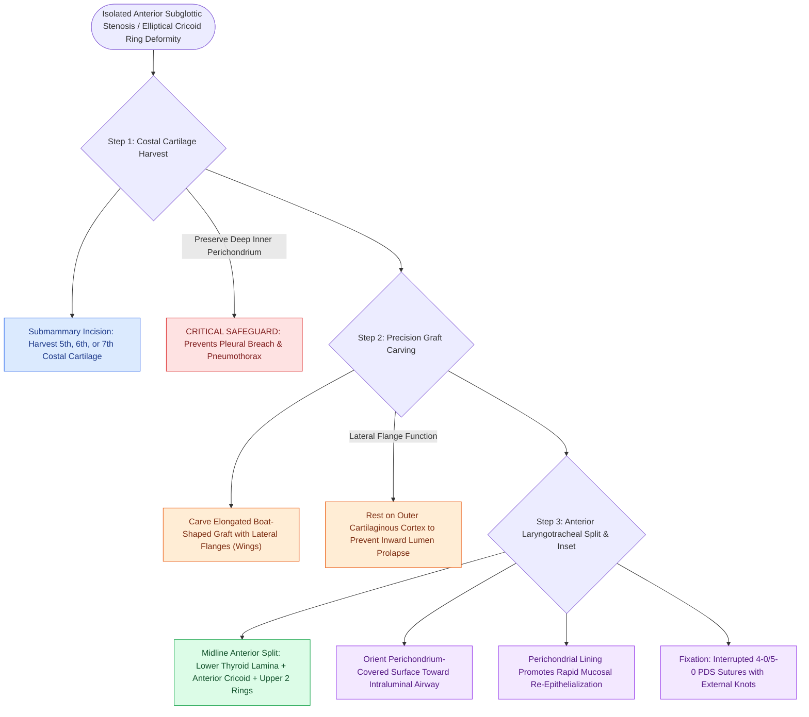

# Anterior costal cartilage grafts expand the thyroid and cricoid cartilage framework

## Active Recall

> [!question]- Why are lateral flanges (wings) carved into an anterior costal cartilage graft during LTR?
> *Answer / Clinical Rationale*: To rest securely on the outer cortical surface of the thyroid and cricoid cartilage, **preventing the graft from falling inward into the airway lumen**.

> [!question]- Which surface of the harvested costal cartilage graft is oriented toward the airway lumen, and why?
> *Answer / Clinical Rationale*: The **perichondrium-lined surface**, because it promotes **rapid mucosal re-epithelialization** and prevents cartilage granulation/necrosis.

## Core Clinical & Mechanistic Principles
**Anterior costal cartilage grafting** is indicated for isolated anterior subglottic stenosis, [[Congenital subglottic stenosis results from incomplete recanalization of the laryngeal lumen during embryogenesis|elliptical cricoid]] cartilage deformities, or anterior soft-tissue webs:
- **Graft Harvesting & Preparation**:
  - Harvested from the **5th, 6th, or 7th true costal cartilage** through a small submammary incision (preserving the inner perichondrium to prevent pneumothorax).
  - The cartilage is carved into an **elongated, boat-shaped (elliptical) contour** with lateral flanges or lateral grooves:
    - *Central Core*: Protrudes into the split cartilaginous defect to expand the lumen.
    - *Flanges (Wings)*: Rest on the outer surface of the thyroid and cricoid cartilage to **prevent inward displacement / collapse into the airway lumen**.
- **Surgical Inset Technique**:
  1. Perform an anterior vertical midline split through the lower half of the thyroid cartilage, the cricoid ring, and the upper 1–2 tracheal rings.
  2. Inset the carved graft with the **perichondrial layer facing the intraluminal airway mucosa** (promotes rapid re-epithelialization).
  3. Secure the graft to the native cartilages with interrupted **4-0 or 5-0 polydioxanone (PDS) or Prolene sutures** with knots tied externally.

### Surgical Technique & Critical Safety Checks
- **Perichondrium Rule**: Always place the perichondrium-covered surface toward the airway lumen to prevent cartilage necrosis and stimulate epithelial migration.

## Connected Concepts & Graph Traversal
- **LTR Reconstruction**: [[Single-stage and double-stage laryngotracheal reconstruction LTR repair mature high-grade subglottic stenosis|LTR Reconstruction]]
- **Posterior Costal Graft**: [[Posterior costal cartilage grafts with a carved flange split the posterior cricoid lamina to expand the glottic lumen|Posterior Costal Cartilage Graft]]
- **Single-Stage LTR**: [[Single-stage LTR utilizes an endotracheal tube as a temporary stent avoiding tracheostomy placement|Single-Stage LTR]]
- **Embryological & Sleep Foundation**: [[Third and fourth branchial pouch anomalies present as recurrent left thyroid bed abscesses and piriform sinus fistulas]]
- **Sleep Endoscopy & Airway Dynamics**: [[Drug-induced sleep endoscopy DISE evaluates dynamic multi-level upper airway collapse under sedation|Drug-Induced Sleep Endoscopy (DISE)]] [[Severe secondary post-tonsillectomy hemorrhage requires urgent airway stabilization and surgical electrocautery]]
- **Congenital Airway Pathology**: [[Myer-Cotton grading system stratifies subglottic stenosis from Grade I less than fifty percent to Grade IV no lumen]]
- **Open Airway Reconstruction**: [[Innominate artery compression syndrome causes dynamic anterior tracheal pulsatile collapse]]
