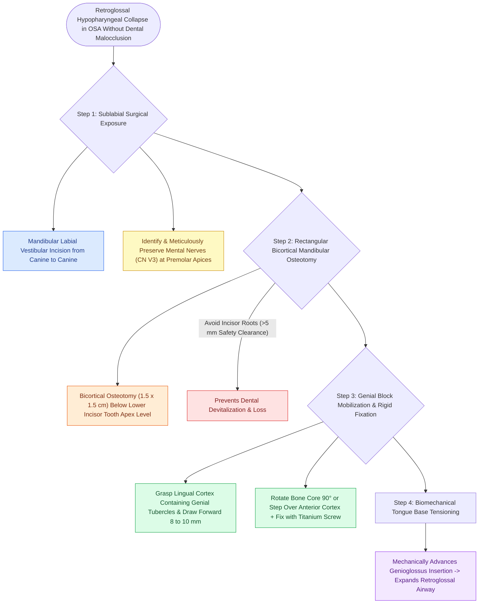

# Anterior mandibular osteotomy and genial tubercle advancement advance the genioglossus insertion without dental osteotomy

## Active Recall

> [!question]- What muscle insertion is mechanically advanced during a Genial Tubercle Advancement (GTA)?
> *Answer / Clinical Rationale*: The **genioglossus muscle** (originating from the genial tubercles/mental spines).

> [!question]- What major sensory nerve must be identified and preserved during the sublabial approach for GTA?
> *Answer / Clinical Rationale*: The **mental nerve (branch of CN V3)** as it exits the mental foramen.

## Core Clinical & Mechanistic Principles
**Genial Tubercle Advancement (GTA / Genioglossus Advancement)** is a skeletal procedure that advances the muscular insertion of the **[[Geniohyoid and genioglossus muscles are primary upper airway dilators maintaining pharyngeal patency|genioglossus muscle]]** without altering dental occlusion or requiring [[Le Fort I osteotomy and bilateral sagittal split osteotomy BSSO achieve rigid skeletal advancement in MMA|BSSO]]:
- **Anatomical Basis**:
  - The genioglossus muscle originates from the **genial tubercles (mental spines)** on the lingual cortex of the mandibular symphysis.
- **Surgical Execution Protocol**:
  1. Transoral sublabial incision from canine to canine in the lower vestibular mucosa.
  2. Elevate periosteum off the anterior mandible; identify the **mental nerves (CN V3)** bilaterally at the premolar apices and preserve them.
  3. Perform a rectangular or circular bicortical osteotomy ($1.5\times 1.5\text{ cm}$) centered on the lower anterior mandible below the incisor tooth roots.
  4. The rectangular bony block containing the lingual cortex and attached genial tubercles is pulled forward **anteriorly out of the osteotomy defect by $8\text{–}10\text{ mm}$**.
  5. The bone block is rotated $90^\circ$ (or stepped) and fixed to the outer mandibular cortex with a titanium screw or plate, **tensing the genioglossus muscle and pulling the tongue base forward**.

### Surgical Technique & Critical Safety Checks
- **Clinical Role**: Frequently performed as a multi-level component in combination with UPPP or [[Hyoid suspension thyrohyoidopexy anchors the hyoid bone to the thyroid cartilage to stabilize the hypopharynx|hyoid suspension]]; does not change dental bite.

## Connected Concepts & Graph Traversal
- **MMA Advancement**: [[Maxillomandibular advancement MMA advances the skeletal framework by ten to twelve millimeters to expand the upper airway|MMA Advancement]]
- **Hyoid Suspension**: [[Hyoid suspension thyrohyoidopexy anchors the hyoid bone to the thyroid cartilage to stabilize the hypopharynx|Hyoid Suspension]]
- **TORS Tongue Base**: [[Transoral robotic surgery TORS tongue base reduction debulks lingual tonsil and midline tongue musculature in OSA|TORS Tongue Base]]
- **Embryological & Sleep Foundation**: [[Third and fourth branchial pouch anomalies present as recurrent left thyroid bed abscesses and piriform sinus fistulas]]
- **Sleep Endoscopy & Airway Dynamics**: [[Drug-induced sleep endoscopy DISE evaluates dynamic multi-level upper airway collapse under sedation|Drug-Induced Sleep Endoscopy (DISE)]] [[High-risk pediatric criteria mandate overnight inpatient admission following adenotonsillectomy]]
- **Congenital Airway Pathology**: [[Congenital bilateral vocal fold paralysis presents with severe inspiratory stridor requiring airway protection]]
- **Open Airway Reconstruction**: [[Slide tracheoplasty achieves immediate vascularized mucosal lumen doubling with lowest restenosis rates]]
