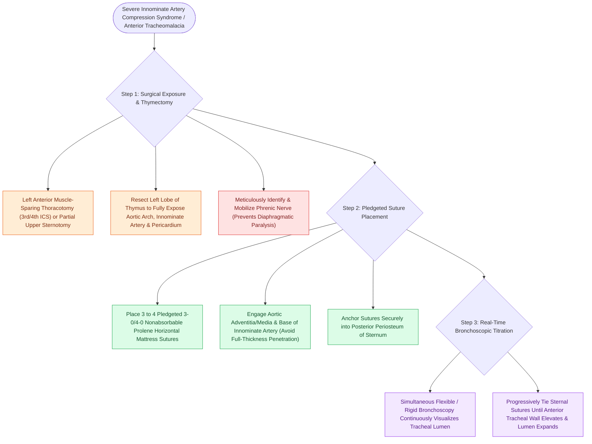

# Aortopexy suspends the aorta to the sternum to relieve anterior vascular tracheal compression

## Active Recall

> [!question]- How is the degree of surgical tension adjusted during an aortopexy?
> *Answer / Clinical Rationale*: Under **continuous intraoperative bronchoscopic visualization**, tightening sutures until the tracheal lumen is seen to expand fully.

> [!question]- What anatomical structure is the aorta sutured to during an aortopexy?
> *Answer / Clinical Rationale*: The **posterior periosteum of the sternum**.

## Core Clinical & Mechanistic Principles
**Aortopexy (and Innominate Arteriopexy)** is the primary surgical procedure for relieving anterior tracheal compression caused by the innominate artery or severe anterior [[Tracheomalacia causes dynamic expiratory tracheal collapse and is managed with posterior tracheobronchopexy|tracheomalacia]]:
- **Surgical Mechanism**:
  - The ascending aorta, aortic arch, and innominate artery are surgically tacked anteriorly to the posterior surface of the sternum.
  - This pulls the anterior vascular structures and the attached anterior tracheal wall forward, **expanding the tracheal lumen and eliminating dynamic collapse**.
- **Surgical Step-by-Step Execution**:
  1. **Approach**: Left anterior muscle-sparing thoracotomy (3rd or 4th intercostal space) or partial upper median sternotomy.
  2. **Thymectomy**: Resect the left lobe of the thymus to fully expose the aortic arch, innominate artery, and pericardium.
  3. **Suture Placement**:
     - Place **3 to 4 pledgeted 3-0 or 4-0 non-absorbable (Prolene) mattress sutures** through the adventitia and media of the ascending aorta and base of the innominate artery.
     - Pass sutures through the **posterior periosteum of the sternum**.
  4. **Intraoperative Bronchoscopic Verification**:
     - While looking through a flexible/rigid bronchoscope inside the trachea, tie the sutures under direct visual guidance until the **anterior tracheal wall lifts anteriorly and the lumen becomes widely patent**.

### Surgical Technique & Critical Safety Checks
- **Complications**: Aortic laceration/hemorrhage (prevented by avoiding full-thickness aortic penetration) and phrenic nerve injury.

## Connected Concepts & Graph Traversal
- **Innominate Compression**: [[Innominate artery compression syndrome causes dynamic anterior tracheal pulsatile collapse|Innominate Compression]]
- **Tracheomalacia**: [[Tracheomalacia causes dynamic expiratory tracheal collapse and is managed with posterior tracheobronchopexy|Tracheomalacia]]
- **Chin-to-Chest Stitch**: [[Postoperative chin-to-chest flexion stitch prevents catastrophic neck extension and tracheal anastomotic dehiscence|Chin-to-Chest Stitch]]
- **Embryological & Sleep Foundation**: [[Second branchial cleft anomalies represent the most common branchial anomaly situated anterior to the sternocleidomastoid]]
- **Sleep Endoscopy & Airway Dynamics**: [[Drug-induced sleep endoscopy DISE evaluates dynamic multi-level upper airway collapse under sedation|Drug-Induced Sleep Endoscopy (DISE)]] [[Rapid maxillary expansion widens the hard palate and nasal floor to improve pediatric nasal breathing and OSA]]
- **Congenital Airway Pathology**: [[Subglottic hemangiomas present as biphasic stridor in infants and respond to systemic oral propranolol]]
- **Open Airway Reconstruction**: [[Anterior costal cartilage grafts expand the thyroid and cricoid cartilage framework]]
