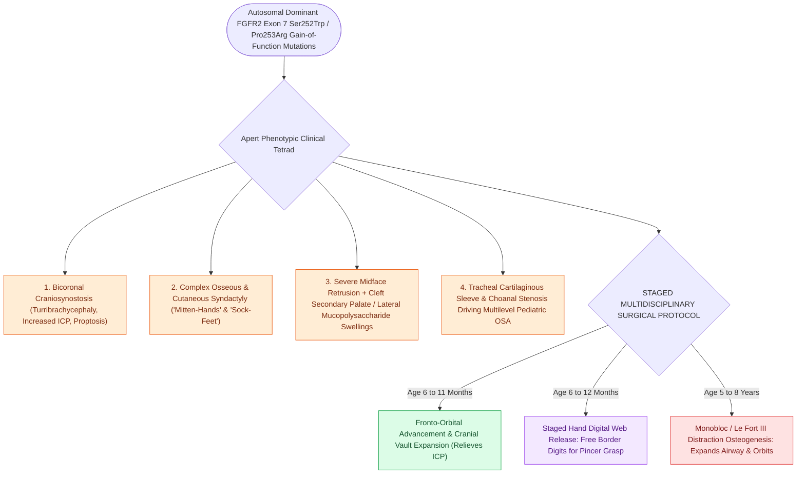

# Apert syndrome combines acrocephalosyndactyly from FGFR2 mutations with complex hand-foot syndactyly and cleft palate

## Active Recall

> [!question]- What specific FGFR2 codon mutations cause Apert syndrome, and what pathognomonic extremity malformation distinguishes it from all other craniosynostosis syndromes?
> *Answer / Clinical Rationale*: Apert syndrome is caused by specific point mutations in **FGFR2** (specifically **Ser252Trp** or **Pro253Arg** on exon 7). It is distinguished by pathognomonic **complex osseous and cutaneous syndactyly of all four extremities ("mitten-hands" and "sock-feet")**, involving fusion of digits 2, 3, and 4 (and often thumb/digit 5) sharing a common nail bed.

> [!question]- How does the oral cavity, palate, and intellectual profile of Apert syndrome contrast with Crouzon syndrome?
> *Answer / Clinical Rationale*: Patients with Apert syndrome have a high frequency of **cleft secondary palate or high-arched palate with prominent lateral palatal swellings (pseudocleft with mucopolysaccharide deposits)**, severe dental crowding, and a high incidence of **moderate-to-severe intellectual disability and non-progressive ventriculomegaly/hydrocephalus**, contrasting with the normal extremities, intact intelligence, and low cleft rates of Crouzon syndrome.

> [!question]- What otolaryngologic and airway challenges dominate the clinical management of Apert syndrome?
> *Answer / Clinical Rationale*: Severe multilevel **obstructive sleep apnea (OSA)** secondary to midface hypoplasia, choanal stenosis, and cartilaginous sleeve anomalies of the trachea (solid cartilaginous trachea without membranous posterior wall). Conductive hearing loss is ubiquitous due to chronic middle ear effusions and stapes fixation.

## Core Clinical & Mechanistic Principles
Apert syndrome (acrocephalosyndactyly Type I) occurs in $1\text{ in }65,000\text{–}88,000$ live births, driven by paternal age-dependent de novo mutations:

### Multidisciplinary Surgical Management
1. **Calvarial & Airway Decompression**:
   - Fronto-orbital advancement and cranial vault remodeling at $6\text{–}11\text{ months}$ to relieve elevated ICP.
   - Comprehensive airway evaluation including sleep endoscopy and bronchoscopy to rule out complete tracheal cartilaginous sleeves prior to any elective intubation or decannulation.
2. **Extremity Separation**:
   - Staged hand surgery by plastic/orthopedic surgery beginning at $6\text{–}12\text{ months}$ to release the border digits (thumb and small finger) to establish a functional pincer grasp.
3. **Midface Advancement**:
   - Le Fort III / Monobloc distraction osteogenesis with external halo distractor at age $5\text{–}8\text{ years}$ to advance the orbits, eliminate proptosis, and drastically expand the posterior nasopharyngeal airway space (see [[Crouzon syndrome exhibits FGFR2-mediated craniosynostosis with ocular proptosis, midface hypoplasia, and normal extremities|Crouzon vs Apert Distinction]]).

## Connected Concepts & Graph Traversal
- **Craniosynostosis Differential**: [[Crouzon syndrome exhibits FGFR2-mediated craniosynostosis with ocular proptosis, midface hypoplasia, and normal extremities|Crouzon vs Apert Distinction]]
- **Cleft Palate Repair**: [[Two-flap palatoplasty and Furlow double-reversing Z-plasty reconstruct the hard and soft palate musculature|Palatoplasty Craft in Syndromes]]
- **Pediatric Airway Staging**: [[Pediatric stertor and stridor differentiate upper supraglottic airway obstruction from intrathoracic tracheobronchial disease|Airway Staging & Tracheal Sleeves]]
- **Branchial Syndromic Differential**: [[Treacher Collins syndrome results from TCOF1 mutations causing mandibulofacial dysostosis and conductive hearing loss|Treacher Collins Comparison]]
- **Pediatric PSG**: [[Pediatric polysomnography criteria define obstructive sleep apnea with an obstructive apnea-hypopnea index exceeding one|Polysomnography in Craniofacial Syndromes]]
- **Disease Mechanism**: [[Pediatric skull base synchondroses guide craniofacial growth and ossify in a predictable sequence from anterior to posterior|Premature Synchondrosis Fusion in Apert]]
- **FGFR Craniosynostosis Differential**: [[Pfeiffer syndrome features FGFR1 and FGFR2 mutations causing bicoronal craniosynostosis, broad thumbs and great toes, and severe midface hypoplasia|Pfeiffer Syndrome]]
