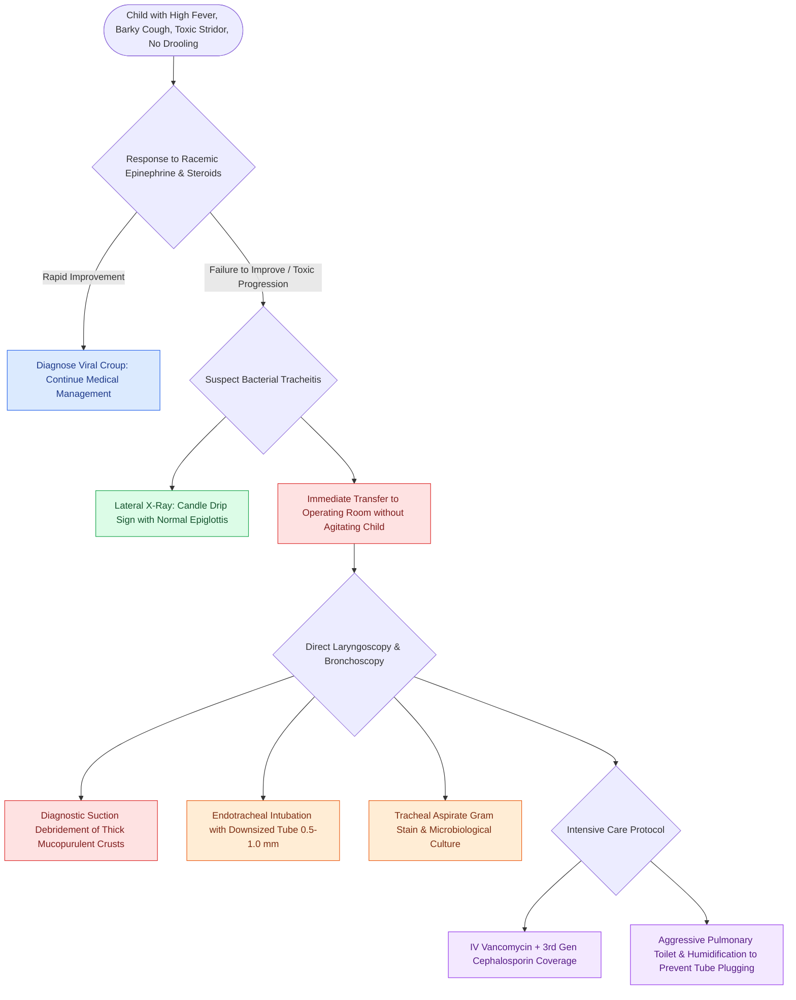

# Bacterial tracheitis presents with toxic croup-like stridor, high fever, and thick subglottic mucopurulent pseudomembranes requiring urgent airway debridement

## Active Recall

> [!question]- How does bacterial tracheitis differ clinically and therapeutically from severe viral croup?
> *Answer / Clinical Rationale*: Bacterial tracheitis features a **toxic appearance, high fever, progressive exhaustion, and complete failure to respond to nebulized racemic epinephrine and systemic corticosteroids**, caused by bacterial superinfection with copious subglottic pseudomembranous slough requiring direct operative suction debridement.

> [!question]- What characteristic radiographic finding on lateral soft-tissue neck radiographs suggests bacterial tracheitis rather than epiglottitis?
> *Answer / Clinical Rationale*: The **"candle drip" sign** (diffuse tracheal haziness with irregular, scalloped intraluminal soft-tissue borders representing non-adherent pseudomembranes), alongside a normal, non-swollen epiglottis.

## Core Clinical & Mechanistic Principles

Bacterial tracheitis (also termed pseudomembranous croup or bacterial laryngotracheobronchitis) is an acute, life-threatening infectious disease of the lower upper airway characterized by mucosal ulceration of the subglottis and trachea with the formation of copious, tenacious, mucopurulent pseudomembranes:

### Etiology & Pathogenesis
- **Secondary Superinfection**: Most commonly arises as a secondary bacterial complication following an antecedent viral upper respiratory infection (parainfluenza type 1, influenza A/B, respiratory syncytial virus) that denudes the protective respiratory ciliated epithelium.
- **Microbiology**: 
  - **Staphylococcus aureus** is the primary pathogen isolated in $>50\text{–}70\%$ of cases, including methicillin-resistant *S. aureus* (MRSA).
  - Secondary pathogens include *Streptococcus pneumoniae*, *Moraxella catarrhalis*, *Haemophilus influenzae*, and Group A *Streptococcus*.
  - Exotoxin-producing strains can precipitate secondary toxic shock syndrome.

### Clinical Presentation & Critical Differentiating Signs
- **Demographics**: Typically affects children aged 6 months to 8 years (mean age 5 to 7.9 years), distinctly **older than the classic demographic for viral croup** (<3 years).
- **Presentation**: Bimodal onset with 2 to 5 days of mild viral prodrome (rhinorrhea, low-grade fever, barky cough) followed by an acute, fulminant deterioration over hours marked by high fever ($>39^\circ\text{C}$), toxic lethargy, severe biphasic stridor, and signs of respiratory failure.
- **Differentiating from Epiglottitis & Croup**:
  - **Versus Viral Croup**: Unlike [[Viral laryngotracheobronchitis croup presents with a barking cough and subglottic steeple sign on radiography]], bacterial tracheitis does **NOT** improve following nebulized racemic epinephrine and dexamethasone.
  - **Versus Acute Epiglottitis**: In contrast to [[Acute epiglottitis causes rapid supraglottic swelling with thumbprint sign and mandates controlled operating room intubation]], children with bacterial tracheitis lack severe odynophagia, prefer to lie supine rather than maintain a rigid tripod posture, and **drooling is absent** because pharyngeal swallowing is unaffected.

### Diagnostic Workup
1. **Plain Film Radiography**:
   - AP neck view demonstrates subglottic narrowing similar to the classic steeple sign of croup.
   - Lateral soft-tissue neck view shows normal supraglottic structures with ragged, scalloped tracheal luminal irregularity and intraluminal air-soft tissue density gradients (**candle drip sign**).
2. **Definitive Operating Room Endoscopy**:
   - In unstable children, imaging must never delay airway control. Rigid or flexible tracheoscopy in the operating room establishes the definitive diagnosis: normal epiglottis and vocal folds with intense subglottic erythema and copious, thick, green-yellow mucopurulent crusts and pseudomembranes obstructing the tracheal lumen.

### Emergency Management Protocol
- **Immediate Airway Clearance**: Urgent mechanical debridement via rigid bronchoscopic suctioning under general anesthesia to clear obstructing pseudomembranes and establish airway patency.
- **Endotracheal Intubation**: Secure airway with an uncuffed or microcuffed endotracheal tube sized 0.5 to 1.0 mm smaller than normal for age to avoid ischemic mucosal necrosis against the swollen subglottic walls.
- **Intravenous Antimicrobial Therapy**: Immediate empiric broad-spectrum parenteral coverage directed against *S. aureus* and respiratory pathogens (vancomycin or clindamycin PLUS ceftriaxone or ampicillin-sulbactam).
- **PICU Pulmonary Toilet**: Continuous humidification, frequent sterile endotracheal suctioning, and surveillance for acute tube pluggage until membrane formation ceases (typically 3 to 5 days).

## Connected Concepts & Graph Traversal

- **Croup Pharmacotherapy**: [[Nebulized racemic epinephrine and oral dexamethasone provide rapid treatment for acute croup]]
- **Radiographic Differentiation**: [[The lateral neck thumb sign and steeple sign differentiate epiglottitis from croup on plain radiography]]
- **Airway Subsite Stridor**: [[Inspiratory, biphasic, and expiratory stridor localize pediatric airway obstruction to supraglottic, subglottic, and tracheobronchial subsites]]
- **Upper Airway Sounds**: [[Pediatric stertor and stridor differentiate upper supraglottic airway obstruction from intrathoracic tracheobronchial disease]]
- **Foreign Body Aspiration**: [[Tracheobronchial foreign body aspiration presents with choking and air trapping requiring rigid bronchoscopy]]
