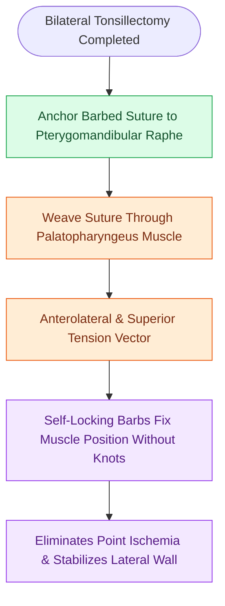

# Barbed suture suspension pharyngoplasty achieves tension-distributed palatopharyngoplasty without mucosal resection

## Active Recall

> [!question]- What are the two primary mechanical advantages of using barbed sutures in pharyngoplasty?
> *Answer / Clinical Rationale*: They provide **uniform tension distribution along the entire suture** and **eliminate the need for tying knots**, preventing focal tissue ischemia and knot extrusion.

> [!question]- What anatomical structure anchors the barbed suture in Barbed Reposition Pharyngoplasty (BRP)?
> *Answer / Clinical Rationale*: The **pterygomandibular raphe**.

## Core Clinical & Mechanistic Principles
**Barbed Suture Suspension Pharyngoplasty (Barbed Reposition Pharyngoplasty - BRP)** (introduced by Mario Mantovani and Claudio Vicini) utilizes bidirectional barbed sutures to expand the pharyngeal airway in patients with [[Drug-induced sleep endoscopy DISE evaluates dynamic multi-level upper airway collapse under sedation|lateral pharyngeal wall collapse]], avoiding the destructive mucosal excision of traditional [[Modified uvulopalatopharyngoplasty UPPP resects redundant palatal tissue while preserving muscular function|uvulopalatopharyngoplasty (UPPP)]]:

- **Biomechanical Advantages of Barbed Sutures**:
  - Knotless, polydioxanone (PDS) or polyglyconate sutures covered with microscopic, self-anchoring barbs.
  - **Evenly distributes tensile forces** along the entire length of the suture line, eliminating point tension, mucosal ischemia, and knot extrusion.
- **Surgical Execution Protocol**:
  1. Complete extracapsular bilateral palatine tonsillectomy.
  2. Anchor the barbed suture to the rigid fibrous **pterygomandibular raphe** adjacent to the pterygoid hamulus.
  3. Weave the suture in a continuous loop through the **posterior tonsillar pillar ([[Expansion sphincter pharyngoplasty ESP rotates the palatopharyngeus muscle to stabilize lateral pharyngeal wall collapse|palatopharyngeus muscle]])** and soft palate.
  4. Cinch the suture to pull and suspend the posterior pillar **anteriorly, superiorly, and laterally**, anchoring it rigidly against the raphe.
  5. The microscopic barbs lock the muscle in its expanded position with **zero knots**, expanding both the retropalatal and lateral oropharyngeal airway dimensions.

### Surgical Technique & Critical Safety Checks
- **Clinical Benefits**: Drastically shortens operative time, reduces postoperative bleeding, eliminates mucosal ulceration from tight knots, and achieves surgical cure rates of **$>80\%$**.

## Connected Concepts & Graph Traversal
- **Surgical Alternative**: [[Expansion sphincter pharyngoplasty ESP rotates the palatopharyngeus muscle to stabilize lateral pharyngeal wall collapse|Expansion Sphincter Pharyngoplasty]]
- **Muscle Vector Foundation**: [[Relocating the palatopharyngeus anterolaterally splints the lateral pharyngeal walls in expansion pharyngoplasty|Palatopharyngeus Muscle Relocation]]
- **Traditional Palatal Surgery**: [[Modified uvulopalatopharyngoplasty UPPP resects redundant palatal tissue while preserving muscular function|Modified Uvulopalatopharyngoplasty]]
- **Dynamic Endoscopic Assessment**: [[Drug-induced sleep endoscopy DISE evaluates dynamic multi-level upper airway collapse under sedation|DISE Multi-Level Airway Mapping]]
- **Postoperative Complication**: [[Post-tonsillectomy hemorrhage is classified into primary within twenty-four hours and secondary beyond twenty-four hours|Post-Tonsillectomy Hemorrhage Management]]
- **Minimally Invasive Alternative**: [[Palatal implants and radiofrequency stiffening induce submucosal fibrosis to dampen soft palate vibration in primary snoring and mild obstructive sleep apnea|Palatal Implants for Mild Disease]]
