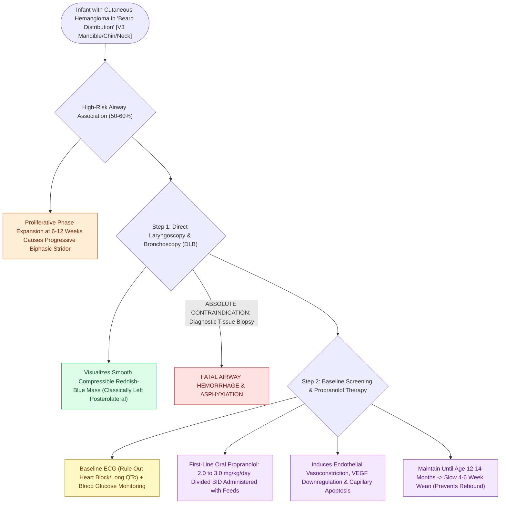

# Beard distribution infantile hemangiomas are associated with symptomatic subglottic hemangiomas requiring oral propranolol

## Active Recall

> [!question]- Why is diagnostic tissue biopsy strictly contraindicated when a smooth reddish submucosal mass is visualized in the subglottis?
> *Answer / Clinical Rationale*: Subglottic hemangiomas are high-flow vascular lesions comprised of tightly packed capillary and venous channels. Biopsy precipitates massive, uncontrollable intraluminal hemorrhage in the narrow pediatric airway, causing immediate asphyxiation and loss of the airway.

> [!question]- What anatomical cutaneous pattern in an infant with new-onset biphasic stridor should immediately raise suspicion for an airway hemangioma?
> *Answer / Clinical Rationale*: A cutaneous hemangioma in the **"beard distribution"** (lower lip, chin, mandible, and anterior neck). Over 50% to 60% of infants with beard hemangiomas harbor synchronous symptomatic subglottic hemangiomas.

## Core Clinical & Mechanistic Principles
Infantile hemangiomas are benign vascular neoplasms characterized by rapid endothelial proliferation during the first year of life (proliferative phase) followed by slow spontaneous involution over several years. Cutaneous hemangiomas distributed across the **"beard area"** (preauricular skin, mandibular body, chin, lower lip, and anterior neck in a $V_3$ dermatomal pattern) carry a **$50\text{ to }60\%$ risk of an associated synchronous subglottic or airway hemangioma**.

Airway hemangiomas typically arise within the posterolateral subglottis beneath an intact mucosa. As the infant reaches 6 to 12 weeks of age, rapid proliferative expansion causes progressive [[Pediatric stertor and stridor differentiate upper supraglottic airway obstruction from intrathoracic tracheobronchial disease|biphasic stridor]], [[Viral laryngotracheobronchitis croup presents with a barking cough and subglottic steeple sign on radiography|barking cough]], dyspnea during feeding, and recurrent "refractory [[Nebulized racemic epinephrine and oral dexamethasone provide rapid treatment for acute croup|croup]]" that fails to resolve. Oral **propranolol** (a non-selective $\beta$-adrenergic antagonist) is the first-line pharmacotherapy, inducing rapid endothelial vasoconstriction, downregulation of VEGF/bFGF angiogenic signaling, and early capillary apoptosis.

### Diagnostic Evaluation & Propranolol Protocol
1. **Direct Laryngoscopy & Bronchoscopy (DLB)**:
   - Gold standard for definitive diagnosis.
   - Reveals a compressible, smooth, non-ulcerated, reddish-blue or submucosal mass classically located in the **left posterolateral subglottis** (or circumferentially).
   - Biopsy is strictly contraindicated due to catastrophic, life-threatening airway hemorrhage.
2. **Propranolol Dosing & Pre-Treatment Screening**:
   - *Baseline Workup*: Obtain baseline vital signs, ECG to rule out congenital heart block or prolonged QTc interval, and assess for history of reactive airway disease.
   - *Initiation & Escalation*:
     - Day 1: Initiate at $1.0\text{ mg/kg/day}$ divided BID.
     - Day 2–3: Escalate to target therapeutic dose of **$2.0\text{ to }3.0\text{ mg/kg/day}$ divided BID** with feeds.
   - *Adverse Effect Precautions*: Educate parents regarding hypoglycemia (must administer with or immediately following feeds) and monitor for bradycardia and hypotension.
   - *Duration*: Maintain therapy throughout the proliferative phase, continuing until 12 to 14 months of age, followed by gradual weaning over 4 to 6 weeks to prevent rebound proliferation.
3. **Surgical Interventions (Reserved for Refractory Obstruction)**:
   - Endoscopic $\text{CO}_2$ or KTP laser ablation (conservative; avoid deep burns that induce circumferential subglottic scarring).
   - Open surgical excision with anterior/[[Posterior costal cartilage grafts with a carved flange split the posterior cricoid lamina to expand the glottic lumen|posterior cricoid split]] and cartilage grafting.

## Connected Concepts & Graph Traversal
- **Physiological Basis**: [[Nebulized racemic epinephrine and oral dexamethasone provide rapid treatment for acute croup|Acute Croup & Subglottic Edema]]
- **Differential Pathology**: [[The Cotton-Myer classification grades subglottic stenosis by luminal reduction|Cotton-Myer Subglottic Stenosis]]
- **Stridor Staging**: [[Inspiratory, biphasic, and expiratory stridor localize pediatric airway obstruction to supraglottic, subglottic, and tracheobronchial subsites|Stridor Timing Localization]]
- **Airway Dynamic Collapse**: [[Laryngomalacia is the most common cause of congenital pediatric stridor characterized by dynamic supraglottic collapse|Laryngomalacia Pathophysiology]]
- **Endoscopic Technique**: [[Rigid bronchoscopy technique for pediatric airway foreign body removal requires systematic distal-to-proximal examination|Pediatric Rigid Bronchoscopy]]
