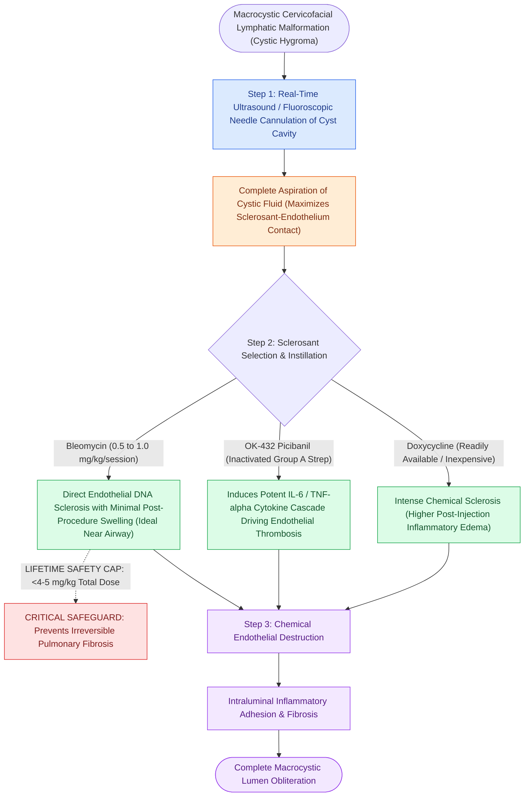

# Bleomycin and OK-432 picibanil sclerotherapy provide targeted ablation of macrocystic lymphatic malformations

## Active Recall

> [!question]- What is the maximum cumulative lifetime dose of bleomycin in pediatric sclerotherapy to prevent pulmonary fibrosis?
> *Answer / Clinical Rationale*: A cumulative lifetime dose of **$<4\text{ to }5\text{ mg/kg}$** (or $<300\text{ mg}$ total).

> [!question]- What is the first step performed after placing a needle into a macrocystic LM before injecting the sclerosant?
> *Answer / Clinical Rationale*: **Complete aspiration of the internal cystic fluid** to maximize contact between the sclerosant and the endothelial cyst lining.

## Core Clinical & Mechanistic Principles
**Percutaneous image-guided sclerotherapy** has replaced radical open surgery as the primary first-line treatment for macrocystic lymphatic malformations:
- **Biomechanical Mechanism of Sclerotherapy**:
  - The sclerosant is injected directly into the cyst under ultrasound or fluoroscopic guidance.
  - Induces severe endothelial cell chemical destruction, intense inflammatory reaction, thrombus formation, and subsequent **fibrous obliteration of the cyst lumen**.
- **The Primary Sclerosants**:
  1. **Bleomycin**:
     - *Mechanism*: Antitumor antibiotic that inhibits DNA synthesis and causes direct endothelial sclerosis.
     - *Dose*: $0.5\text{–}1.0\text{ mg/kg}$ per session (max cumulative lifetime dose $<4\text{–}5\text{ mg/kg}$ to **prevent pulmonary fibrosis**).
     - *Advantage*: Minimal post-injection swelling; safe near the pediatric airway.
  2. **OK-432 (Picibanil)**:
     - Lyophilized mixture of *Streptococcus pyogenes* treated with penicillin; induces powerful cytokine-mediated immune inflammation (IL-6, TNF-$\alpha$).
  3. **Doxycycline**:
     - Readily available, inexpensive; causes intense chemical sclerosis (higher post-procedure inflammatory edema).

### Surgical Technique & Critical Safety Checks
- **Airway Precaution**: Sclerotherapy in suprahyoid / floor of mouth LMs causes transient inflammatory swelling; requires intensive care observation and prophylactic dexamethasone (see [[Lymphatic malformations are slow-flow vascular anomalies classified into macrocystic and microcystic lesions|Lymphatic Malformations]]).

## Connected Concepts & Graph Traversal
- **Lymphatic Malformations**: [[Lymphatic malformations are slow-flow vascular anomalies classified into macrocystic and microcystic lesions|Lymphatic Malformations]]
- **Infantile Hemangiomas**: [[Infantile hemangiomas exhibit rapid neonatal proliferation followed by slow involution driven by GLUT-1 positivity|Infantile Hemangiomas]]
- **Sistrunk Procedure**: [[Sistrunk procedure resects the thyroglossal duct cyst with the central body of the hyoid bone and foramen cecum core|Sistrunk Procedure]]
- **Embryological & Sleep Foundation**: [[Pediatric polysomnography criteria define obstructive sleep apnea with an obstructive apnea-hypopnea index exceeding one]]
- **Sleep Endoscopy & Airway Dynamics**: [[Drug-induced sleep endoscopy DISE evaluates dynamic multi-level upper airway collapse under sedation|Drug-Induced Sleep Endoscopy (DISE)]] [[Severe secondary post-tonsillectomy hemorrhage requires urgent airway stabilization and surgical electrocautery]]
- **Congenital Airway Pathology**: [[Recurrent respiratory papillomatosis RRP is driven by HPV six and eleven causing recurrent laryngeal lesions]]
- **Open Airway Reconstruction**: [[Postoperative chin-to-chest flexion stitch prevents catastrophic neck extension and tracheal anastomotic dehiscence]]
