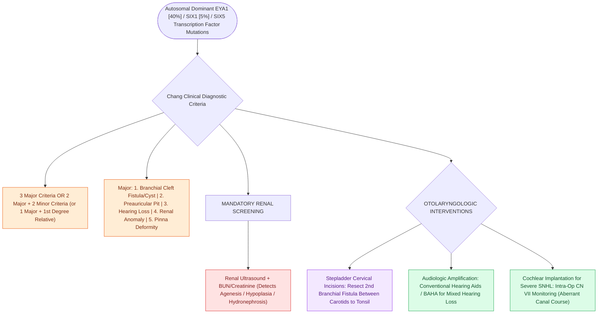

# Branchio-oto-renal syndrome pairs branchial fistulas, preauricular pits, structural renal dysplasia, and mixed hearing loss

## Active Recall

> [!question]- What is the genetic inheritance and molecular basis of Branchio-Oto-Renal (BOR) syndrome / Melnick-Fraser syndrome?
> *Answer / Clinical Rationale*: BOR is an autosomal dominant condition with high penetrance ($>95\%$) and variable expressivity, caused by mutations in **EYA1** ($40\%$, chromosome 8q13.3), **SIX1** ($5\%$), or **SIX5** genes, which encode essential transcription factors regulating early branchial arch, otic vesicle, and metanephric blastema organogenesis.

> [!question]- What are the Chang diagnostic criteria for BOR syndrome, and what screening test is universally mandatory in any suspected child?
> *Answer / Clinical Rationale*: Diagnosis requires **3 major criteria**, OR **2 major + 2 minor criteria**, OR **1 major criterion in a patient with an affected 1st-degree relative**: - *Major Criteria*: (1) Branchial cleft fistulas/cysts, (2) Preauricular pits/tags, (3) Hearing loss (sensorineural, conductive, or mixed), (4) Renal anomalies, (5) Auricular deformities. - *Minor Criteria*: External auditory canal stenosis/atresia, middle ear ossicular malformations, inner ear cochlear hypoplasia/Mondini, preauricular sinuses, lacrimal duct stenosis, retrognathia. - *Mandatory Screening*: A **renal ultrasound** and serum BUN/creatinine are universally required to detect asymptomatic renal agenesis, hypoplasia, or hydronephrosis before renal failure develops.

> [!question]- What specific inner and middle ear temporal bone malformations are characteristic of BOR syndrome?
> *Answer / Clinical Rationale*: Cochlear hypoplasia, **Mondini malformation** ($1.5$ turns), **enlarged vestibular aqueduct (EVA)**, hypoplastic semicircular canals, deep internal auditory canal, and middle ear dysplasias including **incus-stapes fusion, obtuse angle of the facial nerve**, and stapes fixation.

## Core Clinical & Mechanistic Principles
Branchio-Oto-Renal (BOR) syndrome accounts for approximately $2\%$ of children with profound congenital deafness:

### Otolaryngologic Surgical Interventions
- **Branchial Fistula Excision**:
  - Complete surgical excision of second branchial cleft fistulae via stepped "stepladder" transverse cervical incisions, tracing the tract deep between the internal and external carotid arteries to the tonsillar fossa.
- **Auditory Rehabilitation**:
  - Regular audiometric tracking. High-frequency mixed hearing loss managed with conventional digital acoustic hearing aids or bone-conduction implants (BAHA).
  - Cochlear implantation is indicated for severe-to-profound SNHL, requiring careful intraoperative facial nerve monitoring due to an abnormally aberrant facial nerve canal course (see [[First branchial cleft anomalies present as periauricular cysts or sinus tracts parallel to the external auditory canal|Branchial Cleft & Pouch Anatomy]]).

## Connected Concepts & Graph Traversal
- **Branchial Arch Anomalies**: [[First branchial cleft anomalies present as periauricular cysts or sinus tracts parallel to the external auditory canal|Branchial Cleft & Pouch Anatomy]]
- **Syndromic SNHL Overview**: [[Syndromic pediatric sensorineural hearing loss encompasses Pendred, Usher, Waardenburg, and Jervell and Lange-Nielsen syndromes|Syndromic Pediatric Hearing Loss]]
- **EVA & Inner Ear Malformations**: [[Pendred syndrome causes sensorineural hearing loss and euthyroid goiter due to SLC26A4 mutations with enlarged vestibular aqueducts|EVA & Cochlear Dysplasia in Pendred]]
- **Cochlear Implantation**: [[Cochlear implant candidacy criteria include severe to profound bilateral sensorineural hearing loss|Cochlear Implantation in Inner Ear Dysplasia]]
- **Tympanostomy Tube Guidelines**: [[Tympanostomy tube placement follows guideline criteria for chronic effusion and recurrent acute otitis media|Middle Ear Management in Craniofacial Syndromes]]
