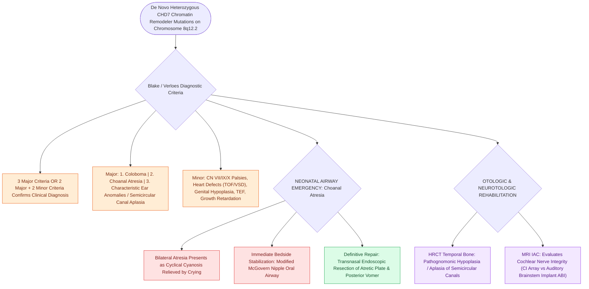

# CHARGE syndrome is diagnosed by coloboma, heart defects, choanal atresia, growth retardation, genital anomalies, and ear abnormalities

## Active Recall

> [!question]- What is the genetic mutation and molecular mechanism responsible for CHARGE syndrome?
> *Answer / Clinical Rationale*: Over $90\%$ of typical CHARGE cases are caused by de novo heterozygous mutations or deletions in the **CHD7** gene (Chromodomain Helicase DNA-binding protein 7 on chromosome 8q12.2), an essential ATP-dependent chromatin remodeler controlling embryonic neural crest migration.

> [!question]- What are the updated Blake/Verloes diagnostic criteria for CHARGE syndrome, and what specific temporal bone imaging finding is pathognomonic?
> *Answer / Clinical Rationale*: Diagnosis requires **all 3 major criteria** OR **2 major + 2 minor criteria**: - *Major Criteria*: (1) **Ocular Coloboma** (retinochoroidal/iris), (2) **Choanal Atresia** (unilateral or bilateral bony/membranous), (3) **Characteristic Ear Anomalies** (external square cup-shaped ear with absent lobule, ossicular dysplasia, and pathognomonic **hypoplasia or complete aplasia of the semicircular canals** on high-resolution temporal bone CT). - *Minor Criteria*: Cranial nerve palsies (CN VII palsy, CN IX/X swallowing dysfunction), heart defects (tetralogy of Fallot, VSD, PDA), genital hypoplasia (micropenis/cryptorchidism), growth/developmental retardation, tracheoesophageal fistula.

> [!question]- What is the primary acute otolaryngologic emergency in a newborn with CHARGE syndrome, and what is the definitive repair?
> *Answer / Clinical Rationale*: **Bilateral choanal atresia** causes immediate asphyxia in obligate nasal-breathing neonates (cyclical cyanosis relieved by crying). Emergency management requires immediate placement of an oral **McGovern nipple airway** or endotracheal intubation. Definitive surgical repair is **transnasal endoscopic resection of the atretic plate and posterior vomer with mucosal preservation flap techniques**, eliminating the need for rigid stents.

## Core Clinical & Mechanistic Principles
CHARGE syndrome is an autosomal dominant multisystem malformation syndrome with an incidence of $1\text{ in }10,000$ live births:

### Otolaryngologic Surgical & Airway Protocols
1. **Neonatal Airway & Choanal Atresia**:
   - Immediate stabilization with a modified McGovern nipple oral airway or soft oral airway.
   - Contrast-enhanced CT maxillofacial protocol confirming bony vs membranous atresia thickness.
   - Endoscopic transnasal repair using $0^\circ$ and $30^\circ$ endoscopes, powered microdebrider, and diamond burr unroofing of the medial pterygoid plate and posterior 1 cm of the vomer, lining the neochoana with mucosal advancement flaps.
2. **Cochlear & Auditory Implantation**:
   - Severe-to-profound SNHL combined with vestibular areflexia causes profound motor and language delays.
   - High-resolution temporal bone CT/MRI is essential to evaluate cochlear nerve presence within the IAC; in cases of cochlear nerve hypoplasia/aplasia or severe inner ear dysplasia, **Auditory Brainstem Implantation (ABI)** or specialized cochlear implant arrays are indicated.
3. **Cranial Nerve IX/X Dysphagia**:
   - High risk of silent aspiration due to vagal dysmotility; early FEES evaluation and gastrostomy tube placement frequently required (see [[Transnasal endoscopic resection of the atretic plate and posterior vomer establishes choanal patency without stents|Endoscopic Choanal Atresia Surgical Technique]]).

## Connected Concepts & Graph Traversal
- **Choanal Atresia Repair**: [[Transnasal endoscopic resection of the atretic plate and posterior vomer establishes choanal patency without stents|Endoscopic Choanal Atresia Surgical Technique]]
- **Syndromic SNHL Overview**: [[Syndromic pediatric sensorineural hearing loss encompasses Pendred, Usher, Waardenburg, and Jervell and Lange-Nielsen syndromes|Syndromic SNHL Overview]]
- **Auditory Implantation**: [[Auditory Brainstem Implantation ABI bypasses the cochlea and cochlear nerve to stimulate the cochlear nucleus in NF2|Auditory Brainstem Implantation for Cochlear Nerve Aplasia]]
- **Pediatric Airway Assessment**: [[Pediatric stertor and stridor differentiate upper supraglottic airway obstruction from intrathoracic tracheobronchial disease|Pediatric Stridor & Airway Staging]]
- **Cleft & Branchial Syndromes**: [[Branchio-oto-renal syndrome pairs branchial fistulas, preauricular pits, structural renal dysplasia, and mixed hearing loss|BOR Syndrome Comparison]]
