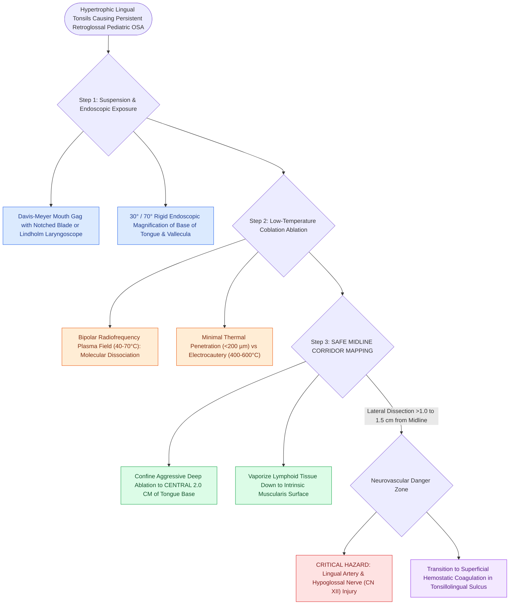

# Coblation lingual tonsillectomy debulks tongue base lymphoid tissue while preserving the lingual neurovascular bundles

## Active Recall

> [!question]- Why is deep tissue ablation restricted to the central 2.0 cm of the tongue base during lingual tonsillectomy?
> *Answer / Clinical Rationale*: To avoid catastrophic injury to the **lingual arteries and hypoglossal nerves**, which course $1.0\text{–}1.5\text{ cm}$ lateral to the midline.

> [!question]- What is the primary physical advantage of coblation over traditional electrocautery for tongue base surgery?
> *Answer / Clinical Rationale*: It operates at **much lower temperatures ($40\text{–}70^\circ\text{C}$)**, producing minimal thermal spread and significantly less postoperative pain and edema.

## Core Clinical & Mechanistic Principles
**Coblation (Plasma-Mediated Radiofrequency) Lingual Tonsillectomy** is the standard surgical technique for debulking hypertrophic tongue base lymphoid tissue:
- **Biophysical Mechanism of Coblation**:
  - Uses bipolar radiofrequency energy passing through a conductive saline medium to create a focused **plasma field ($100\text{–}200\ \mu\text{m}$ thick)**.
  - Operates at **low temperatures ($40\text{–}70^\circ\text{C}$)** compared to standard electrocautery ($400\text{–}600^\circ\text{C}$), vaporizing molecular bonds while minimizing deep muscular thermal necrosis and pain.
- **Surgical Step-by-Step Execution**:
  1. **Exposure**: Place a Davis-Meyer or Crowe-Davis mouth gag with a notched tongue blade, or suspend with a Lindholm / Feyh-Kastenbauer (FK) laryngoscope.
  2. **Visualization**: Use a $30^\circ$ or $70^\circ$ rigid endoscope or surgical microscope.
  3. **Ablation Vector**: Begin ablation in the midline vallecula and progress laterally and superiorly, vaporizing lymphoid tissue down to the intrinsic tongue musculature (genioglossus/hyoglossus).
  4. **The "Safe Midline Corridor" & Lingual Artery Protection**:
     - The **lingual neurovascular bundles (lingual artery & hypoglossal nerve)** course **$1.0\text{–}1.5\text{ cm}$ lateral to the midline** deep within the hyoglossus muscle.
     - Confine aggressive deep ablation to the **central $2.0\text{ cm}$ of the tongue base**; transition to superficial coagulation when dissecting laterally toward the tonsillolingual sulcus.

### Surgical Technique & Critical Safety Checks
- **Postoperative Care**: Short course of systemic dexamethasone to prevent acute tongue base edema, and strict overnight airway observation in the PICU/step-down unit (see [[Lingual tonsil hypertrophy causes persistent pediatric obstructive sleep apnea and base of tongue collapse|Lingual Tonsils]]).

## Connected Concepts & Graph Traversal
- **Lingual Tonsils**: [[Lingual tonsil hypertrophy causes persistent pediatric obstructive sleep apnea and base of tongue collapse|Lingual Tonsils]]
- **Pediatric DISE**: [[Pediatric DISE identifies persistent multi-level airway collapse following adenotonsillectomy|Pediatric DISE]]
- **TORS Tongue Base**: [[Transoral robotic surgery TORS tongue base reduction debulks lingual tonsil and midline tongue musculature in OSA|TORS Tongue Base]]
- **Embryological & Sleep Foundation**: [[Geniohyoid and genioglossus muscles are primary upper airway dilators maintaining pharyngeal patency]]
- **Adenotonsillar & Endoscopic DISE**: [[Post-tonsillectomy hemorrhage is classified into primary within twenty-four hours and secondary beyond twenty-four hours]]
- **Congenital Airway Pathology**: [[Inspiratory, biphasic, and expiratory stridor localize pediatric airway obstruction to supraglottic, subglottic, and tracheobronchial subsites]]
- **Open Airway Reconstruction**: [[Tracheomalacia causes dynamic expiratory tracheal collapse and is managed with posterior tracheobronchopexy]]
