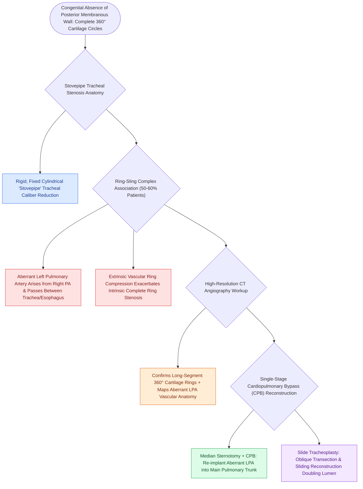

# Complete tracheal rings present with generalized tracheal stenosis and stovepipe appearance on imaging

## Active Recall

> [!question]- What vascular anomaly is present in $>50\%$ of infants with congenital complete tracheal rings?
> *Answer / Clinical Rationale*: **Pulmonary artery sling (aberrant left pulmonary artery)** arising from the right pulmonary artery and compressing the tracheoesophageal space.

> [!question]- What classic radiographic and CT appearance is characteristic of complete tracheal rings?
> *Answer / Clinical Rationale*: A **narrow, rigid 'stovepipe' or 'funnel' trachea** with complete absence of the posterior membranous wall.

## Core Clinical & Mechanistic Principles
**Complete Tracheal Rings** are a rare congenital anomaly characterized by the absence of the posterior membranous trachea, where cartilaginous rings form complete, non-distensible $360^\circ$ circles:
- **Pathophysiology & "Stovepipe" Morphology**:
  - Normal trachea is C-shaped with a dynamic posterior membranous wall that allows expansion.
  - Complete rings produce a rigid, fixed, narrow cylindrical conduit (**"stovepipe / funnel trachea"**).
  - [[High-stakes pediatric and adult sleep airway complications require rapid structured algorithmic emergency rescue|Can]] involve a few rings, a segmental section, or the entire length of the trachea from cricoid to carina ($>80\%$).
- **The "Ring-Sling Complex" Association ($50\text{–}60\%$)**:
  - Strongly associated with **Pulmonary Artery Sling (Aberrant Left Pulmonary Artery)**:
    - The left pulmonary artery arises anomalously from the right pulmonary artery, arching **between the trachea and esophagus** to reach the left lung.
    - Compresses the distal trachea and right mainstem bronchus, exacerbating complete ring stenosis.
- **Clinical Presentation & Imaging**:
  - "Washing machine" breathing, persistent expiratory wheezing/stridor, recurrent respiratory infections, and "dying spells" with feeding.
  - **High-Resolution CT Angiography**: Demonstrates the absence of the posterior membranous trachea and delineates anomalous pulmonary vascular anatomy.

### Surgical Technique & Critical Safety Checks
- **Surgical Mandate**: Complete rings with pulmonary artery sling are repaired simultaneously via median sternotomy on CPB ([[Slide tracheoplasty expands complete tracheal rings by oblique division and sliding longitudinal reconstruction|Slide Tracheoplasty]] + Left PA Reimplantation into Main Pulmonary Artery).

## Connected Concepts & Graph Traversal
- **Slide Tracheoplasty**: [[Slide tracheoplasty expands complete tracheal rings by oblique division and sliding longitudinal reconstruction|Slide Tracheoplasty]]
- **Slide Tracheoplasty Craft**: [[Slide tracheoplasty achieves immediate vascularized mucosal lumen doubling with lowest restenosis rates|Slide Tracheoplasty Craft]]
- **Innominate Compression**: [[Innominate artery compression syndrome causes dynamic anterior tracheal pulsatile collapse|Innominate Compression]]
- **Disease Mechanism**: [[Complete vascular rings and pulmonary artery slings cause tracheoesophageal compression requiring surgical division or arterial translocation|Ring-Sling Complex]]
