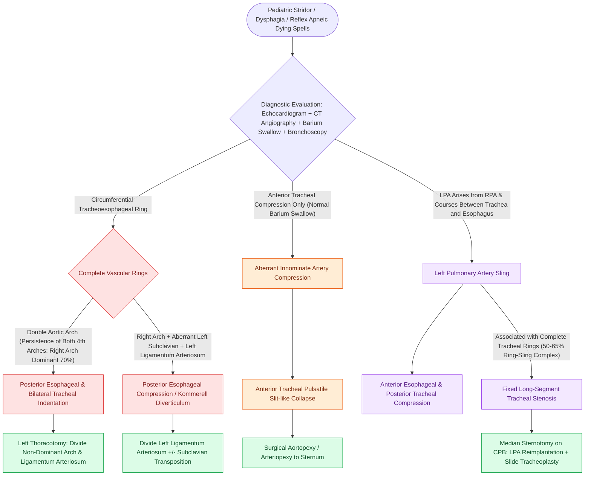

# Complete vascular rings and pulmonary artery slings cause tracheoesophageal compression requiring surgical division or arterial translocation

## Active Recall

> [!question]- How does the anatomical relationship of a pulmonary artery sling differ from a complete vascular ring on barium esophagogram and bronchoscopy?
> *Answer / Clinical Rationale*: A complete vascular ring (e.g., double aortic arch) encircles both the trachea and esophagus, producing a characteristic **posterior esophageal indentation** and bilateral or circumferential tracheal compression. In contrast, an anomalous **left pulmonary artery sling** arises from the right pulmonary artery and courses **between the trachea and esophagus** toward the left hilum. On barium esophagogram, it produces a pathognomonic **anterior indentation of the esophagus**, while bronchoscopy demonstrates **pulsatile posterior tracheal compression** of the lower trachea and carina.

> [!question]- What congenital tracheobronchial pathology is classically associated with pulmonary artery sling, and why does this dictate surgical planning?
> *Answer / Clinical Rationale*: Pulmonary artery sling is uniquely associated with **complete cartilaginous tracheal rings** (the **"ring-sling complex"**) in $50\%\text{ to }65\%$ of cases. Because complete rings cause fixed, circumferential, long-segment tracheal stenosis ("stovepipe trachea"), simple vascular translocation of the left pulmonary artery alone will **not relieve airway obstruction**. Operative intervention requires median sternotomy with cardiopulmonary bypass to perform both **left pulmonary artery reimplantation** anterior to the trachea and concurrent **slide tracheoplasty**.

> [!question]- What is the most common symptomatic complete vascular ring, which arch is typically dominant, and how is it repaired?
> *Answer / Clinical Rationale*: The **double aortic arch** is the most common symptomatic complete vascular ring ($\sim 50\%\text{ to }70\%$ of complete rings). The **right aortic arch is dominant** (larger, higher, giving off right common carotid and right subclavian arteries) in approximately $70\%$ of cases, while the left arch is non-dominant / smaller. Repair is performed via a **left posterolateral thoracotomy** (without cardiopulmonary bypass) with surgical **division and suture ligation of the non-dominant (smaller) arch** distal to the origin of the left subclavian artery, followed by division of the ligamentum arteriosum and mobilization of the trachea and esophagus.

## Core Clinical & Mechanistic Principles

Congenital vascular anomalies of the aortic arch and pulmonary arterial tree cause dynamic or fixed extrinsic compression of the pediatric aerodigestive tract. Symptoms depend on whether the vascular structures encircle both organs (complete ring: stridor + dysphagia) or compress a single conduit (incomplete ring / sling).

### Anatomical & Diagnostic Classification Ledger

| Anomaly | Embryologic Mechanism | Tracheal Compression | Esophageal Compression | Distinctive Imaging / Endoscopic Hallmark | Definitive Surgical Procedure |
| :--- | :--- | :--- | :--- | :--- | :--- |
| **Double Aortic Arch** *(Fig 6.15 A)* | Persistence of right and left 4th branchial aortic arches | Bilateral / circumferential; dynamic inspiratory & expiratory stridor | Posterior indentation; dysphagia lusoria | Barium swallow: bilateral / posterior indentations; CTA shows symmetrical 4-vessel takeoff | Left thoracotomy; divide non-dominant arch (usually left) distal to subclavian |
| **Right Arch with Aberrant Left Subclavian & Left Ligamentum** *(Fig 6.15 B)* | Left 4th arch involution between carotid & subclavian; persistence of right arch | Anterior / lateral tracheal narrowing | Posterior oblique indentation by aberrant retroesophageal artery | Retroesophageal vascular band with aneurysmal dilation (Kommerell diverticulum) | Division of left ligamentum arteriosum and resection of Kommerell diverticulum |
| **Aberrant Innominate Artery** *(Fig 6.15 C)* | Origin of brachiocephalic artery more distal or to the left of midline | Dynamic anterior compression at lower trachea | **None** (normal barium esophagogram; no dysphagia) | Bronchoscopy: anterior pulsatile vascular compression; reflex apneic "dying spells" | **Aortopexy / arteriopexy**: suspend aortic adventitia to posterior sternum |
| **Pulmonary Artery Sling** *(Fig 6.15 D)* | Failure of 6th arch; anomalous left pulmonary artery branches off RPA | Posterior lower tracheal & right mainstem bronchus compression | **Anterior indentation** of esophagus (pathognomonic on barium swallow) | High association ($50\%\text{--}65\%$) with **complete tracheal rings** (ring-sling complex) | Sternotomy on CPB; LPA transection & reimplantation anterior to trachea + slide tracheoplasty |

### Endoscopic & Clinical Distinction

1. **Clinical Presentation**:
   - Symptoms manifest in early infancy ($<3\text{ months}$): high-pitched biphasic stridor, brassy "barking" cough, recurrent lower respiratory infections, hyperextension of the neck (infants hyperextend to straighten the airway), and feeding difficulty with coughing/choking during bolus transit.
   - **Reflex Apnea ("Dying Spells")**: Seen with severe innominate artery compression or vascular rings when a food bolus or dynamic airway collapse triggers complete tracheal occlusion, vagal bradycardia, cyanosis, and loss of consciousness.

2. **Diagnostic Protocol**:
   - **Echocardiography**: Identifies arch sidedness, branching anatomy, intracardiac anomalies, and origin of the left pulmonary artery.
   - **CTA or MRA (Gold Standard)**: Defines the 3D vascular geometry relative to the airway and esophagus, identifying arch dominance, Kommerell diverticulum, and anomalous LPA.
   - **Rigid / Flexible Bronchoscopy**: Demonstrates site and pulsatility of extrinsic airway compression. In complete tracheal rings, the posterior membranous trachea is absent, replaced by complete circular cartilaginous rings.
   - **Barium Esophagogram**: Key functional study that immediately distinguishes vascular rings (posterior indentations) from pulmonary slings (anterior indentation).

Comprehensive anatomical and therapeutic integration links these principles directly to [[Tracheomalacia causes dynamic expiratory tracheal collapse and is managed with posterior tracheobronchopexy|Tracheomalacia & Posterior Tracheobronchopexy]].

## Connected Concepts & Graph Traversal
- **Airway Foreign Body & Stridor**: [[Inspiratory, biphasic, and expiratory stridor localize pediatric airway obstruction to supraglottic, subglottic, and tracheobronchial subsites|Stridor Localization and Aerodigestive Diagnostics]]
- **Complete Tracheal Rings**: [[Complete tracheal rings present with generalized tracheal stenosis and stovepipe appearance on imaging|Ring-Sling Complex & Complete Rings]]
- **Slide Tracheoplasty**: [[Slide tracheoplasty achieves immediate vascularized mucosal lumen doubling with lowest restenosis rates|Slide Tracheoplasty Technique]]
- **Innominate Artery Compression**: [[Innominate artery compression syndrome causes dynamic anterior tracheal pulsatile collapse|Innominate Artery Compression]]
- **Aortopexy**: [[Aortopexy suspends the aorta to the sternum to relieve anterior vascular tracheal compression|Surgical Aortopexy]]
