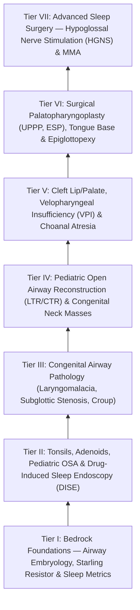

# Comprehensive Pediatric Otolaryngology & Sleep Surgery Residency Mastery Curriculum & Self-Assessment Guide

This curriculum provides a **progressively load-bearing mastery framework** integrating Pediatric Otolaryngology and Sleep Surgery (Pediatric and Adult). Moving from embryology, fluid mechanics ([[The Starling resistor model explains upper airway collapsibility and critical closing pressure Pcrit|Starling resistor model]]), and sleep physiology up through endoscopic airway interventions, open congenital neck/airway reconstructions, [[Velopharyngeal insufficiency VPI causes hypernasal resonance and nasal air emission during speech|velopharyngeal insufficiency]] (VPI), cleft surgery, palatopharyngoplasty variants, and advanced [[Hypoglossal nerve stimulation HGNS activates the medial branch of CN XII to advance the tongue during inspiration|hypoglossal nerve stimulation]] (HGNS) / [[Maxillomandibular advancement MMA advances the skeletal framework by ten to twelve millimeters to expand the upper airway|maxillomandibular advancement]] (MMA). Each tier features operative nuances, failure mode analyses, and collapsible retrieval self-tests.

## **Tier I: Bedrock Foundations — Airway Embryology, Starling Resistor & Sleep Metrics**

### **1\. Branchial Apparatus Embryology & Airway Development**

> * **The [[Each branchial arch packages one nerve, one artery, one cartilage bar, and one muscle group|Branchial Apparatus]]:** Composed of Branchial Clefts (ectoderm), Branchial Arches (mesoderm and neural crest), and Branchial Pouches (endoderm).  
  * *1st Arch (Mandibular - CN V3):* Malleus head, incus body, Meckel's cartilage, muscles of mastication, tensor veli palatini, tensor tympani. *1st Cleft:* External auditory canal. *1st Pouch:* Eustachian tube and middle ear cavity.  
  * *2nd Arch (Hyoid - CN VII):* Stapes superstructure, incus long process, manubrium, lesser horn and superior body of hyoid, Reichert's cartilage, muscles of facial expression, stapedius. *2nd Pouch:* Palatine tonsillar fossa.  
  * *3rd Arch (CN IX):* Greater horn and inferior body of hyoid, stylopharyngeus muscle. *3rd Pouch:* Inferior parathyroids and thymus.  
  * *4th Arch (CN X - SLN):* Thyroid cartilage, cricothyroid muscle, pharyngeal constrictors. *4th Pouch:* Superior parathyroids and ultimobranchial body (C-cells of thyroid).  
  * *6th Arch (CN X - RLN):* Cricoid cartilage, arytenoid cartilages, intrinsic laryngeal muscles (except CT).  
> * **Developmental Differences in Pediatric Airway:** The infant larynx is conical (narrowest at the non-distensible cricoid ring, whereas the adult is cylindrical and narrowest at the rima glottidis), sits higher in the neck (C3–C4 vs. C6 in adults), has a larger [[Omega-shaped epiglottis, foreshortened aryepiglottic folds, and redundant arytenoid mucosa define laryngomalacia|omega-shaped epiglottis]], larger tongue relative to oral cavity, and higher compliance of cartilaginous structures.

### **2\. Upper Airway Biomechanics & The Starling Resistor Model**

During sleep, muscle atonia reduces pharyngeal dilator muscle tone (genioglossus, tensor veli palatini). The pharynx acts as a **collapsible Starling resistor**:

> * **[[Critical closing pressure Pcrit stratifies upper airway collapsibility from snorers to severe obstructive sleep apnea|Critical Closing Pressure]] ($P_{\text{crit}}$):** The intraluminal pressure below which the pharyngeal airway collapses completely.  
  * Normal non-snoring individuals: $P_{\text{crit}} < -10\text{ cm H}_2\text{O}$ (airway remains patent even under strong negative inspiratory suction).  
  * Snoring / Upper Airway Resistance: $P_{\text{crit}}$ between $-10\text{ and } -5\text{ cm H}_2\text{O}$.  
  * Obstructive Sleep Apnea (OSA): $P_{\text{crit}} > 0\text{ cm H}_2\text{O}$ (airway collapses spontaneously even at atmospheric pressure during sleep).  
> * **Poiseuille’s Law & Bernoulli Principle:** Airway resistance is inversely proportional to the 4th power of radius ($\text{Resistance} \propto 1/r^4$). A 50% decrease in luminal radius increases resistance by 16-fold. Accelerated air velocity through a narrowed segment drops lateral intraluminal pressure (Bernoulli), accelerating downstream dynamic collapse.

### **3\. Polysomnography (PSG) Metrics: Pediatric vs. Adult Diagnostic Thresholds**

| Metric / Parameter | Pediatric PSG Criteria (<18 Years) | Adult PSG Criteria (≥18 Years)   |
| :---- | :---- | :---- |
| **Apnea Definition** | $\ge 90\\%$ drop in airflow lasting **$\ge 2$ missed respiratory cycles** with continued respiratory effort. | $\ge 90\\%$ drop in airflow lasting **$\ge 10\text{ seconds}$** with continued respiratory effort. |
| **Hypopnea Definition** | $\ge 30\\%$ drop in airflow for $\ge 2$ cycles with $\ge 3\\%$ desaturation OR associated cortical arousal. | $\ge 30\\%$ drop in airflow for $\ge 10\text{ s}$ with $\ge 3\\%$ or $4\\%$ desaturation OR associated EEG arousal. |
| **Mild OSA Severity** | **AHI 1.0 to 4.9 events/hr** (or gas exchange abnormalities: $O_2\text{ nadir } < 92\\%$). | **AHI 5.0 to 14.9 events/hr** with daytime symptoms. |
| **Moderate OSA Severity** | **AHI 5.0 to 9.9 events/hr** | **AHI 15.0 to 29.9 events/hr** |
| **Severe OSA Severity** | **AHI $\ge 10.0\text{ events/hr}$** (or $O_2\text{ nadir } < 80\\%$). | **AHI $\ge 30.0\text{ events/hr}$** |

Self-Assessment Checkpoint: Tier I Foundations (Click to Expand)

**Q1: Why is an AHI of 2.5 events/hr considered abnormal in a 4-year-old child but normal in a 40-year-old adult?**  
*A:* Healthy pediatric patients possess high baseline metabolic oxygen demand, low functional residual capacity, and very high neuromuscular airway tone during sleep; normal pediatric physiology exhibits $AHI < 1.0\text{ event/hr}$. Any repetitive collapse ($AHI > 1$) causes nocturnal hypoxemia, sleep fragmentation, neurocognitive impairment, and failure to thrive.  
**Q2: From which embryonic branchial structures do the pyriform sinus fistula and congenital thymic cyst arise?**  
*A:* The **3rd and 4th branchial pouches**. A 3rd pouch fistula exits the superior aspect of the pyriform sinus passing superficial to the recurrent laryngeal nerve and superior to the superior laryngeal nerve, whereas a 4th pouch fistula originates from the apex of the pyriform sinus and loops inferiorly around the subclavian artery (right) or aorta (left) and deep to the RLN.

## **Tier II: Tonsils, Adenoids, Pediatric OSA & Drug-Induced Sleep Endoscopy (DISE)**

### **1\. Clinical Staging & Indications for Adenotonsillectomy (T\&A)**

> * **Brodsky Tonsillar Grading:**  
  * *0:* Tonsils confined to tonsillar fossa.  
  * *1+:* Tonsils occupy $<25\\%$ of oropharyngeal width (between anterior pillars).  
  * *2+:* Tonsils occupy $25\text{–}50\\%$ of oropharynx.  
  * *3+:* Tonsils occupy $50\text{–}75\\%$ of oropharynx.  
  * *4+:* Tonsils occupy $>75\\%$ of oropharynx ("kissing tonsils").  
> * **[[Paradise criteria define evidence-based indications for pediatric tonsillectomy in recurrent throat infections|Paradise Criteria]] for Recurrent Tonsillitis (Infectious Indication):** $\ge 7$ episodes in past 1 year, OR $\ge 5$ episodes/year for past 2 years, OR $\ge 3$ episodes/year for past 3 years; each episode documented with sore throat plus $\ge 1$: temperature $>38.3^\circ\text{C}$, cervical adenopathy, tonsillar exudate, or positive Group A Strep.  
> * **Pediatric Sleep-Disordered Breathing:** First-line surgical treatment is [[Adenotonsillectomy is the first-line surgical treatment for pediatric obstructive sleep apnea|Adenotonsillectomy]], which resolves OSA in 70–80% of non-obese, structurally normal children.

### **2\. High-Risk Pediatric T\&A Complications & Post-Obstructive Pulmonary Edema**

> * **Mandatory Inpatient Postoperative Admission Criteria (AAO-HNS Guidelines):** Age $<3\text{ years}$, severe OSA ($AHI \ge 10\text{ events/hr}$ or $O_2\text{ nadir } < 80\\%$), craniofacial abnormalities, neuromuscular disorders, Trisomy 21, failure to thrive, obesity ($BMI > 95\text{th percentile}$), and secondary pulmonary hypertension (cor pulmonale).  
> * **Post-Obstructive Pulmonary Edema (POPE / Type I NPPE):**  
  * *Pathophysiology:* Relief of chronic upper airway obstruction suddenly eliminates high intrinsic PEEP. Generates high transcapillary hydrostatic pressure gradients combined with profound negative intrathoracic inspiratory efforts, flooding alveoli with transudate.  
  * *Treatment:* Reintubation or continuous positive airway pressure (CPAP), gentle suctioning of pink frothy secretions, oxygenation, and fluid restriction. Diuretics are generally contraindicated if the patient is hypovolemic.

### **3\. Drug-Induced Sleep Endoscopy (DISE) & The VOTE Classification**

| VOTE Level | Anatomical Collapse Configuration | Degree of Obstruction (0, 1, 2\) | Surgical Implications   |
| :---- | :---- | :---- | :---- |
| **V: Velum / Soft Palate** | • Anteroposterior (AP) • Lateral wall • **Complete Concentric Collapse (CCC)** | 0: None (<50%) 1: Partial (50–75%) 2: Complete (>75%) | **Complete Concentric Collapse (CCC) at the Velum is an ABSOLUTE CONTRAINDICATION for Hypoglossal Nerve Stimulation (Inspire).** Directs patient toward UPPP or Expansion Sphincter Pharyngoplasty. |
| **O: Oropharynx / Lateral Walls** | Lateral pharyngeal wall collapse (palatopharyngeus/superior constrictor). | 0: None 1: Partial 2: Complete | Standard UPPP fails in pure lateral wall collapse; requires Expansion Sphincter Pharyngoplasty (ESP) or Relocation Pharyngoplasty. |
| **T: Tongue Base** | Anteroposterior tongue base prolapse into hypopharyngeal airway. | 0: None 1: Partial 2: Complete | Indication for Hypoglossal Nerve Stimulation (HGNS), TORS Lingual Tonsillectomy, or Maxillomandibular Advancement (MMA). |
| **E: Epiglottis** | • AP (trapdoor posterior collapse) • Lateral (omega curl) | 0: None 1: Partial 2: Complete | Trapdoor AP collapse worsens with CPAP (air pushes epiglottis closed). Indication for **Epiglottopexy** or partial epiglottectomy. |

Self-Assessment Checkpoint: Tier II T\&A and DISE (Click to Expand)

**Q1: Why is [[Concentric velopharyngeal collapse on DISE is a contraindication to hypoglossal nerve stimulation|Complete Concentric Collapse]] (CCC) at the level of the velum on DISE a contraindication for Hypoglossal Nerve Stimulation (HGNS)?**  
*A:* HGNS acts by protruding the tongue base forward (via the genioglossus), pulling the palate forward secondarily through the palatoglossus muscle. In CCC, the circular sphincter of the velum and lateral pharyngeal walls collapses simultaneously; forward tongue displacement cannot open the circumferential lateral sphincter, leading to HGNS treatment failure.  
**Q2: How does an isolated epiglottic trapdoor collapse behave under therapeutic CPAP titration?**  
*A:* CPAP pneumatic splinting fails because the positive column of incoming air strikes the lingual face of the flaccid epiglottis, pushing it directly backward like a one-way flap valve over the laryngeal inlet, exacerbating airway obstruction.

## **Tier III: Congenital & Inflammatory Pediatric Airway Pathology**

### **1\. Laryngomalacia & Supraglottoplasty Protocol**

> * **Pathophysiology:** Most common cause of congenital stridor (60–70%). Inherent neuromuscular hypotonia with dynamic prolapse of supraglottic tissues into the glottic aperture during inspiration.  
> * **Clinical Classification:**  
  * *Type 1:* Redundant, prolapsing mucosa over the arytenoid / corniculate cartilages.  
  * *Type 2:* Shortened aryepiglottic (AE) folds tethering the epiglottis.  
  * *Type 3:* Severe posterior retroflexion / omega-shaped epiglottis collapsing into the glottis.  
> * **[[Endoscopic supraglottoplasty cold-steel and laser division of aryepiglottic folds relieves severe laryngomalacia|Supraglottoplasty]] Surgical Technique:**  
  1. Suspend larynx under spontaneous respiration anesthesia with a Parsons or Benjamin-Lindholm laryngoscope.  
  2. Using cold micro-scissors or $\text{CO}_2$ laser, sharply divide the shortened bilateral **aryepiglottic folds**, releasing the epiglottis anteriorly.  
  3. Excise redundant cuneiform/corniculate mucosa over the arytenoid cartilages. **CRITICAL RULE:** Never dissect or cauterize across the *interarytenoid posterior mucosa* to prevent severe cicatricial posterior glottic stenosis.

### **2\. Congenital Subglottic Hemangioma & The Propranolol Paradigm**

> * **Presentation:** Asymptomatic at birth; presents at 6–12 weeks of life with progressive [[Inspiratory, biphasic, and expiratory stridor localize pediatric airway obstruction to supraglottic, subglottic, and tracheobronchial subsites|biphasic stridor]], barking cough, and feeding difficulties during the rapid proliferative endothelial phase. 50% have concurrent cutaneous hemangiomas ("beard distribution" correlates with airway involvement).  
> * **Endoscopic Appearance:** Compressible, smooth, reddish-blue submucosal mass in the posterolateral subglottis. Biopsy is strictly contraindicated (severe hemorrhage).  
> * **Medical Management (First-Line):** **[[Oral propranolol is the first-line pharmacotherapy for proliferating infantile hemangiomas|Oral Propranolol]] ($2.0\text{–}3.0\text{ mg/kg/day}$ divided BID/TID)**. Induces vasoconstriction, downregulates VEGF and bFGF angiogenic pathways, and triggers endothelial apoptosis. Requires baseline ECG (rule out heart block) and blood glucose monitoring.

### **3\. Infectious Pediatric Airway Emergencies**

| Condition | Etiology & Age Group | Radiographic Sign | Definitive Management   |
| :---- | :---- | :---- | :---- |
| **Croup (Laryngotracheobronchitis)** | Parainfluenza Virus Types 1 & 2\. Age: 6 months to 3 years. | **Steeple Sign** (subglottic symmetric tapering on AP neck X-ray). | Dexamethasone ($0.6\text{ mg/kg}$ PO/IM), Nebulized Racemic Epinephrine (2.25%, $0.5\text{ mL}$ in $3\text{ mL}$ NS); observe 2–4 hr for rebound stridor. |
| **Bacterial Tracheitis** | *Staphylococcus aureus*, *S. pneumoniae*. Age: 3 to 8 years. | Ragged, irregular tracheal air column with subglottic narrowing. | Emergent operative rigid bronchoscopy with thick pseudomembrane/mucopus debridement; endotracheal intubation, IV Vancomycin \+ Ceftriaxone. |
| **Acute Epiglottitis** | *Haemophilus influenzae* type B, Group A Strep. Age: 2 to 7 years. | **Thumbprint Sign** (swollen, rounded epiglottis on lateral neck X-ray). | Do NOT agitate child. Immediate transport to OR for inhalational gas induction, awake fiberoptic/rigid intubation with ENT surgeon prepared for surgical airway. IV Ceftriaxone. |

Self-Assessment Checkpoint: Tier III Pediatric Airway (Click to Expand)

**Q1: Why is excising interarytenoid mucosa strictly prohibited during a supraglottoplasty?**  
*A:* The interarytenoid space is lined by fragile respiratory epithelium. Denuding both opposing arytenoid margins allows raw surfaces to adhere during healing, creating a dense, cicatrized **posterior glottic web/stenosis** that requires open airway reconstruction.  
**Q2: Differentiate the clinical course of Croup vs. Bacterial Tracheitis.**  
*A:* Croup presents as a low-grade, viral prodrome with a barking cough and rapid clinical response to [[Nebulized racemic epinephrine and oral dexamethasone provide rapid treatment for acute croup|racemic epinephrine]] and dexamethasone. Bacterial tracheitis presents as a toxic, high-fever child who initially appears to have croup but rapidly deteriorates with thick, obstructing subglottic tracheal pseudomembranes unresponsive to racemic epinephrine.

## **Tier IV: Pediatric Open Airway Reconstruction & Congenital Neck Masses**

### **1\. Pediatric Laryngotracheal Reconstruction (LTR) Protocols**

> * **Single-Stage vs. Two-Stage LTR Selection:**  
  * *[[Single-stage LTR utilizes an endotracheal tube as a temporary stent avoiding tracheostomy placement|Single-Stage LTR]] (SS-LTR):* Indicated for Cotton-Myer Grade II/III stenosis without significant [[Tracheomalacia causes dynamic expiratory tracheal collapse and is managed with posterior tracheobronchopexy|tracheomalacia]], active pulmonary disease, severe reflux, or neurological impairment. Cartilage graft (anterior $\pm$ posterior costal) is placed, tracheostomy tube is removed immediately, and the airway is stented via nasotracheal intubation for 7–14 days in the PICU.  
  * *Two-Stage LTR (TS-LTR):* Indicated for severe Grade III/IV stenosis, multi-level airway collapse, uncontrolled GERD, or failed prior single-stage. Tracheostomy is maintained; internal stenting with an LT-Mold, [[Double-stage LTR maintains a tracheostomy and utilizes an endolaryngeal LT-Mold or Montgomery T-tube stent|Aboulker stent]], or T-tube for 4 to 6 months prior to open decannulation.  
> * **Costal Cartilage Carving Standards:** Harvest 5th or 6th rib preserving inner perichondrium. Carve graft with **lateral flanges** (boat shape). Flanges sit externally against the anterior tracheal/cricoid cartilage edges, preventing the graft from prolapsing internally into the airway lumen.

### **2\. Congenital Neck Anomalies & The Sistrunk Procedure**

| Congenital Entity | Embryologic Tract & Anatomical Course | Definitive Surgical Protocol   |
| :---- | :---- | :---- |
| **Thyroglossal Duct Cyst (TGDC)** | Descent of thyroid gland from foramen cecum at base of tongue down to anterior neck; intimately wraps anterior, through, or posterior to central hyoid body. | **Sistrunk Procedure:** Complete en bloc excision of: (1) Cyst, (2) Entire central $1.0\text{–}1.5\text{ cm}$ body of the hyoid bone, (3) A $1\text{-cm}$ cone of tongue base muscle surrounding the tract up to the foramen cecum. (Reduces recurrence from 50% to <3%). |
| **1st Branchial Cleft Anomaly (Work Type I / II)** | • **Type I:** Ectodermal only; duplicates external auditory canal (runs medial/parallel to EAC, lateral to CN VII). • **Type II:** Ectoderm \+ mesoderm; tract runs from submandibular angle through parotid gland into bony-cartilaginous EAC junction (variable relation to CN VII). | Superficial parotidectomy with full identification and continuous monitoring of the main trunk and branches of the facial nerve (CN VII); complete excision of tract with ellipse of EAC cartilage. |
| **2nd Branchial Cleft Anomaly (95% of all branchial clefts)** | Tract ascends anterior border of SCM, passes between internal and external carotid arteries, crosses over CN IX and CN XII, and opens into the **palatine tonsillar fossa** (Bailey Types I–IV). | Step-ladder transcervical incisions; complete dissection of tract between carotid bifurcation into the tonsillar fossa with ipsilateral tonsillectomy. |

Self-Assessment Checkpoint: Tier IV Open Airway & Neck Masses (Click to Expand)

**Q1: Why is simple enucleation of a [[Thyroglossal duct cyst tract tracks from the foramen cecum through the hyoid bone to the anterior neck|thyroglossal duct cyst]] associated with a >50% recurrence rate?**  
*A:* The descending thyroglossal duct forms microscopic branching canaliculi that pass through the central periosteum and ossification centers of the hyoid body. Leaving the central hyoid bone intact leaves these microscopic epithelial rests behind, driving cyst recurrence.  
**Q2: What is the relationship of a 2nd branchial cleft fistula to the internal and external carotid arteries?**  
*A:* The 2nd branchial cleft tract ascends along the carotid sheath and plunges directly **between the internal carotid artery (deep) and external carotid artery (superficial)**, traveling superior to the glossopharyngeal (CN IX) and hypoglossal (CN XII) nerves to insert into the palatine tonsillar fossa.

## **Tier V: Cleft Lip/Palate, Velopharyngeal Insufficiency (VPI) & Choanal Atresia**

### **1\. Cleft Lip & Palate Primary Repair Protocols**

> * **Surgical Timing (Rule of 10s for Cleft Lip):** Age $\ge 10\text{ weeks}$, Weight $\ge 10\text{ lbs}$, Hemoglobin $\ge 10\text{ g/dL}$, WBC $<10,000/\mu\text{L}$.  
> * **[[Two-flap palatoplasty and Furlow double-reversing Z-plasty reconstruct the hard and soft palate musculature|Cleft Palate Repair]] Timing:** Performed at **9 to 12 months** (prior to the onset of canonical babbling/speech development to prevent compensatory articulation errors, while minimizing midface maxillary growth restriction).  
> * **Palatoplasty Techniques:**  
  * *Furlow Double-Opposing Z-Plasty:* Transposes oral and nasal mucosal-muscular Z-flaps, retropositioning and reorienting the **levator veli palatini muscle sling** transversely across the midline while lengthening the soft palate. Ideal for narrow clefts and submucous clefts.  
  * *Two-Flap / Von Langenbeck Palatoplasty:* Bilateral axial mucoperiosteal flaps based on the greater palatine arteries; mobilizes and reconstructs levator muscle (intravelar veloplasty) with lateral relaxing incisions.

### **2\. Velopharyngeal Insufficiency (VPI) Surgical Algorithms**

| VP Closure Pattern (Nasopharyngoscopy) | Gap Size & Geometry | Definitive Surgical Procedure   |
| :---- | :---- | :---- |
| **Coronal Closure Pattern** | Palate fails to contact posterior wall; robust lateral pharyngeal wall motion. | **Superiorly Based Pharyngeal Flap:** Flap of posterior pharyngeal wall mucosa/superior constrictor sutured into soft palate, creating two lateral breathing ports. |
| **Sagittal Closure Pattern** | Good velar elevation; poor medial excursion of lateral pharyngeal walls. | **Sphincter Pharyngoplasty (Orticochea / Jackson):** Bilateral palatopharyngeus muscle flaps elevated from posterior pillars, rotated 90°, and overlapped horizontally on the posterior pharyngeal wall. |
| **Circular / Small Central Defect** | Small central gap ($<4\text{–}5\text{ mm}$) with occult submucous cleft. | **Furlow Z-Plasty Revision** or Posterior Pharyngeal Wall Augmentation (fat/collagen injection). |

### **3\. Congenital Choanal Atresia**

> * **Pathology:** Failure of the buccopharyngeal membrane to rupture (70% mixed bony-membranous, 30% pure bone). Bilateral presents as acute neonatal respiratory distress (infants are obligate nasal breathers) relieved by crying (McGovern nipple airway). Associated with **CHARGE Syndrome** ($Coloboma, Heart defects, Atresia choanae, Retarded growth, Genital anomalies, Ear anomalies$).  
> * **Endoscopic Transnasal Repair:** Puncture membranous atresia; use a $70^\circ$ diamond burr to drill the dense bony atresia plate, resecting the posterior vomer and medial pterygoid plate to create a single large unified neo-choana. Stenting is optional; mucosal flap coverage prevents restenosis.

Self-Assessment Checkpoint: Tier V Cleft & VPI (Click to Expand)

**Q1: What is the classic Calnan triad of physical exam findings in a Submucous Cleft Palate?**  
*A:* (1) Bifid uvula, (2) Hard palate bony notch (loss of posterior nasal spine), and (3) Midline muscular diastasis of the soft palate with translucent central zone (zona pellucida).  
**Q2: Why must carotid vascular anatomy (CTA/MRA) be reviewed prior to performing a posterior [[Superiorly based posterior pharyngeal flaps create a central tissue bridge for coronal velopharyngeal insufficiency|pharyngeal flap]] in 22q11.2 Deletion (DiGeorge / Velocardiofacial) Syndrome?**  
*A:* Patients with 22q11.2 deletion syndrome frequently possess **medially displaced, tortuous internal carotid arteries** that course directly beneath the submucosa of the posterior pharyngeal wall. Incising the pharyngeal wall without preoperative imaging risks direct ICA transection.

## **Tier VI: Surgical Palatopharyngoplasty (UPPP, ESP), Tongue Base & Epiglottopexy**

### **1\. Friedman Staging & Selection in Adult OSA**

> * **Friedman Palate Position (Tongue in neutral):**  
  * *Stage I:* Uvula and entire tonsils/pillars visible.  
  * *Stage II:* Uvula and partial tonsils visible; base of tongue obscures lower tonsil.  
  * *Stage III:* Soft palate visible; uvula obscured.  
  * *Stage IV:* Hard palate only visible.  
> * **Friedman Clinical Staging System:**  
  * *Friedman Stage I (Palate Position 1 or 2, Tonsil Size 3+ or 4+, BMI < 40):* Success rate of standard UPPP is **$>80\\%$**.  
  * *Friedman Stage III (Palate Position 3 or 4, Tonsil Size 0, 1+, or 2+, any BMI):* Success rate of isolated UPPP is **$<15\\%$**; requires multilevel hypopharyngeal / tongue base surgery.

### **2\. Palatopharyngoplasty Techniques**

| Procedure | Surgical Muscle Modifications | Anatomical Mechanism & Target Collapse   |
| :---- | :---- | :---- |
| **Uvulopalatopharyngoplasty (UPPP - Fujita)** | Bilateral tonsillectomy; amputation of uvula and $1\text{ cm}$ of redundant velum; anterior/posterior pillar closure. | Shortens and stiffens the AP dimension of the palate. Ineffective for lateral wall collapse. |
| **Expansion Sphincter Pharyngoplasty (ESP - Pang)** | Tonsillectomy; transection of the inferior **palatopharyngeus muscle**, rotating it superolaterally and anchoring it to the hamulus / pterygomandibular raphe. | Pulls lateral pharyngeal walls laterally and anteriorly, rigidly expanding the lateral velopharyngeal lumen. |
| **Relocation Pharyngoplasty (Li)** | Excision of supratonsillar fat; advancement of anterior/posterior pillars superiorly and laterally without full mucosal stripping. | Minimizes risk of nasopharyngeal stenosis; stabilizes lateral pharyngeal wall flaccidity. |

### **3\. Tongue Base & Epiglottic Procedures**

> * **Transoral Robotic Surgery (TORS) Lingual Tonsillectomy:** Robotic-assisted midline debulking of hypertrophic lingual tonsils and deep posterior tongue base musculature. *Critical landmark:* Track lingual arteries $1.5\text{–}2.0\text{ cm}$ lateral to midline using intraoperative micro-Doppler to prevent catastrophic intraoral bleeding.  
> * **Epiglottopexy:** Indicated for adult floppy epiglottis / dynamic retroflexion during sleep. Resect a diamond of lingual epiglottic vallecular mucosa down to cartilage; anchor lingual face of epiglottis to base of tongue with nonabsorbable horizontal mattress sutures.

Self-Assessment Checkpoint: Tier VI Sleep Surgery (Click to Expand)

**Q1: Why does an Expansion Sphincter Pharyngoplasty (ESP) yield higher surgical success than traditional UPPP in patients with lateral wall collapse on DISE?**  
*A:* Traditional UPPP only resects redundant anterior/posterior mucosa and uvula, addressing anterior-posterior collapse. ESP isolates, transects, and rotates the palatopharyngeus muscle laterally and superiorly, creating an active lateral tension vector that physically resists medial lateral pharyngeal wall collapse.  
**Q2: What is the most severe long-term complication of over-aggressive mucosal resection during UPPP?**  
*A:* **[[Postoperative palatopharyngeal stenosis is a severe complication of over-resection managed with local flaps|Nasopharyngeal Stenosis]] (NPS)**, caused by circumferential mucosal stripping between the posterior pharyngeal wall and soft palate. This produces an unyielding cicatricial band that severely obstructs nasal breathing, worsens sleep apnea, and requires complex local flap reconstruction.

## **Tier VII: Advanced Multilevel Sleep Surgery: Hypoglossal Nerve Stimulation & Skeletal MMA**

### **1\. Hypoglossal Nerve Stimulation (HGNS / Inspire System)**

HGNS delivers synchronized inspiratory electrical stimulation to the protrusor branches of CN XII, advancing the [[Geniohyoid and genioglossus muscles are primary upper airway dilators maintaining pharyngeal patency|genioglossus muscle]] forward to relieve tongue base and secondarily velopharyngeal collapse.

| Criterion Class | FDA / Clinical Candidacy Thresholds | Exclusion Criteria   |
| :---- | :---- | :---- |
| **Polysomnography** | Moderate-to-Severe OSA: **AHI 15 to 100 events/hr** with failed CPAP compliance. | Central / mixed sleep apnea $>25\\%$ of total AHI. |
| **Body Mass Index (BMI)** | **$\text{BMI} \le 35\text{–}40\text{ kg/m}^2$** | $\text{BMI} > 40\text{ kg/m}^2$ (diminished therapeutic response due to parapharyngeal fat deposition). |
| **DISE Endoscopy** | Anteroposterior velar, lateral wall, or tongue base collapse. | **Complete Concentric Collapse (CCC) at the level of the Velum.** |

\========================================================================================  
             HYPOGLOSSAL NERVE BRANCH DISSECTION & CUFF SELECTION PROTOCOL  
\========================================================================================  
1\. INCISION & EXPOSURE: Horizontal incision $2\text{ cm}$ below mandible; elevate subplatysmal   
   flap; retract submandibular gland superiorly to expose digastric tendon and CN XII.  
2\. DISTAL BRANCH DISSECTION: Follow CN XII distally past the mylohyoid border into the   
   sublingual space.  
3\. BRANCH MAPPING:  
   - PROTRUSORS (INCLUSION): Medial branches supplying the \*\*Genioglossus\*\* muscle.   
     (Produce tongue protrusion and forward displacement).  
   - RETRACTORS (EXCLUSION): Lateral branches supplying \*\*Hyoglossus\*\* and \*\*Styloglossus\*\*.  
     (Produce backward tongue pulling).  
4\. NERVE STIMULATION VERIFICATION: Stimulate with intraoperative nerve stimulator. Verify pure   
   symmetrical forward protrusion without retraction or ipsilateral deviation.  
5\. CUFF PLACEMENT: Wrap the stimulation lead cuff exclusively around the medial (protrusor)   
   branch complex; tunnel sensing lead to 4th/5th intercostal space and IPG to infraclavicular pocket.  
\========================================================================================

### **2\. Maxillomandibular Advancement (MMA)**

> * **Surgical Mechanism:** The most effective non-tracheostomy surgical treatment for severe, multi-level refractory OSA (Sher Class I success rate $>85\text{–}90\\%$, cure rate $>40\\%$). Advances the skeletal framework of the midface and lower face by $10\text{–}12\text{ mm}$, physically expanding the velopharyngeal, oropharyngeal, and hypopharyngeal airway dimensions simultaneously.  
> * **Step-by-Step Execution:**  
  1. *Maxillary [[Le Fort I osteotomy and bilateral sagittal split osteotomy BSSO achieve rigid skeletal advancement in MMA|Le Fort I Osteotomy]]:* Complete downfracture and mobilization of maxilla with $10\text{–}12\text{ mm}$ anterior advancement and counterclockwise occlusal plane rotation; rigid fixation with $2.0\text{-mm}$ L-plates.  
  2. *Bilateral Sagittal Split Osteotomy (BSSO):* Osteotomy through the mandibular ramus and body; mobilization of the distal tooth-bearing mandible $10\text{–}12\text{ mm}$ anteriorly; fix with bicortical positional screws or reconstruction mini-plates.  
  3. Restores functional class I occlusion via intermaxillary splints.

Self-Assessment Checkpoint: Tier VII HGNS & MMA (Click to Expand)

**Q1: What happens intraoperatively if the hyoglossus branch of CN XII is accidentally included inside the Inspire stimulation cuff?**  
*A:* Stimulation triggers simultaneous contraction of the hyoglossus (a powerful tongue retractor) along with the genioglossus. The retractive vector pulls the tongue backward into the pharynx, worsening upper airway obstruction during sleep rather than resolving it.  
**Q2: Why does counterclockwise rotation of the occlusal plane during Maxillomandibular Advancement (MMA) maximize airway expansion?**  
*A:* Counterclockwise rotation allows greater anterior advancement of the lower mandibular border (pogonion and genial tubercles) relative to the maxillary incisors, maximizing the anterior traction vector applied to the genioglossus and geniohyoid muscles and drastically enlarging the retroglottic hypopharyngeal airway.

## **Operative Verification & Complication Matrix**

| Tier | Procedural Milestone | Key Anatomical / Technical Landmark | Failure Mode to Anticipate | Rescue / Prevention Maneuver   |
| :---- | :---- | :---- | :---- | :---- |
| **I** | Diagnostic Pediatric Airway Assessment | Cricoid cartilage; $P_{\text{crit}}$; PSG metrics | Undiagnosed severe pediatric OSA leading to fatal postoperative respiratory arrest | Mandate overnight inpatient admission and continuous pulse oximetry for children with $AHI \ge 10$ or age $<3$. |
| **II** | DISE Endoscopy & T\&A | Velum CCC; tonsillar pillars; lingual face of epiglottis | Post-obstructive pulmonary edema (POPE) upon extubation | Immediate positive pressure ventilation (CPAP/PEEP), gentle suction, $O_2$ support. |
| **III** | Supraglottoplasty | Aryepiglottic folds; Interarytenoid notch | Iatrogenic posterior glottic web and bilateral vocal fold fixation | Never incise or cauterize the interarytenoid mucosa; dissect strictly lateral on the AE folds. |
| **IV** | Sistrunk & LTR Reconstruction | Central hyoid bone; boat-shaped costal flanges | TGDC recurrence or internal dislocation of cartilage graft into the tracheal lumen | Resect central $1.5\text{ cm}$ of hyoid and muscle core; carve lateral graft stabilizing flanges. |
| **V** | VPI Pharyngeal Flap / Sphincter | Levator sling; posterior constrictor; lateral ICA course | Severe obstructive sleep apnea or catastrophic ICA laceration in 22q11 deletion | Tailor port size using 14-Fr catheters; obtain preoperative CTA of neck in all syndromic patients. |
| **VI** | Expansion Sphincter Pharyngoplasty | Palatopharyngeus muscle; Pterygomandibular raphe | Nasopharyngeal stenosis or muscle flap dehiscence | Anchor palatopharyngeus tension-free using nonabsorbable 3-0 sutures into dense fibrous raphe. |
| **VII** | Hypoglossal Nerve Stimulation (Inspire) | Medial protrusor vs Lateral retractor branch of CN XII | Paradoxical tongue retraction and treatment failure | Isolate and exclude the hyoglossus/styloglossus motor branches prior to cuff closure; confirm intraoperative protrusion. |

---

## **Tier S: Congenital Midline, Airway & Development Completion**
- **Midline Nasal Masses**: [[Congenital midline nasal masses must be imaged before any biopsy to exclude intracranial connection|Congenital Midline Nasal Masses]] (dermoids, encephaloceles, gliomas) mandate pre-biopsy MRI/CT to evaluate for anterior skull base defect (foramen cecum) before instrumentation.
- **Laryngeal Cleft**: [[Laryngeal clefts are graded by the Benjamin-Inglis classification from interarytenoid notch to intrathoracic extension|Laryngeal Cleft (Benjamin-Inglis)]] stages defects from Type I (interarytenoid) to Type IV (intrathoracic).
- **Airway Foreign Body**: [[Airway foreign body aspiration mandates rigid bronchoscopy despite normal radiographs|Airway Foreign Body Aspiration]] requires rigid endoscopy on clinical suspicion regardless of normal initial films.
- **Pediatric Sialorrhea**: [[Pediatric sialorrhea is managed along a ladder from anticholinergics and botulinum toxin to duct surgery|Pediatric Sialorrhea]] progresses from speech/behavioral therapy to glycopyrrolate/scopolamine, intraglandular Botox, and duct relocation (Wilke) or submandibular excision.
- **Newborn Hearing Screening**: [[Newborn hearing screening follows the one-three-six EHDI timeline with early CMV testing|Newborn Hearing Screening (1-3-6 EHDI)]] screens by 1 month, diagnoses by 3 months, and intervenes by 6 months, incorporating targeted congenital CMV testing.
- **Ankyloglossia Release**: [[Ankyloglossia release is indicated for functional breastfeeding impairment rather than appearance|Ankyloglossia Release]] addresses frenulum restriction causing maternal nipple pain and poor latch rather than isolated cosmetic tongue-tie.
- **Esophageal Button Battery**: [[Pediatric esophageal button battery impaction causes liquefaction necrosis within two hours and mandates emergent endoscopic extraction|Esophageal Button Battery & Liquefaction Necrosis]] generates alkaline hydroxide at the anode with transmural necrosis within 2 hours; mitigated with pre-hospital oral honey/sucralfate; mandates emergent rigid esophagoscopy extraction.
