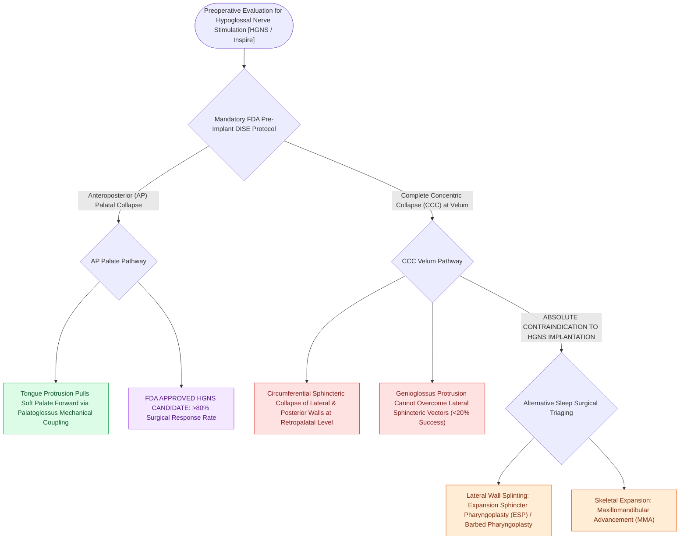

# Concentric velopharyngeal collapse on DISE is a contraindication to hypoglossal nerve stimulation

## Active Recall

> [!question]- Why is Complete Concentric Collapse (CCC) at the velum an absolute contraindication to hypoglossal nerve stimulation?
> *Answer / Clinical Rationale*: Because HGNS advances the tongue anteriorly, which fails to overcome the **sphincteric inward collapse of the lateral and posterior pharyngeal walls**, leading to surgical failure.

> [!question]- What diagnostic procedure is required by the FDA prior to HGNS implantation to evaluate for CCC?
> *Answer / Clinical Rationale*: **Drug-Induced Sleep Endoscopy (DISE)**.

## Core Clinical & Mechanistic Principles
**Complete Concentric Collapse (CCC)** of the velopharynx during [[Drug-induced sleep endoscopy DISE evaluates dynamic multi-level upper airway collapse under sedation|DISE]] is an absolute contraindication to [[Hypoglossal nerve stimulation HGNS activates the medial branch of CN XII to advance the tongue during inspiration|Hypoglossal Nerve Stimulation]] (HGNS / Inspire system):
- **Pathomorphology of CCC**:
  - Occurs at the **retropalatal (velum) level**.
  - Characterized by circumferential, sphincteric inward collapse of the anterior soft palate, posterior pharyngeal wall, and bilateral lateral pharyngeal walls simultaneously.
- **Why HGNS Fails in CCC**:
  - HGNS selectively stimulates the hypoglossal nerve (CN XII) to protrude the **[[Geniohyoid and genioglossus muscles are primary upper airway dilators maintaining pharyngeal patency|genioglossus muscle]]**, advancing the tongue anteriorly.
  - Tongue advancement creates longitudinal tension that pulls the soft palate anteriorly via the **palatoglossus muscle**, effectively opening the airway in **anteroposterior (AP) palatal collapse**.
  - In **concentric (sphincteric) collapse**, lateral pharyngeal wall and posterior mucosal inward forces overwhelm anterior palatal displacement; advancing the tongue fails to recruit lateral walls, resulting in **HGNS treatment failure ($<20\%$ response rate)**.
- **FDA Mandate**: Every adult candidate for HGNS must undergo **pre-implantation DISE** to definitively rule out Complete Concentric Collapse at the velum.

### Surgical Technique & Critical Safety Checks
- **Alternative Options for CCC**: Expansion [[Sphincter pharyngoplasties transpose bilateral palatopharyngeus flaps to narrow the lateral velopharyngeal port in sagittal insufficiency|sphincter pharyngoplasty]] (ESP), [[Barbed suture suspension pharyngoplasty achieves tension-distributed palatopharyngoplasty without mucosal resection|barbed reposition pharyngoplasty]], [[Maxillomandibular advancement MMA advances the skeletal framework by ten to twelve millimeters to expand the upper airway|Maxillomandibular Advancement]] (MMA), or CPAP.

## Connected Concepts & Graph Traversal
- **VOTE Classification**: [[VOTE classification standardizes drug-induced sleep endoscopy findings across velum, oropharynx, tongue base, and epiglottis|VOTE Classification]]
- **HGNS Stimulation**: [[Hypoglossal nerve stimulation HGNS activates the medial branch of CN XII to advance the tongue during inspiration|HGNS Stimulation]]
- **Expansion Pharyngoplasty**: [[Expansion sphincter pharyngoplasty ESP rotates the palatopharyngeus muscle to stabilize lateral pharyngeal wall collapse|Expansion Pharyngoplasty]]
- **Embryological & Sleep Foundation**: [[Second branchial cleft anomalies represent the most common branchial anomaly situated anterior to the sternocleidomastoid]]
- **Adenotonsillar & Endoscopic DISE**: [[Dexmedetomidine and propofol titrations simulate natural sleep architecture during DISE]]
- **Congenital Airway Pathology**: [[Omega-shaped epiglottis, foreshortened aryepiglottic folds, and redundant arytenoid mucosa define laryngomalacia]]
- **Open Airway Reconstruction**: [[Suprahyoid and infrahyoid laryngeal release maneuvers reduce anastomotic tension in tracheal surgery]]
